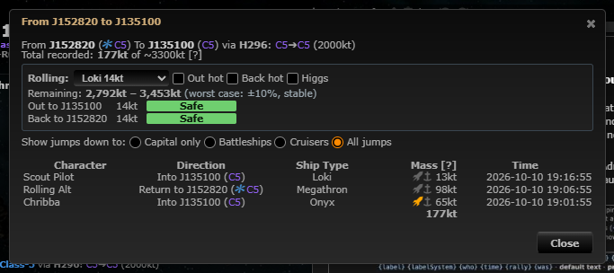
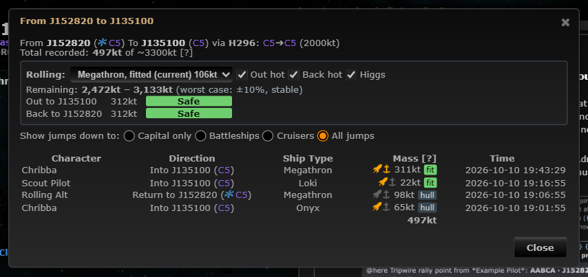
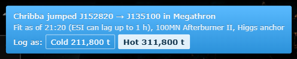
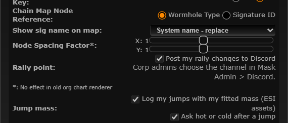

# Fitted jump mass (automatic mass logging)

**Date:** 2026-10-10

## Description

When a tracked character jumps through a mapped hole, Tripwire now logs the mass that jump really took, from the
ship's current fitting (ESI assets: plates, prop module, Higgs anchor), and asks the pilot whether it was hot or cold.
The mass dialog and the rolling calculator use these numbers instead of the hull mass and a flat +50,000 t guess
(a hot 50MN MWD cruiser was counted as +50,000 t; it really adds 5,000 t).

## Before / After

| Before | After |
| --- | --- |
|  |  |

After a jump (hot by default when the chain map's hot-jump toggle is on):

## Settings

Toggle: yes (automatic behaviour, a pop-up and a new ESI data access). Settings > Chain Map Settings > Jump mass:
"Log my jumps with my fitted mass (ESI assets)" (`options.autoMass.enabled`) and "Ask hot or cold after a jump"
(`options.autoMass.prompt`), both on by default (missing key = on), applied on Save, Reset turns them back on.
Off: no asset requests and no reports; upstream still logs the jump with the hull and the chain map toggles
(that logging is a database trigger and was never optional). Masses already logged by others still show.

## Change

- **What upstream already did** (`.docker/mysql/tripwire.sql`): the `jumpHistory` trigger on `tracking` inserts a
  `jumps` row (hole, character, from/to, ship type, `shipType` = "Name|hp" from the chain map's hot/Higgs toggles)
  whenever a tracked character's system changes between two systems joined by a mapped hole; `signatures.php`
  `addAutomapMass` does the same for a hole the automapper just created. `mass.js` then counts hull mass from
  `appData.mass`, +50,000 t (+500,000 t over 500,000 t hull) if hot, x2 with Higgs. This feature extends that row,
  it does not add a parallel log.
- **ESI facts (checked against CCP's ESI OpenAPI spec and public `/universe/types`, `/dogma/*`):** there is no
  "current fit" endpoint. `/characters/{id}/ship/` (scope `esi-location.read_ship_type.v1`, already requested) gives
  `ship_item_id` and `ship_type_id`. `/characters/{id}/fittings/` is saved fittings only. The fitted modules are in
  `/characters/{id}/assets/` (scope `esi-assets.read_assets.v1`, cached 3600 s, paged by `X-Pages`) as items whose
  `location_id` is the ship's item ID and whose `location_flag` is `HiSlot0-7`, `MedSlot0-7`, `LoSlot0-7`,
  `RigSlot0-7` or `SubSystemSlot0-7`. A refit can take up to an hour to show; a docked ship's modules are already
  in the snapshot, so boarding a fitted ship usually works straight away.
- **Mass dogma:** armor plates add `massAddition` (attribute 796, effect `armorReinforcerMassAdd`) always;
  afterburners / MWDs add `massAddition` only while active (hot): 500 t (1MN/5MN), 5,000 t (10MN/50MN),
  50,000 t (100MN/500MN), 500,000 t (capital); Higgs anchor rigs multiply mass by 1 + `massBonusPercentage`/100 = x2
  (post-percent, after the additions). T3 subsystems' own 1,400 t item mass is not added (no mass modifier; the
  hull mass already includes it). Hull and skill bonuses are not modelled.
- **Abyssal (mutated) props and plates** have no `massAddition` on their type (each item's value is rolled by its
  mutaplasmid). They are listed with the heaviest base value of the modules their mutaplasmid applies to (same size
  and kind; plates: Small = up to 200mm, Medium = up to 800mm, Large = 1600mm) and shown as "(base value)", so an
  abyssal prop still makes a hot jump and the log errs towards more mass used rather than less. A roll above the
  base is not seen.
- `app/js/fork/fit-mass-data.js`: static list of the ~190 modules that change mass, generated once from public ESI
  by `tools/fork/build-fit-mass-data.mjs` (not in the image); no type lookups at runtime.
- `app/js/fork/auto-mass.js` (`autoMass`): pure maths (assets -> fit, fit -> cold/hot mass, logged row -> jump mass,
  throttling, token scopes) and the browser part. Assets are fetched with each tracking character's own token,
  like location/ship in `esi.js`: first load, then only after a ship change or 10 minutes, never before ESI's
  `Expires`, at most 50 pages, back off 5 min on errors and 1 h on 403. The token's `scp` claim is checked first, so
  characters without the new scope make no asset requests and log "hull only". On a jump between two systems that
  aren't plain gate neighbours, the client reports the fit to `public/jump_fit.php` (retries for ~3 min until
  upstream's row exists), then shows a notice with the source ("Fit as of 21:20 (ESI can lag up to 1 h)" or why it
  is hull only) and Cold / Hot buttons, preset to the chain map's hot-jump toggle.
- Server: `jump_fit.inc.php` + `public/jump_fit.php` (new table `fork_jump_fits`, created on first use, keyed by
  mask, hole, character and the upstream row's time; rows older than 3 days are pruned). Reports only for the
  user's own ESI characters; hot/cold can be corrected by any mask member (like signatures). POST only, with
  `X-Requested-With`; all values validated as numbers; names are looked up client-side, never stored.
- Mass dialog: each row shows a `fit` / `hull` badge (tooltip: fit time, cold/hot, prop module, Higgs) and the prop
  icon toggles hot/cold for that jump. Totals and the rolling calculator use the fitted mass; the rolling ship list
  offers your current fit ("Megathron, fitted") and other pilots' logged fits with their real prop module and Higgs
  (your own logged fits are left out while your current fit is known).
- **Deploy step, off by default:** EVE SSO refuses scopes the operator's CCP developer application doesn't have
  (`invalid_scope`: adding tracking characters would fail), so the scope is only requested with
  `ENABLE_ASSETS_SCOPE=true` (new, default `false`; `docker/config.php`, `.env.example`, both compose files,
  `docker/README.md` > Fitted jump mass). To turn it on: enable `esi-assets.read_assets.v1` on the application at
  developers.eveonline.com, set `ENABLE_ASSETS_SCOPE=true` and restart, then users re-add their tracking
  characters. Until then every jump is logged with the hull mass and the pilot's hot/cold answer.
- **Upstream files touched:** `public/login.php` (one line: `esi-assets.read_assets.v1` added to the tracking
  character scopes when `ENABLE_ASSETS_SCOPE` is on), `public/mass.php` (one line: the jump log query is replaced by `jump_fit_jumps()`, same columns
  plus `characterID` and the fit, falling back to upstream's result on any error). Fork file
  `app/js/fork/rolling-calculator.js` extended (fitted prop mass, fit choices). Bundles rebuilt.
- **Security / data access (AGENTS.md section 6):** new ESI scope `esi-assets.read_assets.v1` lets the tracking
  character's browser read that character's whole asset list; only the derived masses and the prop module's type ID
  leave the browser (to this Tripwire server, visible to the mask in the mass dialog). Existing
  tracking characters must be removed and added again (Tracking > Add) to grant it; until then they log hull only.
  No new third-party hosts (ESI only).
- Tests: `app/js-test/fork/auto-mass.test.js` (realistic two-page asset fixtures in
  `app/js-test/testdata/auto-mass/`), new cases in `rolling-calculator.test.js`, and
  `php tests/jump_fit_test.php` (validation, plus the report/hot/log flow against the dev database).
