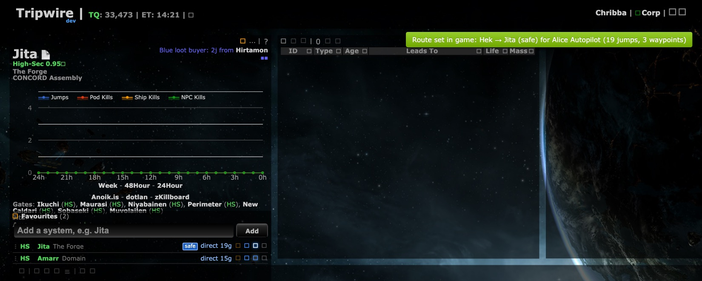
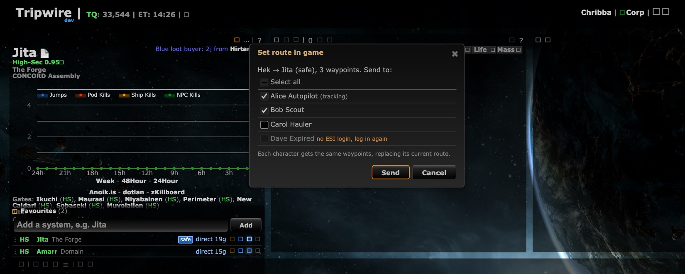

# Set route in game: choose the characters

**Date:** 2026-10-10

## Description

The "Set route in game" button (Favourites panel, Destinations window) now opens a small window listing every tracked
character, so a route can be sent to several characters at once (e.g. a fleet of alts) instead of only the active
tracked character. Follows up [Set route in game](../2026-10-10-autopilot-route/README.md) in the same PR (#25).

## Before / After

| Before | After |
| --- | --- |
|  |  |

Before: clicking the button on Jita (safe route from Hek) sent it straight to the active tracked character. After: the
"Set route in game" window, with the tracked character ticked, a second one added, one not ticked and one without an
ESI login greyed out. Taken on the dev stack with ESI stubbed in the browser (four fake characters, `setDestination`
replaced; no real EVE SSO login or ESI call). The icon font shows as boxes in the headless browser used for the
screenshots; that is not part of the change.

## Settings

No toggle: the window only appears when you click the button (nothing automatic or drawn), and the old one-click
flow is still one click plus Enter (Send has the focus, the tracked character is ticked the first time). A toggle
would only save that one key press. The last selection is remembered per user in `options.autopilotRoute.characters`
(not a setting, nothing in the Settings dialog); Settings > Reset keeps it, like other non-preference keys (see
`whats-new.js`'s reset wrapper).

## Change

- `app/js/fork/autopilot-route.js`:
  - Pure, tested: `characters(opts, characters)` lists every `tripwire.esi.characters` entry sorted by name with
    `{characterID, name, usable (has an accessToken), reason ("no ESI login, log in again"), active, preselected}`;
    preselected = the usable ones of the last selection, else the active tracked character (`options.tracking.active`).
    `noCharacterError` gives the old clear error instead of an empty window when no one has ESI. `selectAllState`
    drives the "Select all" box (all / some (indeterminate) / none). `sendToCharacters` sends the same waypoints to
    each selected character, one character after another and one ESI call at a time (each character: first call
    clears, the rest append, via `sendAll`); a failure stops only that character and records how many waypoints were
    set. `summary` builds the result toast: green (all set, with the existing cap note), yellow (some failed: who got
    it, then "Failed for X: <reason>. Only the first n waypoints were set."), red (all failed; with one character it
    is the old error text). `character()` and `progressText()` are replaced by these; `sendAll` now also reports a
    call that throws as a failed call.
  - UI: a jQuery UI dialog (`#dialog-autopilotCharacters`, same pattern and classes as the Destinations window,
    modal), Send / Cancel buttons; Send is disabled while nothing is ticked; Cancel, Escape and the close button send
    nothing. One progress toast for the whole run ("Hek → Jita (safe). Bob: waypoint 3 of 12 (2 of 3 characters)...").
    The existing `busy` guard covers the whole multi-character run. All names are escaped.
- `app/css/fork/autopilot-route.css`: styles for the window.
- `app/js-test/fork/autopilot-route.test.js`: tests for the picker list, preselection, disabled characters, no
  characters, all succeed, one fails while the others continue, partial-failure index, clear-then-append order per
  character, progress and summary texts (634 mocha tests pass).
- `public/whats-new/features.json`: PR 25's entry describes the window (same PR, so the entry is updated rather
  than a second one added; `pr` must be unique), new image `public/whats-new/img/pr-25-autopilot-characters.png`.
- Rebuilt bundles. Upstream files touched: none. No new hosts: still only ESI's autopilot waypoint endpoint.

## Limitations

- Not tried against live ESI (no SSO login in the dev stack); the ESI call itself is unchanged from #25.
- Characters are sent one after another, so a long route for many characters takes a while (each waypoint is one
  ESI call per character).
