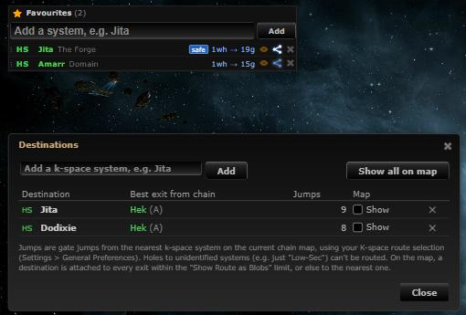
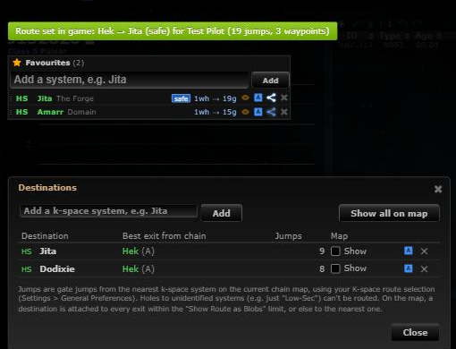

# Set route in game

**Date:** 2026-10-10

## Description

A "Set route in game" button in the Favourites panel (next to each favourite's route button) and in the Destinations
window sends the gate part of the route Tripwire worked out to the in-game autopilot as ESI waypoints, so EVE flies
exactly that route (e.g. the safe, high-sec only one) instead of picking its own.

## Before / After

| Before | After |
| --- | --- |
|  |  |

After: the blue autopilot button on Jita and Amarr in the Favourites panel and on each destination; clicking Jita's
(safe route, 19 gate jumps from Hek) set it with 3 waypoints. ESI was stubbed in the browser for the screenshot.

## Settings

No toggle: it is a button that does nothing until clicked, and it only appears where a route is already shown (a
favourite with Route on, a destination with a gate route). Nothing is drawn or sent automatically.

## Change

- `app/js/fork/autopilot-route.js` (new): pure logic in `autopilotRoute` plus the UI.
  - Leg: Favourites panel plans through the chain start at the exit system (wormholes can't be waypointed; you
    fly the holes yourself), direct plans at your location. The gate path is a breadth-first search with the
    panel's own rules (`favouritesPanel.passable`: safe = only high-sec in between, Zarzakh and the avoid list are
    never passed), so its length matches the panel's `…g` count. Destinations use the path the window already
    computed (`routeDestinations.evaluate(...).best.path`, from `guidance`). `kspaceLeg` extracts the k-space tail
    of a mixed route.
  - Waypoints: greedy reduction. From each waypoint the route skips ahead while the path so far is the only
    shortest gate route there (counted over the whole gate map) and stays in one security band (high-sec / not),
    so neither EVE's "shortest" nor its "safer" preference has a reason to leave it. Always ends with the
    destination; capped at 25 (in practice 1-4, e.g. a 19-jump safe route needs 3).
  - Sending: `tripwire.esi.setDestination` one call after another (not in parallel), the first with
    `clear_other_waypoints=true`, the rest appended (`add_to_beginning=false`). Character: the active tracked
    character (`options.tracking.active`), like upstream's chain map "Set destination".
  - Feedback via the existing `Notify` toasts: progress, success (jumps and waypoint count), and errors: no tracked
    character / no ESI login, 401/403 (expired login or missing `esi-ui.write_waypoint.v1`: log in again), rate
    limit, network; a failure part-way says how many waypoints were set.
  - UI hooks without touching other files: a `MutationObserver` on the Favourites panel list adds the button to its
    rows; `routeDestinations.renderRows` is wrapped to add a column.
- `app/css/fork/autopilot-route.css` (new), `app/js-test/fork/autopilot-route.test.js` (new, 52 tests), rebuilt
  bundles.
- Upstream files touched: none (besides the rebuilt bundles). Calls only ESI (`esi.evetech.net`), which upstream
  already uses for "Set destination".

## Limitations

- EVE's "less secure" autopilot preference could still leave a high-sec stretch of the route; "shortest" and
  "safer" (the usual ones) follow it. An in-game avoid list that blocks a system on the route also changes it.
- The route is set from where you leave the chain; while you are still in J-space EVE shows it only once you are out.
