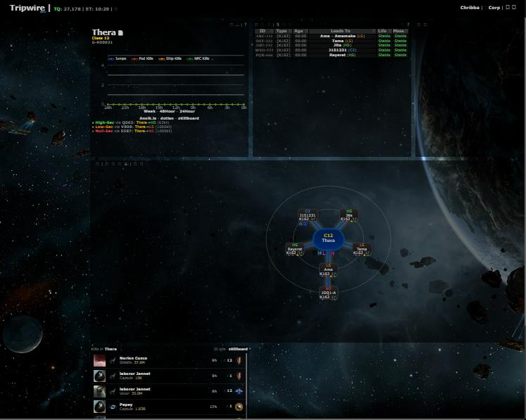
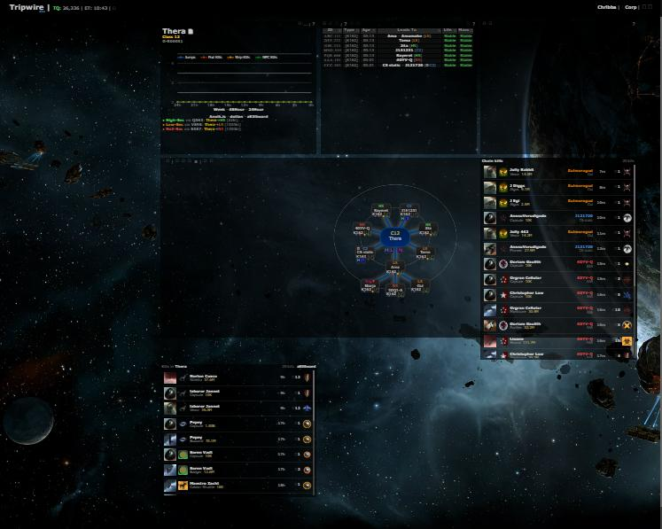
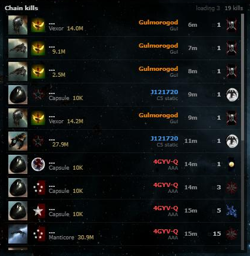
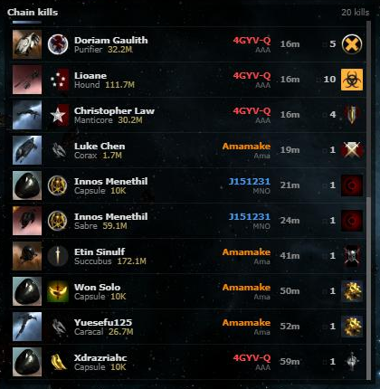
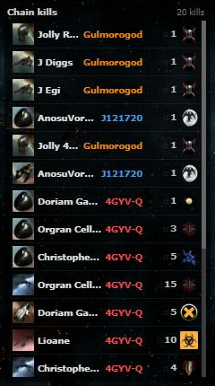
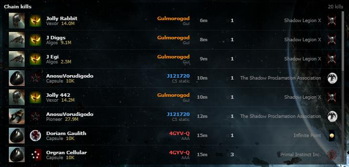

# Chain Kill Feed

**Date:** 2026-10-10

## Description

A new "Chain kills" panel shows one feed of the recent kills in every wormhole, low-sec and null-sec system on the
chain map, newest first, with the system (in its class/security colour, click to view it) and the hole's name or
signature next to each kill. When a system joins the chain, its last hour is loaded; after that the feed stays live.
It reads the pooled zKillboard data (`public/system_kills.php`) and adds no zKillboard or ESI callers.

## Before / After

| Before | After |
| --- | --- |
|  |  |

The panel, while three systems that just joined the chain are back-filled ("loading 3", names still resolving), and
once loaded:

| Loading | Loaded |
| --- | --- |
|  |  |

| Narrow | Wide |
| --- | --- |
|  |  |

## Settings

Toggle: Settings > General Preferences > "Chain kill feed" (on by default), stored in `options.chainKillFeed.enabled`
(missing = on). Off removes the panel and stops all its requests and timers; applied on Save, Settings > Reset turns it
back on.

## Change

- **Panel** `app/js/fork/chain-killfeed.js` + `app/css/fork/chain-killfeed.css`: a gridster widget added from fork JS
  like the System Kill Feed (Customize layout, saved in `options.grid`, placed right of the top row or under
  everything in older layouts). It re-reads the chain map's systems after every `chain.draw` (new hole, chain tab or
  mask switch, system change), skipping high-sec (same 0.45 threshold as `systemAnalysis`), calculated route nodes and
  unknown destinations; Thera, shattered, drifter and Pochven systems are included. NPC kills are shown (greyed), as
  in the System Kill Feed.
- **Requests**: when systems join, one window request for them (`pastSeconds=3600&source=chain`, back-fill queued;
  a system that left less than 30 minutes ago only re-reads, no back-fill); then one shared `since` cursor for all
  systems (`queue=0`), every 20 s, every 4 s while back-fills or names are pending (at most 45 times in a row),
  paused while the tab is hidden, chunks of 200 systems, at most 5 full pages per chunk and poll. Kills are always
  merged by kill time, never by arrival (back-fills and late zKillboard uploads arrive with old kill times). Systems
  that leave drop their kills; if that leaves fewer than 20, the others' last hour is read again.
- **Memory bounds**: at most 50 kills (newest by kill time, older than 6 h dropped), names only for those kills,
  highlights only for those kills, at most 1000 remembered systems (systems that left over 30 minutes ago are
  forgotten). Tooltips are detached before rows are replaced (jBox keeps every attached element otherwise).
- **Rows** reuse the System Kill Feed's renderer: `systemKillFeed.rowHtml(row, now, extra)` takes an optional extra
  class and cell (the system), and `systemKillFeed.defaultPosition()` an optional panel size; both default to the old
  behaviour. A kill that arrives live (less than 15 minutes old, not from a back-fill) is highlighted for 8 s. Header:
  number of kills, "loading N" while back-fills run (tooltip: which systems), "feed behind by …" note. Narrow panels
  drop the value, ship line, hole label, corp logo and time; the system name stays.
- **Server** (small addition to the pooled module): `zk_backfill_request()` now reports a back-fill that is already
  queued or running as `pending` also for read-only requests (`queue=0`), so the live poll can show which systems are
  still loading (new pure helper `zk_backfill_in_progress()`, tested in `zkill/tests/zkill_test.php`). The System Kill
  Feed's read-only first request now says "loading" instead of "no kills" in that case. Docs in `docker/README.md`.
- **Tests**: `app/js-test/fork/chain-killfeed.test.js` (classification, chain extraction, merge order/dedupe/bounds,
  names, cursor, back-fill bookkeeping, highlights, renderer).
- **Third parties**: none new. The browser loads ship icons and corporation logos from `images.evetech.net` and links
  to `zkillboard.com`, like the System Kill Feed. No new server callers.
- **Upstream files touched**: none. Rebuilt bundles: `public/js/app.min.js`, `public/css/app.min.css`.
