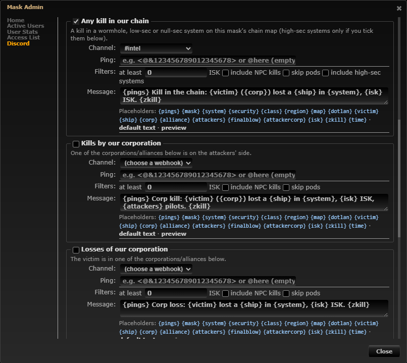
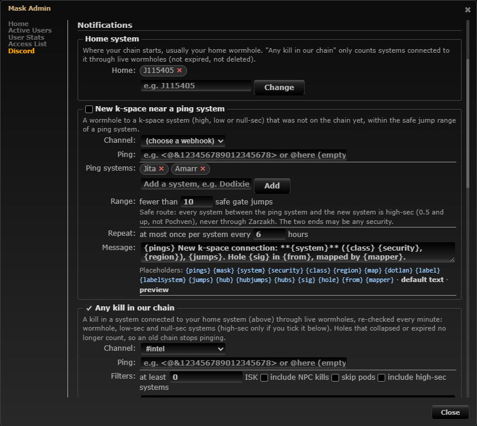
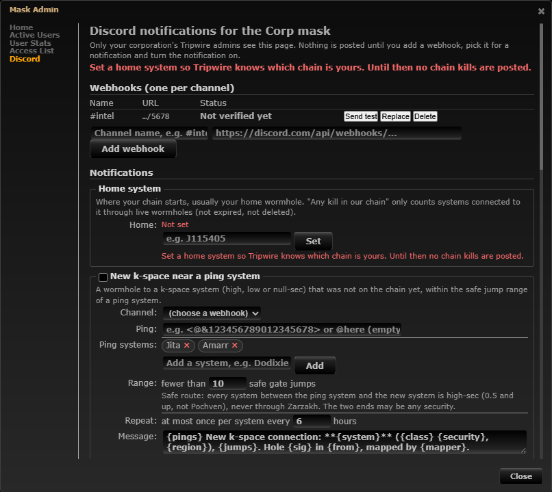

# Discord chain kills: only the chain connected to home

**Date:** 2026-10-10

## Description

The Discord "Any kill in our chain" notification now only posts kills in systems connected to the mask's home system
through live wormholes, re-checked every minute. Each mask gets a **Home system** setting in Mask Admin > Discord.
Fragments of an old chain no longer ping.

## Why

- **Bug report:** "We are noticing that the old chain is still pinging for kills."
- **Root cause:** chain kills (from [Discord notifications](../2026-10-10-discord-notifications/README.md)) treated
  every system with *any* wormhole signature in the mask as "the chain". It never checked whether that system was still
  connected to home. When a hole collapses, rolls or the corporation moves home, the systems behind it stay in the mask
  until someone deletes their signatures. Pilots delete the hole they rolled or saw collapse, but rarely the
  fragment behind it, and upstream's `wormholeClean` event only deletes a wormhole signature at its `lifeLeft` + 10 %
  of its life (a 24 h hole lingers about 26.4 h). Kills in those fragments kept posting as chain kills.
- The in-Tripwire kill sounds and pop-ups were not affected: they already use the systems drawn on the chain map
  (connected from the chain tab's root).

## Before / After

| Before | After |
| --- | --- |
|  |  |

Chain kills on and no home system yet: the page warns at the top and next to the setting, and no chain kills are posted:

## Settings

No new toggle: this is a bug fix plus a setting the feature needs. Chain kills already have their own on/off per mask
(Mask Admin > Discord), and there is no reason to want the old behaviour (pings from a chain you are no longer in).
The home system is required for chain kills rather than optional, so the result is predictable.

## Change

- **Home system** (per mask, `homeSystemID` in the mask's Discord settings, 0 = not set): picked by name in Mask Admin >
  Discord (system search like the ping systems), any known system (wormhole or k-space), validated server-side
  against the static system data (`discord_settings_normalise`, unknown/junk values are refused with an error).
- **Chain = connected to home now:** new fork file `discord/chain.php`. `discord_chain_systems()` loads the live
  wormhole links of all masks with chain kills in one query (`wormholes` joined to both `signatures`, mask-scoped) and
  walks them breadth-first from home, through k-space exits too (like the chain map). The result includes home and the
  k-space exits. `discord_kill_state()` uses it instead of "any system with a wormhole signature"; it is reloaded with
  the other kill settings every `DISCORD_KILL_REFRESH` (60 s).
- **Liveness rule** (a hole counts while all of these hold): its `wormholes` row and both of its signatures exist, all
  in the same mask, both of type wormhole; neither signature is past its `lifeLeft` (compared with PHP's clock, which
  is what `signatures.php` writes `lifeLeft` with; `lifeLength` 0 = no expiry known, always live); both ends are real
  systems (`systemID >= 30000000`; unknown far sides carry a placeholder ID and are never walked through, so two
  unknown ends can't join chains). EOL (critical) and mass-critical holes still count until their `lifeLeft` passes.
  A hole that has expired but isn't deleted yet stops counting at `lifeLeft`, up to 10 % of its life before
  `wormholeClean` deletes it. Limit: a hole that collapsed early (rolled) and is still on the map counts until it is
  deleted or its `lifeLeft` passes; deleting it from the map (as pilots do) cuts off what's behind it within a minute.
- **No home set:** chain kills post nothing (no fallback to "every system") and the page shows "Set a home system so
  Tripwire knows which chain is yours." at the top and next to the setting. Saving is still allowed. Masks that had
  chain kills on before this change show the warning until an admin sets a home. Corp kills and losses are unaffected.
- Mask Admin help text for chain kills: "A kill in a system connected to your home system (above) through live
  wormholes, re-checked every minute ...".
- Tests: `discord/tests/discord_test.php` (+33 checks: connected chain only, disconnected fragment excluded, expired
  hole breaks the chain and what's behind it, deleted signature, unknown far sides, EOL / no-life holes, home without
  holes, no home, mask scoping, the 60 s cache, home setting validation, `discord_kill_state` + classification with and
  without home) and `app/js-test/fork/discord-notifications.test.js` (home picker, warning, settings, page).
- Verified in the dev stack against `discord-mock` with `docker/dev/discord-fake-kill.php`: no home: nothing; home
  J115405 with J115405 → J160650 → J151733 and an old fragment J142520 – J131802: kills in J160650 and J151733 posted,
  kills in the fragment not; after the J115405 – J160650 hole expired: kills in J160650/J151733 not posted, in J115405
  posted.
- Docs: `docker/README.md#discord-notifications` (chain kill rule, Home system).
- **Follow-up:** the Watchlist's Discord matcher (`feature/watchlist`, PR #41, `discord/watchlist.php`) still matches
  the mask's whole chain the old way; it can switch to `discord_chain_systems()` / `discord_chain_systems_cached()`
  with the same home setting.

Files: `discord/chain.php` (new), `discord/kills.php`, `discord/settings.php`, `discord/discord.inc.php`,
`discord/tests/discord_test.php`, `app/js/fork/discord-notifications.js`, `app/css/fork/discord-notifications.css`,
`app/js-test/fork/discord-notifications.test.js`, bundles. Upstream files touched: none.
