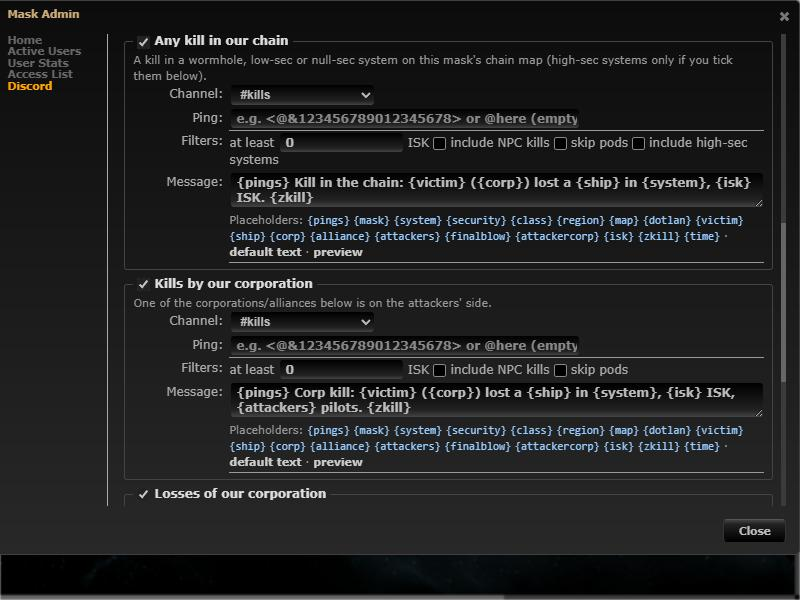
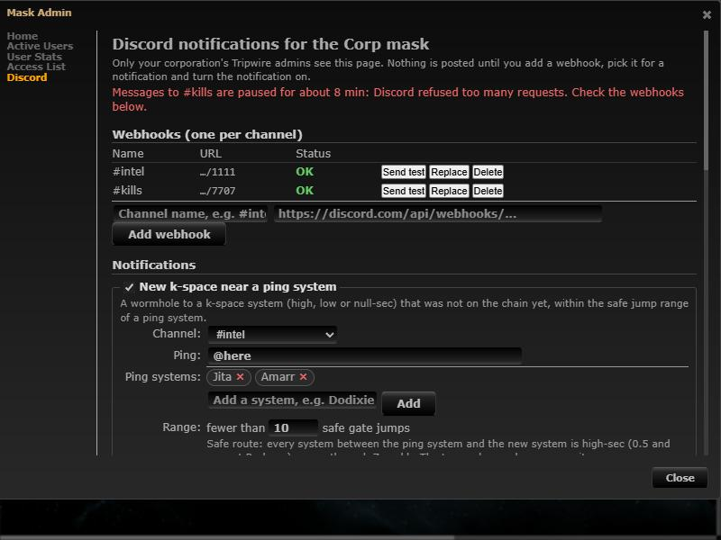

# Discord notifications

**Date:** 2026-10-10

## Description

Corporation admins (Tripwire's admin flag) can have Tripwire post to their Discord for the corp mask and the
corporation's custom masks, through channel webhooks: new
k-space connections within a safe (high-sec only) gate range of trade hubs, kills in the chain (wormhole, low-sec and
null-sec systems; high-sec optional), kills by and losses of their corporation.
Each type has its own channel, mentions and message template; delivery goes through a durable outbox and one sender
that handles Discord's rate limits, retries and broken webhooks.

## Before / After

| Before | After |
| --- | --- |
|  |  |

Kill notifications with their filters, and a message preview (as Discord shows it, and who it pings):

| Kill types | Preview |
| --- | --- |
|  |  |

When Discord keeps refusing one webhook (or the mask's messages), its circuit breaker pauses it and the page says so:

## Settings

No per-user toggle: the feature is opt-in per mask. Nothing is posted until an admin of the mask adds a webhook,
picks it for a notification type and turns that type on (Mask Admin > Discord); each type can be turned off there, and
nothing from before a type was turned on is announced. Users who aren't Tripwire admins of the corporation see nothing,
nor do the Public, Private, alliance and personal custom masks. "Admin" is upstream's `characters.admin` flag (set when
registering as admin with the ESI Director role or a "Tripwire Admin" title, reset on a corporation change; losing
Director within the same corporation isn't detected).

## Change

- New page **Mask Admin > Discord** (`app/js/fork/discord-notifications.js`, `app/css/fork/discord-notifications.css`),
  only on the corp mask and corporation-owned custom masks for the corporation's Tripwire admins; `public/discord.php`
  checks that (`checkAdmin`, not mask ownership) on every request (403 otherwise), needs a per-session CSRF token header on every change, never returns webhook URLs (name, `…/1234` and
  status instead) and validates them as Discord webhook URLs.
- `discord/` (fork-owned module): settings per mask, webhook URLs encrypted at rest with `DISCORD_SECRET_KEY`
  (new env var; plain text without it, still never shown), templates with escaped game data and `allowed_mentions`
  built only from what the admin wrote, a generated static gate graph (`discord/gate_graph.php` from
  `public/js/combine.js`, `discord/tools/generate-gate-graph.js`) for server-side safe-route BFS, outbox + dedupe
  tables, and the dispatcher (per-webhook and global 429s, `X-RateLimit-*`, 5xx/network backoff, broken webhooks on
  401/403/404, new/replaced URLs unverified until a successful send, circuit breakers on refused requests per
  10 minutes: 50 pause a webhook, 150 a mask, 400 a corporation (shown on the mask's page), 2000 everything; queued
  messages of masks that no longer qualify fail instead of being sent; expiry and pruning). Per mask: 5 test messages per minute, 10 webhook URLs per
  hour, no duplicate webhooks.
- `discord_notify.worker.php` (new supervisord program `discord-notify`): polls the chain maps for new k-space
  connections and is the only process that calls Discord; with several containers, MySQL named locks pick one poller
  and one sender.
- `zkill_feed.worker.php`: hands each live streamed killmail to `discord_on_killmail()` (3 lines; queues only, never
  blocks the stream; no new zKillboard/ESI callers, names from the existing cache).
- Dev stack: fake Discord service `discord-mock` (`docker/dev/discord-mock.php`, simulates 404/401/429/500) with
  `DISCORD_API_BASE` (accepted for local hosts only), `docker/dev/discord-fake-kill.php` to feed a made-up kill.
- Tests: `discord/tests/discord_test.php` (163 checks: webhook validation, crypto, escaping, mentions, safe-route BFS
  with low-sec ends, Zarzakh and Pochven, hub range, kill classification and filters, settings validation, Discord
  responses with a fake transport) and `app/js-test/fork/discord-notifications.test.js`.
- Docs: `docker/README.md#discord-notifications`, `docker/sql/discord.sql`, `.env.example`, `docker/config.php`,
  `docker-compose.prod.yml` (`DISCORD_SECRET_KEY`).
- New outbound host: `discord.com` (webhook POSTs from the worker). Embeds link/reference `images.evetech.net`,
  `zkillboard.com` and `evemaps.dotlan.net` (fetched by Discord, not by Tripwire).

Upstream files touched: none (`zkill_feed.worker.php`, `docker/*` and the compose files are fork-owned). Upstream's
manual "ping" button (`DISCORD_WEB_HOOK`) is unchanged.
