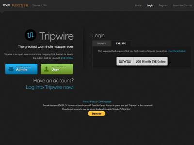

# Docker image and dev stack

**Date:** 2026-10-10

## Description

Tripwire can now run as one Docker image (`petdog/tripwire`: nginx + php-fpm + cron) configured
entirely by environment variables, published to Docker Hub by GitHub Actions, with a local dev stack.

## Before / After

| Before | After |
| --- | --- |
| No published image; upstream's compose needed editing `config.php` / `db.inc.php` by hand and host cron jobs |  Landing page served by the dev stack at `http://127.0.0.1:8080` |

## Change

- `docker/`: Dockerfile (front-end bundles built with gulp in the image), env-driven `config.php` /
  `db.inc.php`, nginx (real client IP behind a proxy via `TRUSTED_PROXIES`), php-fpm bound to
  localhost, cron jobs as `www-data`, entrypoint that imports the schema into an empty database.
- `docker-compose.dev.yml` (bind-mounted source, MySQL, Adminer, asset watcher) and
  `docker-compose.prod.yml`; settings template in `.env.example`.
- `.github/workflows/docker-publish.yml`: builds on PRs, pushes `latest`, the Tripwire version and
  `sha-*` tags on `main`.
- Reviewed (Fable) and fixed (Opus); see `docker/README.md` for details.
- No upstream files touched.
