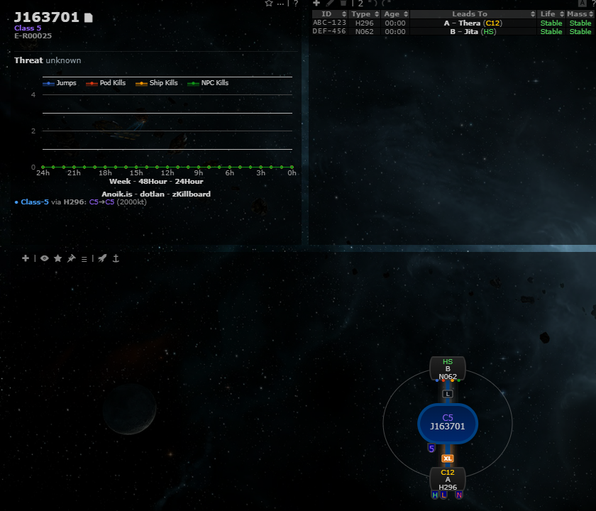
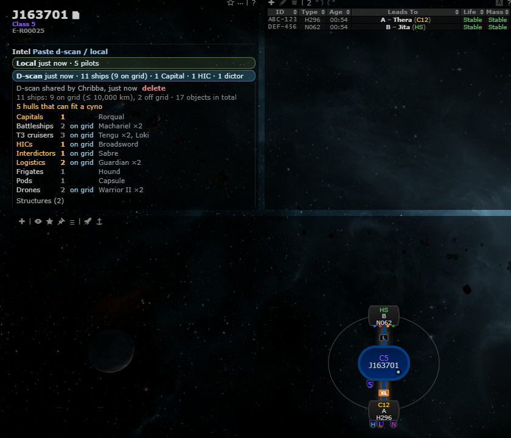
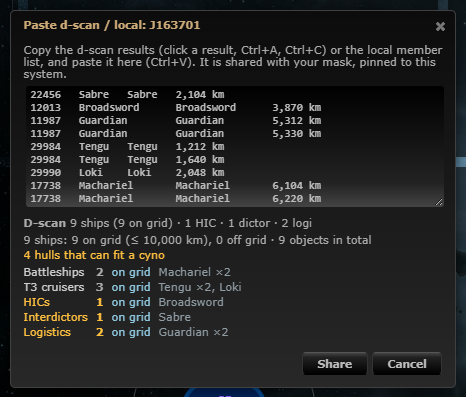
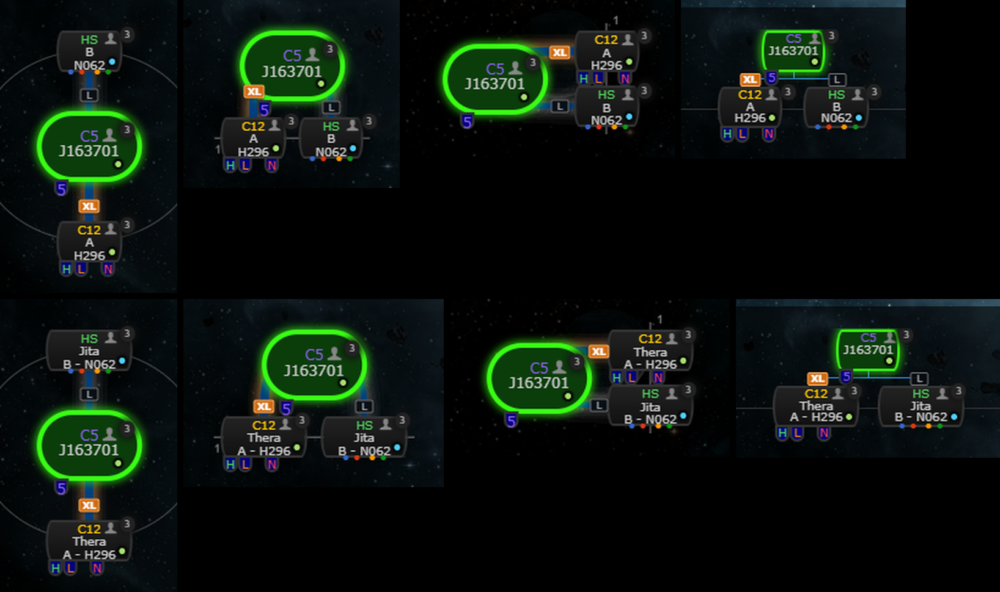

# D-scan & local scans pinned to a system

**Date:** 2026-10-10

## Description

Pilots paste a directional scan or a local member list into Tripwire and share a summary with their mask, pinned to
the system, instead of linking third-party sites such as dscan.info. The system info panel lists the system's scans
as chips ("D-scan 2 min ago · 11 ships (9 on grid) · 1 Capital · 1 HIC") that expand to the full summary, and chain
map nodes with a fresh scan get a small dot in their bottom-right corner (cyan d-scan, green local, half and half for
both; the tooltip says which and how old).

## Before / After

| Before | After |
| --- | --- |
|  |  |

The paste dialog with its live preview (also opened from the chain map's right-click "Paste d-scan / local"):

The marker in the four chain map renderers (radial, org chart top, org chart side, Google org chart), with
upstream's pilots-in-system marker shown on every node, the rally point set on J163701 and scans in all three
systems; top row sig names "System name - replace", bottom row "Reference - prefix" (2× zoom):

## Settings

Toggle: Settings > General Preferences > "D-scan & local intel" (`options.intelScans.enabled`, on by default, missing
key = on, applied on Save, back on after Settings > Reset). The same row sets how long a scan counts as fresh
(`freshMinutes`, default 15: chips and map markers; older scans stay under "older (n)") and the on-grid range
(`gridKm`, default 10,000 km). Off removes the panel block, the markers and the right-click entry and stops the
requests.

## Change

- **Paste**: an explicit text box only (dialog opened from the "Paste d-scan / local" link in the system info panel
  or the chain map context menu); no page-wide paste hook. Kind is detected from the text (tabs = d-scan, else
  local), with a live preview of the summary before sharing.
- **D-scan parsing** (`intel/intel.inc.php` on the server, mirrored in `app/js/fork/intel-scans.js` for the preview):
  current clients copy `typeID \t name \t type \t distance` (checked against open-source d-scan tools: Nimos/dscantool
  reads the type ID from the first column; evepraisal's older parser reads `name \t type \t distance`); both are
  accepted. Distances in m / km / AU with `,` `.` spaces, non-breaking spaces or `'` as separators, a few client
  languages' units (км, а.е., AE, UA …) and `-` (no distance); distances beyond d-scan range (> 15 AU) count as no
  distance. With type IDs the summary is language-independent; without them, types are matched by English name,
  anything else is listed under "Unknown" with the pasted name. Server and preview use the same explicit whitespace
  class (ASCII whitespace + Unicode spaces) and drop control and format characters (bidi controls, zero-width
  spaces), so the preview never accepts what the server rejects.
- **Summary** (browser): ships by class (titans, supercarriers, capitals, battleships, battlecruisers, T3 cruisers,
  HICs, interdictors, logistics, cruisers, T3 destroyers, destroyers, frigates, industrials, shuttles), lit cynos,
  pods, fighters, drones, containers, structures (incl. POS force fields) and deployables listed by name and
  distance; ships (without pods) on and off grid (≤ configurable km) next to the total number of objects; notable
  items (lit cynos first, capitals, HICs, dictors, logistics, warp disruption bubbles, cyno inhibitors) and the number
  of hulls that can fit a normal, covert or industrial cyno (from the three cyno generators' `canFitShipGroup*` /
  `canFitShipType*` dogma attributes: force recons, black ops, HICs, covert ops, bombers, strategic cruisers,
  blockade runners, haulers, deep space transports, Etana, Rabisu, Prospect, Venture; the fit itself is unknown).
  Structures are shown in the summary only; nothing is stored about structures or system ownership.
- **Local**: one character name per line; count and list (unique, valid EVE names only). Corporation / alliance
  affiliation is not in v1 (see below).
- **Static type data**: `public/intel/types.json` (≈71 kB, loaded once when a d-scan is shown), built by
  `intel/tools/generate-types.js` from ESI's public, unauthenticated `/universe/categories`, `/universe/groups`,
  `/universe/names`, `/universe/types` and `/dogma/attributes` (a one-off build step, not a runtime call; no new
  third-party hosts at runtime).
- **Chain map marker**: a 7 px dot with a dark outline inside the node's bottom-right corner (corners: top-left
  threat badge, top-right upstream's pilots marker, bottom-left watchlist); inside the border ring on the rounded
  root nodes of the radial / org chart top / org chart side renderers. A marked node pads its last line by 12 px on
  both sides so long texts ("A - H296" with Settings > Show sig name on map > Reference - prefix) stay clear of the
  dot; the node may get a little wider, so adding or removing a marker redraws the chain instead of patching it.
  Outside the node a marker ran into the statics row, the connections' size tags and neighbouring nodes. Checked in
  all four renderers and all five sig-name settings (image above: "System name - replace" and "Reference - prefix",
  rally point on the root).
- **Storage / endpoint**: new `public/intel_scans.php` (GET latest + system scans, POST `add` / `delete`; same
  session/mask checks and `X-Requested-With` CSRF rule as `rally.php`) and table `fork_intel_scans` (mask, system,
  kind, normalised rows as JSON, creator, created/expires), created on first use. The server validates everything
  (200 kB / 2000 lines, UTF-8, field lengths, control characters dropped, system ID range), stores the normalised
  rows, never the pasted text, allows 20 scans per user per minute, deletes rows after 24 h and keeps the newest 30
  per mask and system. Users can delete their own scans. Scans never change, so the browser sends the IDs whose rows
  it already has (`have=`) and the server leaves those rows out: a 30 s poll of a system with 15 scans of 2000 lines
  is about 1.5 kB instead of 1.5 MB (the rows of each scan are sent once per viewer).
- **Security**: everything pasted (ship, structure and character names) is escaped when rendered; tests use hostile
  names such as ``.
- **Tests**: mocha `app/js-test/fork/intel-scans.test.js` (parsers, summaries, chips, escaping, markers);
  PHP `intel/tests/intel_test.php` (parsing / validation) and `intel/tests/intel_endpoint_test.php` (endpoint
  validation, mask isolation, deletion rights, rate limit, pruning; against the dev database).
- **Follow-up (not in v1)**: local affiliation (corporation / alliance per pilot) needs ESI `POST /universe/ids` and
  `POST /characters/affiliation`. It should be a queued job of the pooled `zkill/` worker (like `zkill/names.php`),
  with the endpoint only reading cached results, and tests with a fake transport.
- Upstream files touched: none. Fork files: `docker/Dockerfile` (leave `intel/tests`, `intel/tools` out of the
  image), `docker/README.md`.
