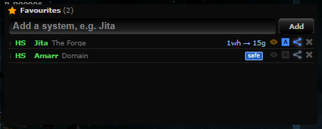
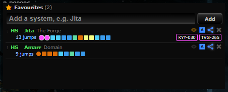
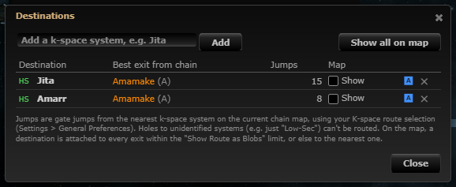
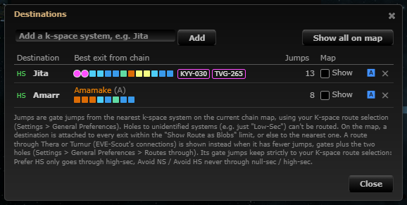
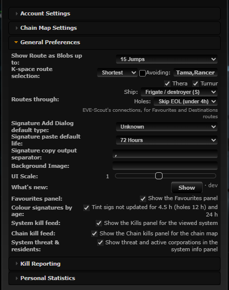

# Routes through Thera and Turnur

**Date:** 2026-10-10

## Description

The Favourites panel's routes and the Destinations window can now go through Thera and Turnur, using the public
connections EVE-Scout publishes (the same list upstream's chain map overlay already loads). When such a route has fewer
jumps it is shown instead, as jump markers (built on the Favourites route strip, #40) with Thera / Turnur hops as coloured
circles and the signature IDs to warp to as small chips; filters for hub, ship size and hole life are in Settings.

## Before / After

| Before | After |
| --- | --- |
|  |  |
|  |  |

Same chain (home J132401 with a hole to Amamake) and favourites, taken on the dev stack with EVE-Scout's live list of
2026-10-10. Before: Jita `1wh → 15g`. After: Jita goes through Turnur (J132401 itself had a Turnur hole, KYY-030): two
pink circles (into and out of Turnur), then 11 gate squares coloured by security, 13 jumps, chips `KYY-030` `TVG-265`;
Amarr is a normal route (`1wh → 8g`: one circle into low-sec Amamake, then gates). The Destinations window shows the same
markers (Jita through Turnur, 13 jumps; Amarr gates from Amamake). The What's New image also has a safe route through both
Turnur and Thera (yellow circles). Settings row: 

## Jump markers (after user feedback on the PR)

The first version showed routes as text ("1wh → 5g → Thera → 7g") plus a yellow line of systems and signatures. The user
asked for Wanderer-style markers instead, so this builds on the Favourites route strip (#40, `favouritesRouteStrip`):

- One marker per jump, EVE-Scout hops included (`theraRoute.stripSteps`, from the plan's own edges, so the markers are
  exactly the route that was counted). Gates are squares in CCP's security colour, the chain's wormholes circles in the
  colour of the system entered (class colour in J-space, security in k-space), as #40 does.
- Thera / Turnur hops (into or out of the hub, EVE-Scout hole or a mapped wormhole) are circles in the hub's colour with
  a thin white ring: Thera `#ffc800` (its C12 colour in `app/css/base.css`), Turnur `#FF4DFF` (no security step or class
  uses it). This replaces #40's triangle for hub hops, as the user asked for circles.
- Hovering a Thera / Turnur marker: "Jump 3 of 13: Thera hole (EVE-Scout) → Thera · warp to EWM-864 in Meirakulf · Q063,
  max medium, 16h left" (hole type, signature, max ship size, life left; all escaped). The strip's tooltip keeps the text
  route and the full walk-through, as #40 does.
- Warp line: dropped. Its information is in the markers' tooltips, and the signatures you must warp to are small chips at
  the end of the strip (yellow border for Thera, pink for Turnur; tooltip "In Meirakulf warp to EWM-864 into Thera
  (...)", click copies the ID). Chips stay readable at a glance, which is what you need in space, while the systems are
  one hover away: the least clutter that still lets you warp without opening anything.
- Destinations window: each route is a marker strip too (gate routes under the exit system, Thera / Turnur routes with
  chips), the jump count stays in the Jumps column; rows are built as HTML, so the strip is fitted to 230 px and long
  routes compress to "…+N".
- With #40's "Show routes as jump markers" off, both places show the text route and the yellow line as before.
- The two "Set route in game" leg buttons are unchanged.

## Settings

The toggle is the filter row itself: Settings > General Preferences > "Routes through": Thera on/off, Turnur on/off (both
on by default, so users see the feature), Ship (Frigate / destroyer (S, the default: every hole) to Capital (XL)), Holes
(Use all / skip under 1h / 2h / Skip EOL (under 4h), the default). Stored per user in
`options.theraRoute = {thera, turnur, shipSize, minHours}`; a missing key means the defaults; Save applies and redraws;
Settings > Reset removes the key (back to the defaults).

- Both off: routes are exactly as before, including on a chain tab that draws EVE-Scout's connections (they count as
  chain wormholes in Favourites and as exits in Destinations again, with no filters).
- Either on (the default): EVE-Scout connections drawn on a chain tab are routed only through this feature, with the
  filters. So with the defaults an EOL Thera/Turnur hole (under 4h left) that is visible on the map is no longer used for
  routes, as it was before; choose "Use all" under Holes to use it.

## Change

- `app/js/fork/thera-route.js` (new): pure logic in `theraRoute`, plus data loading and the Settings row.
  - EVE-Scout fields used (checked against the live response of `cached_third_party.php?key=eve-scout-signatures`):
    `id`, `out_system_id` (the hub: Thera 31000005 or Turnur 30002086), `out_signature` (the signature in the hub),
    `in_system_id` / `in_signature` (the other end and its signature), `wh_type`, `max_ship_size` (`small`, `medium`,
    `large`, `xlarge`, `capital` mapped to the size tags' S / M / L / VL / XL), `expires_at` (life left; falls back to
    `remaining_hours`, whole hours as cached). Holes with unknown life are skipped while a life filter is on; unknown
    sizes only pass for S; expired holes are always skipped.
  - Search: one shortest-path search (every jump counts 1, ties go to fewer wormhole jumps) over k-space gates
    (`appData.map.shortest`), the chain's wormholes and the EVE-Scout holes that pass the filters. Same gate rules as the
    Favourites panel: a system you gate into or out of must be passable (never Zarzakh or the avoid list; safe = high-sec)
    unless it is the start or the destination; wormhole legs are always allowed, so Thera and a low-sec Turnur can be
    passed through, but a safe route never gates out of Turnur or into a low-sec Thera system. It asks for the best route
    that uses at least one EVE-Scout hole (and never straight back through the hole it came out of); the panels compare
    it with their own route and show it only when it has fewer jumps.
  - Favourites: from the tracked character, through the chain (e.g. `1wh → 5g → Thera → 7g`), from k-space, from Thera /
    Turnur itself, or through a mapped hole into Thera. One search per mode per redraw covers every favourite (cached
    while the chain, location, filters, avoid list and usable holes are unchanged; about 7 ms on the full gate map).
  - Destinations: from any system on the chain (chain wormholes aren't counted there, as before); jumps = gates + the two
    holes, compared with the gate jumps from the best exit. The gate legs keep strictly to the K-space route selection
    (`theraRoute.destinationRule`): Prefer HS = only high-sec, Avoid NS = never null-sec (security <= 0.0), Avoid HS =
    never high-sec (>= 0.45), Shortest = any; upstream's guidance only weighs these, so the Thera route is never against
    the preference (the window's note says so). The map nodes for destinations still use the gate route.
  - Data: uses `eveScout.links` when the chain tab shows EVE-Scout (no extra request). Otherwise it reads the same
    local, server-cached `cached_third_party.php?key=eve-scout-signatures` (the server fetches EVE-Scout at most every
    5 minutes for all users), only while a favourite has Route on or destinations exist and a hub is on, at most every
    5 minutes. No new third-party host, no extra EVE-Scout polling.
- `app/js/fork/favourites-panel.js`: `decorate` takes the Thera search as an optional argument and uses its plan when
  shorter; `plan` kind `scout` in `planText` / `planDetail` / `highlight` (chain wormholes used, and EVE-Scout lines when
  the tab draws them); a second line under the row ("J132401 KYY-030 → Turnur TVG-265 → Adreland"); the tooltip has each
  hole's type, max size and life left. While a hub is on, EVE-Scout links drawn on the chain are not used as plain chain
  wormholes (`context(..., dropScout)`), so the filters apply to them too.
- `app/js/fork/route-destinations.js`: while a hub is on (`scoutEnabled`), `chainExits(rows, lines)` skips systems drawn
  through an EVE-Scout link (same reason); new `chainSystems`, `evaluate(...).scout`, the window shows the route, its line
  and total jumps, note text.
- `app/js/fork/autopilot-route.js`: "Set route in game" for a Thera/Turnur route sends only gate legs. **Choice:** one
  button per gate leg, numbered 1, 2 when there are two; each tooltip says when to send it ("Send it once you are out of
  Thera in Suner: the autopilot can't route through wormholes"). Sending both legs at once would make EVE plan a gate
  route from the Thera entry system to the second leg (it doesn't know about wormholes), and we couldn't confirm how the
  in-game route updates after the jump, so the second leg is sent as a separate step.
- `app/css/fork/thera-route.css` (new), `app/js-test/fork/thera-route.test.js` (new, 62 tests: Thera beats gates; skipped
  when too small, EOL, disabled or only reachable straight back; Thera in the chain; safe variant; Avoid NS / Avoid HS /
  Prefer HS rules; Turnur; texts; legs; Favourites integration with hubs on and off), new tests in `route-destinations.test.js`; rebuilt bundles.
- `app/js/fork/favourites-route-strip.js` (#40's file): `steps()` takes `scout` plans, `markers()` knows EVE-Scout steps
  and hub colours (`HUB_COLOURS`), new `pathSteps`, `sigChipsHtml`, `stripHtml` (Destinations); chips in the panel's
  strip and click-to-copy. `app/css/fork/favourites-route-strip.css`: marker rules no longer scoped to the panel (the
  Destinations window uses them), hub marker is a ringed circle. `route-destinations.js`: `stripHtml`, markers in the
  window. `favourites-panel.js`: no yellow line while the markers are on. Tests: Thera plan → steps → markers (kinds,
  colours, tooltips, chips), Turnur colour, Destinations rows as markers and as text with markers off.
- Upstream files touched: none (besides the rebuilt bundles).

## Limitations

- EVE-Scout's list is up to about 5 minutes old (server cache) and a hole can close early; the life shown is from
  `expires_at`.
- Hole sizes are only checked for EVE-Scout holes, not for the chain's own wormholes (as before).
- Signature IDs follow EVE-Scout's API spec (https://api.eve-scout.com/ui/openapi.yaml, `schemas/signature_representation.yaml`):
  `out_system_id` is always Thera or Turnur, `out_signature` is the signature in the hub, `in_signature` the one in the
  other system (`wh_exits_outward` true means `wh_type` is on the hub side). Upstream's chain map overlay
  (`app/js/map-data-suppliers/eve-scout.js`, `findLinks`) swaps the two signature IDs; not changed here (upstream file).
