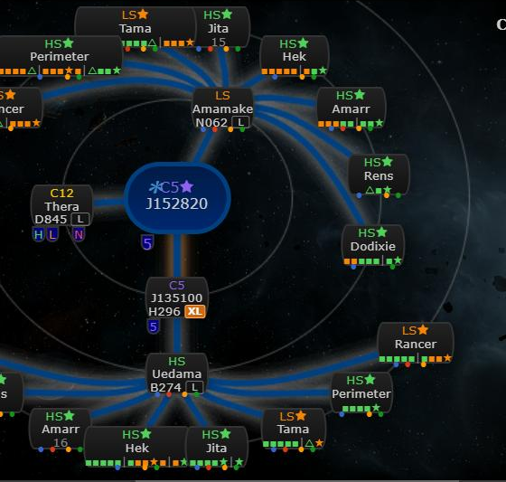
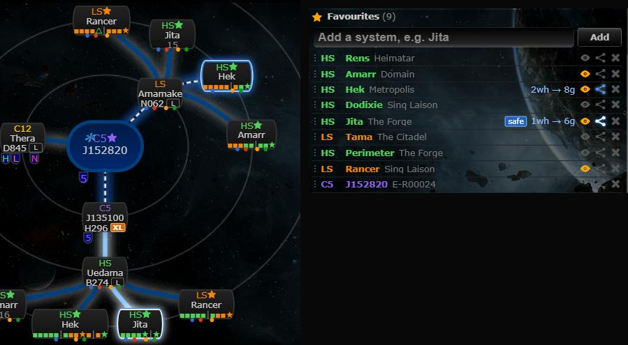

# Favourites panel

**Date:** 2026-10-10

## Description

A new movable, resizable Favourites panel lists your favourite systems and lets you add (system search), remove and
drag-reorder them. Per system, "Show on map" picks which favourites get gate-route nodes on the chain map (so ten
favourites no longer clutter it) and "Route" highlights the quickest (shortest) or high-sec-only (safe) way there
from your location, through the chain or straight through k-space gates.

## Before / After

| Before | After |
| --- | --- |
|  |  |

Before: with "Add favorite systems to chain" on, every k-space exit gets a node for every favourite. After: only
Amarr, Hek, Jita and Rancer are shown on the map. Hek has the shortest route (white dashes on a blue glow, through
low-sec Amamake: `2wh → 8g`), Jita the safe route (solid light blue with a white glow, via high-sec Uedama:
`1wh → 6g`). `whats-new.png` is a taller crop of the same for the What's New entry.

## Settings

Toggle: Settings > General Preferences > "Favourites panel: Show the Favourites panel" (on by default). Off removes the
panel from the layout and turns off its map filter and route highlights (the chain map then behaves as before).
Stored in `options.favoritesPanel.enabled`; a missing key means on; Settings > Reset removes the key.

## Change

- `app/js/fork/favourites-panel.js` (new): pure logic in `favouritesPanel` (flags, list edits, layout placement,
  gate distances and route planning; reuses `rally.routeTo` / `rally.systemConnections` and
  `routeDestinations.chainExits`), plus the widget, added with gridster's `add_widget` so it takes part in Customize
  layout like the other widgets.
- `options.favorites` stays the list of favourites (order = panel order). Per-system flags live in
  `options.favoritesPanel.systems[<id>] = {map, route}`: `map` true/false (missing = on), `route` false, `"shortest"`
  or `"safe"` (missing = off; an older `true` means `"shortest"`); removed with the favourite. The panel's last
  position is kept in `options.favoritesPanel.position` while it is switched off.
- "Show on map" works by wrapping `chain.nodes`: during the build `options.favorites` is swapped for the shown
  favourites (with `indexOf` still covering all of them, so the stars on nodes stay). While the toolbar star
  ("Add favorite systems to chain") is off the eyes are dimmed; clicking one shows only that favourite and switches the
  star on. J-space favourites have a disabled eye (upstream never draws them).
- Route (the route button cycles off → shortest → safe):
  - Starts at the tracked character's system. On the chain: through wormholes. In k-space anywhere: also gates
    straight to the favourite, or gates to a k-space system on the chain and in from there. In J-space off the chain:
    no route.
  - Leaves the chain at the favourite itself (if it is on the chain) or at the k-space system with the quickest gate
    route to it. Fewest jumps in total wins; ties go to fewer wormhole jumps.
  - Safe: every gate leg only through high-sec (security ≥ 0.45, as the app classifies HS; the system you are in may
    be anything). Wormhole legs are allowed. Shortest: any security. Zarzakh is never passed through.
  - Gate jumps come from a breadth-first search over `appData.map.shortest` (cached per system and mode), not
    `guidance`, so the user's K-space route preference doesn't change the shortest/safe meaning.
  - On the map: wormhole connections, the system you enter the chain at (ringed), the calculated node to the
    favourite and its connection (or the exit, ringed). Shortest: white dashes on a blue glow; safe: solid light
    blue with a white glow. A direct gate route highlights nothing.
  - The row shows the breakdown, e.g. `4g → 2wh → 6g` or `direct 9g`, with a "safe" tag in safe mode; the tooltip
    names the systems and, when they differ, shows the other mode too. No route: dimmed icon and the reason.
- Layout: saved layouts from before the panel existed get it placed right of the other widgets if the window is wide
  enough, else below them. Its position is saved with the rest by Customize layout.
- The info panel's star and the panel stay in sync both ways (un-favouriting also clears the system's flags, saved in
  the same request).
- `app/css/fork/favourites-panel.css` (new), `app/js-test/fork/favourites-panel.test.js` (new), rebuilt
  `public/js/app.min.js` and `public/css/app.min.css`.
- Upstream files touched: none (besides the rebuilt bundles).

## Limitations

- Upstream's calculated nodes show gate jumps from `guidance` (with the K-space route preference); the panel counts
  its own (shortest or safe), so the two can differ by a few jumps.
- The info panel's list of routes to favourites refreshes on the next system change, not on edits in the panel.
- The panel and rally each redraw the map when the tracked character moves (two cheap checks, not shared).
