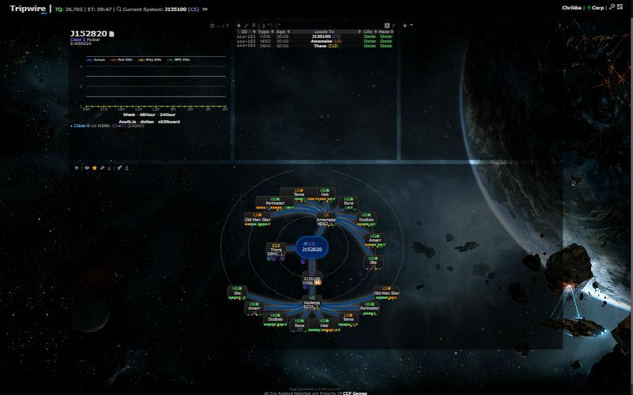
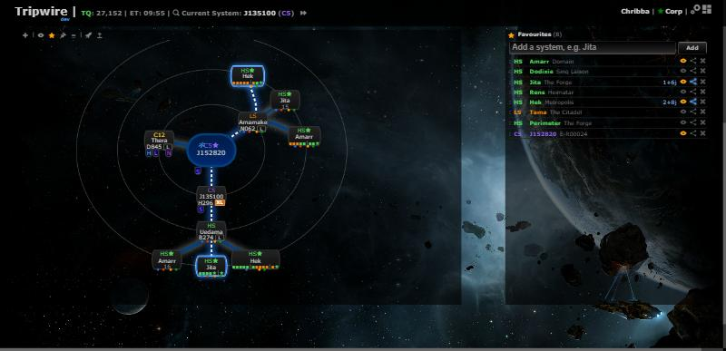

# Favourites panel

**Date:** 2026-10-10

## Description

A new movable, resizable Favourites panel lists your favourite systems and lets you add (system search), remove and
drag-reorder them. Per system, "Show on map" picks which favourites get gate-route nodes on the chain map (so ten
favourites no longer clutter it) and "Route" highlights the quickest way there from your location through the chain.

## Before / After

| Before | After |
| --- | --- |
|  |  |

Before: with "Add favorite systems to chain" on, every k-space exit gets a node for every favourite. After: only
Jita, Amarr and Hek are shown on the map, and Route is on for Jita and Hek (white dashes on a blue glow, end node ringed).

## Settings

Toggle: Settings > General Preferences > "Favourites panel: Show the Favourites panel" (on by default). Off removes the
panel from the layout and turns off its map filter and route highlights (the chain map then behaves as before).
Stored in `options.favoritesPanel.enabled`; a missing key means on; Settings > Reset removes the key.

## Change

- `app/js/fork/favourites-panel.js` (new): pure logic in `favouritesPanel` (flags, list edits, layout placement,
  route finding that reuses `rally.routeTo` / `rally.systemConnections` and `routeDestinations.chainExits` / `jumps`),
  plus the widget, added with gridster's `add_widget` so it takes part in Customize layout like the other widgets.
- `options.favorites` stays the list of favourites (order = panel order). Per-system flags live in
  `options.favoritesPanel.systems[<id>] = {map, route}` (missing = map on, route off; removed with the favourite).
  The panel's last position is kept in `options.favoritesPanel.position` while it is switched off.
- "Show on map" works by wrapping `chain.nodes`: during the build `options.favorites` is swapped for the shown
  favourites (with `indexOf` still covering all of them, so the stars on nodes stay).
- Route: from the tracked character's system (if it is on the chain) through wormholes to the exit with the fewest
  wormhole + gate jumps, then the calculated node if one is drawn (otherwise the exit node is ringed). The row shows
  e.g. `1+6j` (holes + gates); a dimmed route icon with a tooltip means no route (not on the chain / no exit).
- Layout: saved layouts from before the panel existed get it placed right of the other widgets if the window is wide
  enough, else below them. Its position is saved with the rest by Customize layout.
- The info panel's star and the panel stay in sync both ways.
- `app/css/fork/favourites-panel.css` (new), `app/js-test/fork/favourites-panel.test.js` (new), rebuilt
  `public/js/app.min.js` and `public/css/app.min.css`.
- Upstream files touched: none (besides the rebuilt bundles).
