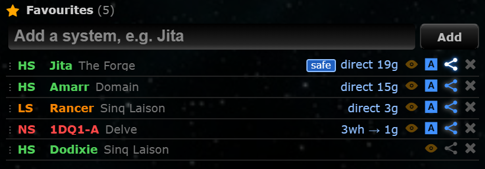
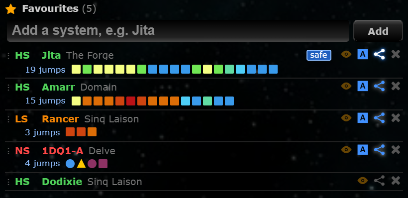

# Favourites panel: route as jump markers

**Date:** 2026-10-10

## Description

Each favourite with Route on now shows its route as a strip of small markers, one per jump in route order (like
Wanderer's "User Routes"), with the jump count in front. You can see at a glance what the route goes through:
square = stargate, circle = wormhole, triangle = EVE-Scout connection or a wormhole into Thera / Turnur, and the
colour is the security (k-space) or class (J-space) of the system the jump enters.

## Before / After

| Before | After |
| --- | --- |
|  |  |

Tracked in Hek, chain Hek → J160650 (C3) → Thera → T5ZI-S. Jita (safe: 19 high-sec gates), Amarr (shortest:
through Metropolis/Heimatar low-sec), Rancer (3 low-sec gates), 1DQ1-A (wormhole to the C3, triangle into Thera,
wormhole to null-sec T5ZI-S, one null-sec gate). `narrow.png`: the same panel made narrower, long routes keep their
start and end and show "…+N" in the middle. `settings.png`: the toggle.

## Settings

Toggle: Settings > General Preferences > Favourites panel > "Show routes as jump markers" (on by default). Off shows
the `1g → 2wh → 6g` text as before. Stored in `options.favouritesRouteStrip.enabled` (missing = on), applied on
Save, Settings > Reset removes the key.

## Change

- `app/js/fork/favourites-route-strip.js` (new): pure logic in `favouritesRouteStrip`:
  - `steps`: the Favourites panel's plan as jumps in order: gate legs from `autopilotRoute.gatePath` (the same
    breadth-first search and safe / avoid-list rules as the panel's counts; a length mismatch falls back to the text),
    wormhole legs by walking the plan's chain connections from the entry system.
  - `markers`: kind (gate / wormhole / hub), colour, and tooltip, e.g. `Jump 2 of 4: Wormhole N110 → J160650 C3 ·
    C-R00009` or `Jump 4 of 4: Gate → 1DQ1-A -0.4 · Delve`. The hole type is the one on the side you jump from (K162
    from the other side). All names escaped.
  - Colours: k-space uses EVE's in-game security scale (1.0 `#2C75E1`, 0.9 `#399AEB`, 0.8 `#4ECEF8`, 0.7 `#60DBA3`,
    0.6 `#71E754`, 0.5 `#F5FF83`, 0.4 `#DC6D07`, 0.3 `#CE440F`, 0.2 `#BB1116`, 0.1 `#731F1F`, 0.0 and below
    `#8D3264`), with the game's rounding (0.45 shows 0.5; above 0.0 but below 0.05 shows 0.1). J-space, Thera and
    Pochven use Tripwire's existing colours (`app/css/base.css`); Zarzakh gets its own grey.
  - `fit` / `compress`: as many markers as fit the panel width; otherwise the start and the end with "…+N" in the
    middle (its tooltip lists the hidden jumps). Re-laid out when the panel is resized (ResizeObserver).
- UI: wraps `favouritesPanel.decorate` to keep a snapshot of the chain connections, and a MutationObserver on the
  panel's list (same pattern as Set route in game) adds a second line to each row with a route. The breakdown text
  moves into the strip's tooltip (with the panel's route detail); the "safe" tag stays. No route / "here" keep the
  existing display. The route button's shortest / safe cycle redraws and updates the strip.
- `app/css/fork/favourites-route-strip.css` (new), `app/js-test/fork/favourites-route-strip.test.js` (new, 60 tests),
  rebuilt bundles.
- Upstream files touched: none (besides the rebuilt bundles). No new hosts.

## Limitations

- The colour scale is the one the current EVE client uses as far as we know; it could not be checked against an
  official source (CCP doesn't publish it). Dotlan's older scale differs (more green / red).
- Hover tooltips are the browser's own (`title`), so they appear after a short delay.
