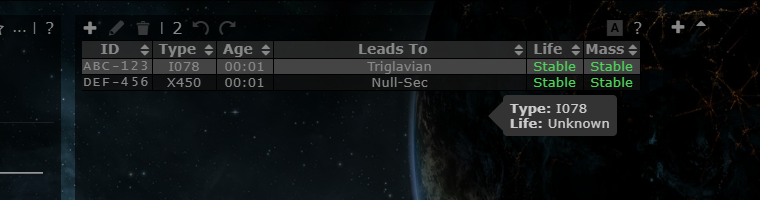
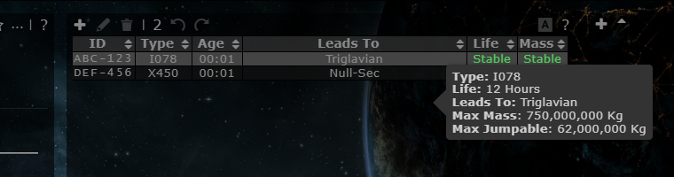

# Game data refresh: Marauder/Black Ops mass, Pochven wormholes

**Date:** 2026-10-10

## Description

Ship hull masses and wormhole types are checked against CCP's live data (public ESI `GET /universe/types/{id}/`) and the
[Patch Notes - Version 24.01](https://www.eveonline.com/news/view/patch-notes-version-24-01) (releases 2026-09-22.1 and
2026-10-06.1 "Crimson Harvest"). Marauder and Black Ops masses were cut by 20-25 %, Pochven wormhole types had the wrong
lifetime, and five wormhole types Tripwire did not know at all now show life and mass.

## Before / After

Signature tooltip for an intra-Pochven wormhole (I078) in Kuharah:

| Before | After |
| --- | --- |
|  |  |

## Settings

No toggle, because this is a data correction: the values are what the game uses, and there is nothing to prefer.

## Change

Edited the sources `tools/mass.json` and `tools/wormholes.json` (upstream files) and the generated `public/js/combine.js`
(upstream, `appData.mass` / `appData.wormholes` only). Upstream's generator (`tools/json_builder.php`) needs the SDE in
MySQL, so a new fork tool `tools/fork/splice-combine.js` rewrites just those two sections of `combine.js` from the JSON
files in the generator's format (`node tools/fork/splice-combine.js`, `--check` to verify). Test fixture values in
`app/js-test/fork/rolling-calculator.test.js` follow the new Paladin mass.

ESI dogma attributes used for wormholes: 1381 `wormholeTargetSystemClass`, 1382 `wormholeMaxStableTime` (minutes),
1383 `wormholeMaxStableMass`, 1385 `wormholeMaxJumpMass`.

**Ship masses** (`appData.mass`, ESI `mass`, matching patch 2026-09-22.1). All other 558 hulls match ESI.

| Ship (type ID) | Old kg | New kg |
| --- | --- | --- |
| Paladin (28659) | 160,000,000 | 128,000,000 |
| Kronos (28661) | 148,000,000 | 118,400,000 |
| Vargur (28665) | 150,000,000 | 120,000,000 |
| Golem (28710) | 157,000,000 | 125,600,000 |
| Babaroga (88001) | 143,000,000 | 114,400,000 |
| Redeemer (22428) | 150,300,000 | 112,700,000 |
| Sin (22430) | 141,700,000 | 106,300,000 |
| Widow (22436) | 151,100,000 | 113,300,000 |
| Panther (22440) | 148,800,000 | 111,600,000 |
| Marshal (44996) | 150,000,000 | 112,500,000 |
| Python (85236) | 141,700,000 | 106,300,000 |
| Akoman (95741), new Attack Battlecruiser | missing | 14,760,000 |

**Wormhole types** (`appData.wormholes`, ESI). Every other type matches ESI.

| Type | Field | Old | New |
| --- | --- | --- | --- |
| F216, U372, R081, X450 (to/from Pochven) | life | 16 Hours | 12 Hours |
| F216 | jump | 300,000,000 | 375,000,000 |
| A239 | jump | 300,000,000 | 375,000,000 |
| O883 | jump | 20,000,000 | 62,000,000 |
| Q003, G008, C008, M001, Z006, L005, E004 (frigate holes) | life | 5 Hours | 4.5 Hours |
| A009 (to C13) | life | 16 Hours | 4.5 Hours |
| I078, L687, O546 (new: Pochven to Pochven) | all | missing | 12 Hours, 750,000,000 / 62,000,000 |
| O753, R327 (new: low/null-sec to Pochven) | all | missing | 12 Hours, 1,000,000,000 / 375,000,000 |

Mass, jump mass, lifetime and "leads to Pochven" for the five new types come from ESI. Where they start from is
inferred, because ESI does not say: I078/L687/O546 are the only Pochven-bound types at 750,000,000 kg / 12 h, the values
the 2026-09-22.1 notes give for intra-Pochven wormholes. O753/R327 are the newest Pochven-bound types; the 2026-10-06.1
notes put the new Extra-Pochven wormholes in Blood Raider space in Delve (null-sec) and the Eugidi, Angils and Essin
constellations (Metropolis low-sec).

"4.5 Hours" pre-fills the signature dialog's duration with 4 h (upstream reads the first two characters), not 5 h.

Not stored by Tripwire, so nothing to change: Extra-Pochven holes now change phase every 30 min (was 60).

The mass dialog works out the mass of every logged jump from today's hull mass, so jumps a Marauder or Black Ops
battleship made before 2026-09-22 now count at the lighter mass.
