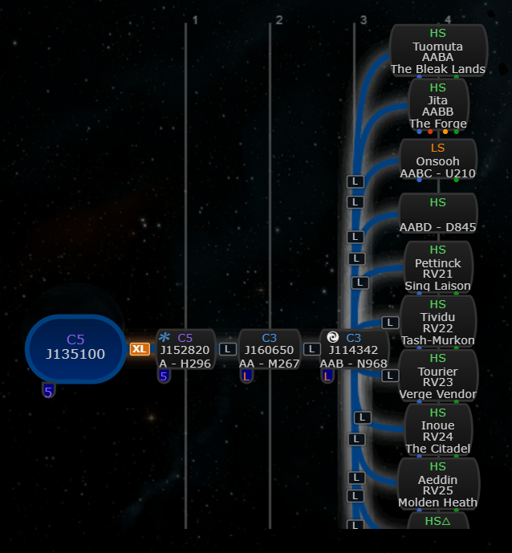

# High-sec region instead of hole type

**Date:** 2026-10-10

## Description

On the chain map, a hole into a known high-sec system now shows the system's region (e.g. "The Forge") where
the node showed the hole type (e.g. "D845"): for an exit you need to know where in New Eden it lands, the type
is already known. The hole type stays in the tooltip.

## Before / After

Default "Show sig name on map: System name - replace" (radial; 11 sibling exits to test crowding):

| Before | After |
| --- | --- |
|  |  |

"Show sig name on map: Reference - prefix" (radial, new org chart top and side):

| Before | After |
| --- | --- |
|  |  |
| |  |
| |  |

## Settings

Toggle: Settings > Chain Map Settings > High-sec region, "Show region instead of hole type on high-sec exits"
(on by default, `options.highsecRegion.enabled`, missing = on). Applied on Save without a reload (upstream's
Save redraws the chain), Settings > Reset removes the key (back on). A toggle because some pilots read the hole
type off the node (e.g. to check mass or lifetime) and prefer it there.

## Change

- New `app/js/fork/highsec-region.js` wraps `chain.nodes` once per chain (like size tags): for each connection
  whose child is a known system that Tripwire classifies as high-sec (`systemAnalysis`: no WH class, not
  Triglavian, security >= 0.45, which EVE displays as 0.5), the hole type in the node's type line is replaced by
  the region name from `appData.regions`. Tooltip: e.g. "The Forge (high-sec region) - hole type D845"; screen
  readers get ", hole type D845" as visually hidden text.
- Per "Show sig name on map" mode:
  - System name - replace / prefix, or a hole without a name: the type line shows the region
    (`HS / AABA / The Forge`).
  - Reference - prefix: the hole name keeps the type line and the region goes on a line of its own below it
    (`HS / Jita / AABA / The Forge`); the node grows by one tightly set line (still within the side org chart's
    45 px rows). On one line ("AABA - The Bleak Lands") the nodes were too wide and overlapped in the radial and
    side layouts.
  - Reference - replace, and "Chain Map Node Reference: Signature ID": unchanged, they don't show the type.
- The region takes its natural width, capped at 8.5em (every high-sec region fits; ellipsis beyond it). The
  renderers lay nodes out from their measured size, which they measure outside `#chainMap`
  (`#temp-div-node-width`), so the styles apply there too. Checked with 11 sibling exits in radial, both new
  org charts and the old org chart, in both modes: no node overlaps that weren't there with the feature off,
  and no region cut off.
- Not changed: low-sec, null-sec, Pochven and W-space nodes; unidentified destinations ("High-Sec" without a
  system); gate routes.
- Pure logic (high-sec check, label, markup rewrite, install once) tested in
  `app/js-test/fork/highsec-region.test.js`, styles in `app/css/fork/highsec-region.css`. No upstream files
  touched.
