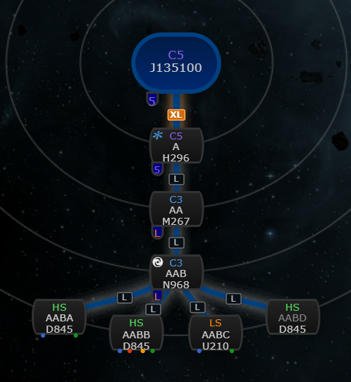
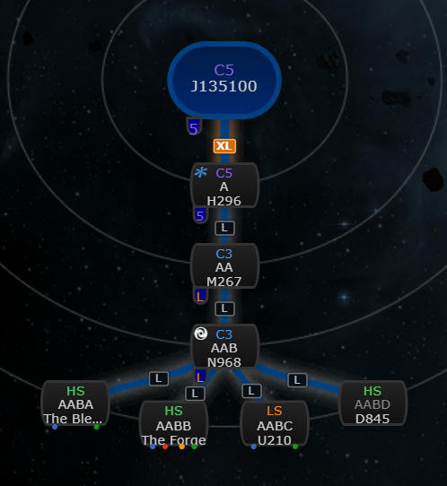
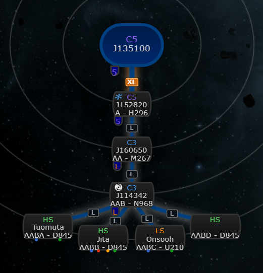
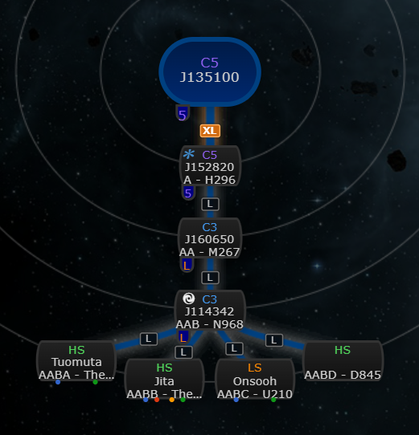
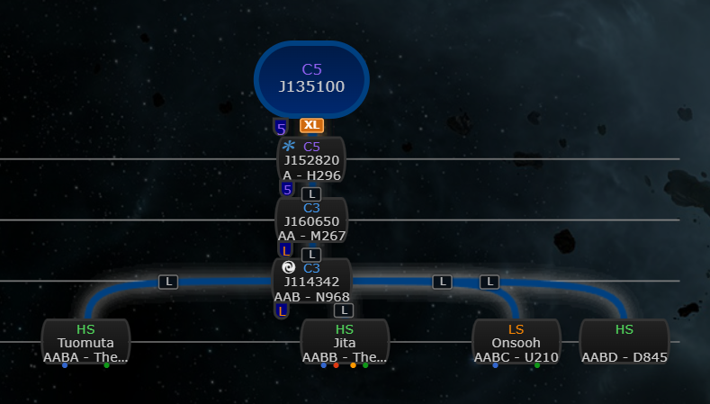
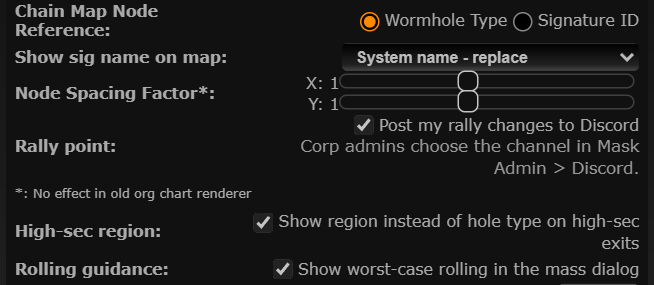

# High-sec region instead of hole type

**Date:** 2026-10-10

## Description

On the chain map, a hole into a known high-sec system now shows the system's region (e.g. "The Forge") where
the node showed the hole type (e.g. "D845"): for an exit you need to know where in New Eden it lands, the type
is already known. The hole type stays in the tooltip.

## Before / After

Default "Show sig name on map: System name - replace" (radial):

| Before | After |
| --- | --- |
|  |  |

"Show sig name on map: Reference - prefix" (name - type) and the new org chart:

| Before | After |
| --- | --- |
|  |  |
| |  |

## Settings

Toggle: Settings > Chain Map Settings > High-sec region, "Show region instead of hole type on high-sec exits"
(on by default, `options.highsecRegion.enabled`, missing = on). Applied on Save without a reload (upstream's
Save redraws the chain), Settings > Reset removes the key (back on). A toggle because some pilots read the hole
type off the node (e.g. to check mass or lifetime) and prefer it there.

## Change

- New `app/js/fork/highsec-region.js` wraps `chain.nodes` (like size tags): for each connection whose child is a
  known system that Tripwire classifies as high-sec (`systemAnalysis`: no WH class, not Triglavian, security
  >= 0.45, i.e. 0.5 after rounding), the hole type in the node's type line is replaced by the region name from
  `appData.regions`. With "Reference - prefix" it becomes `AABA - The Forge`. The tooltip
  (`title`) says e.g. "The Forge (high-sec region) - hole type D845".
- Not changed: low-sec, null-sec, Pochven and W-space nodes; unidentified destinations ("High-Sec" without a
  system); gate routes; nodes that show the signature ID ("Chain Map Node Reference: Signature ID") or only the
  hole name ("Reference - replace"), since those don't show the type.
- Works in all four renderers (radial, both new org charts, old org chart): they all draw the markup that
  `chain.nodes` returns. The line uses the node's existing width (an invisible copy of the original text
  reserves it), so no layout moves; longer names end in an ellipsis, full name in the tooltip.
- Pure logic (high-sec check, label, markup rewrite) tested in `app/js-test/fork/highsec-region.test.js`,
  styles in `app/css/fork/highsec-region.css`. No upstream files touched.
