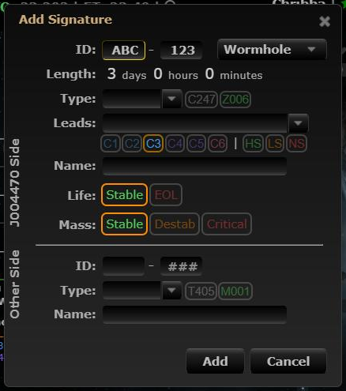
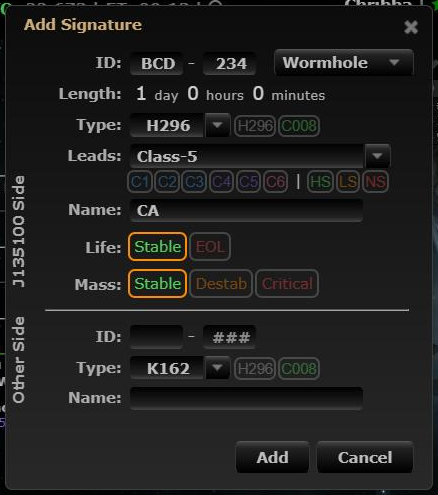

# Hole naming

**Date:** 2026-10-10

## Description

The Add Signature dialog now suggests a hierarchical name for new wormholes (A, AB, AB6, AB61 ...: letters for
large holes, 1-5 for frigate holes, 6-9 for medium holes, prefixed with the name of the hole leading into the
system). After Add/Save, the in-game bookmark string (e.g. `=A C5 ABC EOL`) is copied to the clipboard.

## Before / After

| Before | After |
| --- | --- |
|  |  |

## Change

- New `app/js/fork/hole-naming.js` (pure `holeNaming` logic + dialog hooks) and tests in
  `app/js-test/fork/hole-naming.test.js`. No upstream files touched.
- The name is only auto-filled in Add mode for wormholes, until the user types in the Name field. If the hole
  leading into the system has no name, nothing is suggested.
- The copy hooks `tripwire.refresh` (wrapped from the fork file) so it runs inside the Add/Save click; the
  "Copied ..." toast is only shown when the save succeeds.
