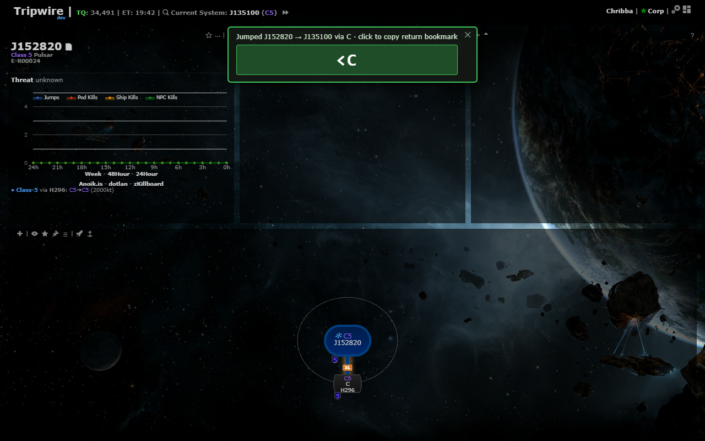
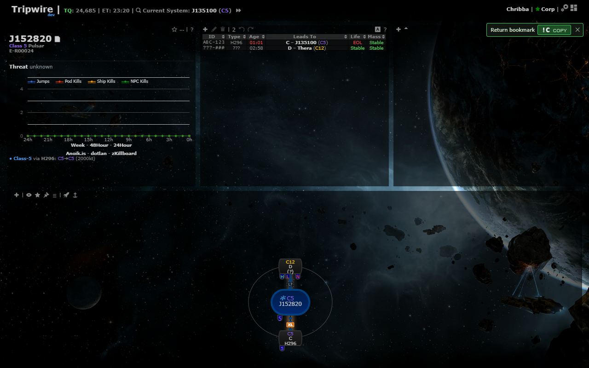
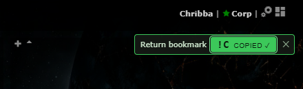
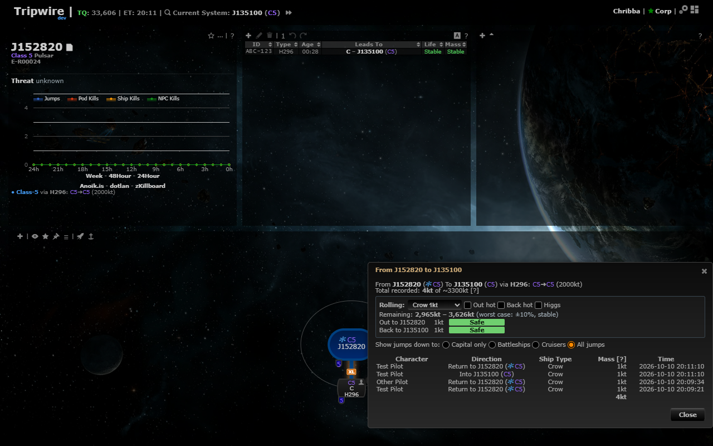
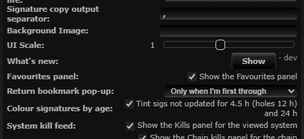

# Jump return bookmark: compact, first pilot through only

**Date:** 2026-10-10

## Description

The return bookmark panel (e.g. `<C`) is now a single small line just under the top bar on the right, instead of
a big box in the middle of the screen, and by default it only pops up for the first pilot through a hole: once
someone has been to the far side, everyone else is left alone.

## Before / After

| Before | After |
| --- | --- |
|  454 x 102 px box, top centre |  211 x 30 px, one line, top right under the top bar |
| |  After clicking: copied (fades out) |
| |  Next pilot through: no pop-up (the jump log, filled by the real trigger, already has *Other Pilot*) |
| |  Settings > General Preferences > Return bookmark pop-up |

Checked in all four chain renderers (org chart, org chart top, org chart side, radial) at 1280 px, and at
900/600/400 px: it never overlaps a chain node and adds no horizontal scroll. At narrow widths it can cover the
top-right corner of the panel below the top bar (e.g. the signature table header) until it is copied, closed
(✕ / Esc) or fades after 60 s.

## Rule: who gets the pop-up

After a jump outbound through a named hole (unchanged), the pop-up is **not** shown when any of these says
someone has already been to the far side (checked in this order):

1. the far-side (return) signature already has a signature ID (at least its 3 letters): it was scanned from inside;
2. the far-side signature already has a name (e.g. `<C`): someone recorded the return;
   (1 and 2 are skipped when the sig's last edit, `modifiedByID`, was by one of this browser's characters: the
   logged-in character, the tracked ones or the active one. So a first pilot who quickly pastes sigs / sets the
   return sig during the 1.5/6/12 s re-checks doesn't suppress their own pop-up.)
3. this browser already copied the return bookmark for this hole (this session);
4. the hole's jump log (upstream's mass log, `mass.php`, filled for every tracked character by the `jumpHistory`
   trigger) has a jump through it, in either direction, by a character that is **not** one of this browser's
   characters, made at or after the near-side (named) sig's last change (`modifiedTime`).
   - Names in the log carry upstream's tracking visibility suffix (`Name|P`, `Name|p`, `Name|x`, set in
     `refresh.php`); it is stripped before comparing, like upstream's mass dialog does. The log has no
     character IDs, so names are compared (case-insensitive).
   - Jumps older than the near-side sig's last change don't count: a scout who jumped an un-entered sig (the
     automapper then makes an unnamed hole, no pop-up) doesn't stop the first pilot after the hole gets named.
     Any later edit of that sig also restarts the window, which errs on showing. Both times are server times
     (`jumps.time` from MySQL, `signatures.modifiedTime` from PHP); they are compared as-is, which assumes MySQL
     and PHP (`TZ`, UTC by default in our image) use the same time zone.

All four use data that already exists and syncs to everyone on the mask; no new server state. If the jump log
can't be loaded (error / 4 s timeout), only 1-3 decide (the pop-up errs on showing).

Verified end to end with real trigger-logged jumps (tracking updates posted through `refresh.php` across the
hole): first pilot (own `Test Pilot|P` jump already in the log) gets it; after `Other Pilot|P` jumped, the next
pilot doesn't; after the near-side sig changed later than that jump, it shows again; a far-side sig ID set by the
logged-in character doesn't suppress it, one set by someone else does.

Edge cases:
- Several pilots jumping within seconds: each client checks the log right after its own jump, and a jump only
  reaches the log on the jumper's next sync, so both may get the pop-up. Acceptable: worst case is the old behaviour.
- Same pilot jumping back and forth: their own jumps never count; after they copied it once (or once someone
  else gave the far-side sig an ID or name) it stays quiet.
- Several tracked characters in one browser: the pop-up still follows the active character only, and jumps by
  any of this browser's characters don't count (so an alt jumping alongside doesn't suppress it).
- Unknown/unnamed holes: unchanged (no pop-up).

## Settings

Settings > General Preferences > **Return bookmark pop-up**: *Only when I'm first through* (default) /
*After every jump* (the old behaviour) / *Off*. Stored as `options.jumpReturn = {enabled, firstOnly}` (missing
= on, first only), applied on Save, removed by Settings > Reset. The feature had no toggle before; one select
covers both turning it off (AGENTS.md: pop-ups get a toggle) and getting it on every jump, for pilots who want
the string even when they're not first.

## Change

Fork files only: `app/js/fork/jump-return.js` (new pure `jumpReturn.alreadyHandled`, `enabled`, `firstOnly`,
`modeFor`/`optionsForMode`; `forJump` also returns the far-side sig; jump-log read via upstream's existing
`mass.php`; compact markup; settings row), `app/css/fork/jump-return.css`, tests in
`app/js-test/fork/jump-return.test.js`, rebuilt bundles. No upstream files touched.
