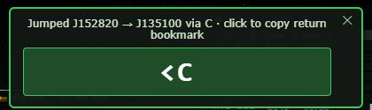
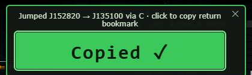
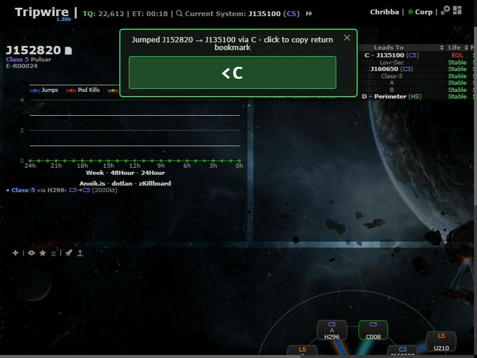

# Jump return bookmark

**Date:** 2026-10-10

## Description

After the tracked character jumps outbound through a named hole (e.g. `AB`, bookmarked `=AB …` on the home
side), a panel at the top of the window offers the return bookmark string (`<AB`); one click copies it.

## Before / After

| Before | After |
| --- | --- |
| No pop-up after a jump; the return bookmark had to be typed by hand. |  Panel after jumping J152820 → J135100 through hole C |
| |  After clicking: copied |
| |  In the app (top centre, doesn't block the map) |

## Change

New fork files only: `app/js/fork/jump-return.js` (wraps `tripwire.EVE` to detect jumps, finds the jumped
hole in the client's wormholes/signatures, shows the panel; re-checks after ~1.5s/6s/12s in case the
automapper is still adding the hole), `app/css/fork/jump-return.css`, and tests in
`app/js-test/fork/jump-return.test.js`. Reuses `holeNaming.leadingToken` / `holeNaming.copyText` from the
hole-naming feature. No upstream files touched.
