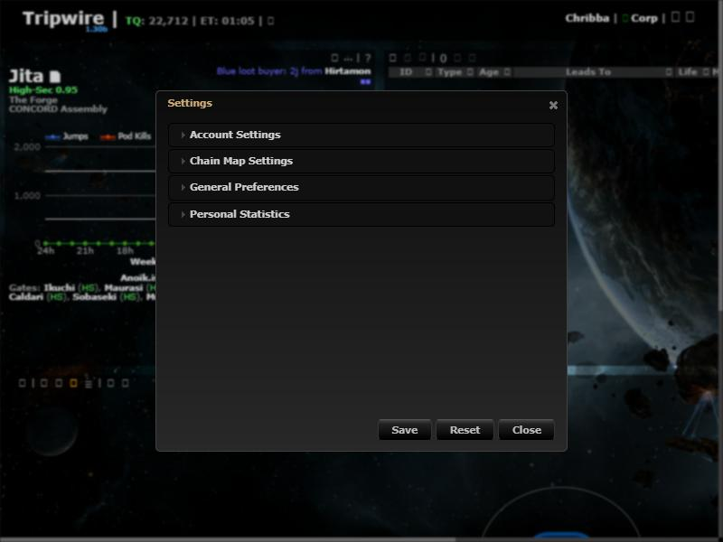
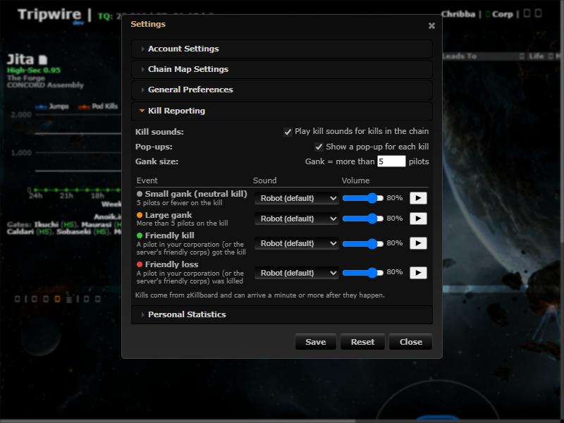
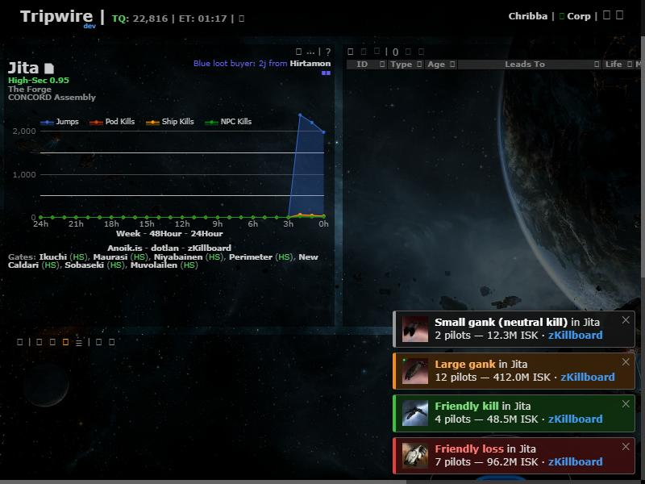

# Kill Reporting

**Date:** 2026-10-10

## Description

Tripwire now plays a sound (and shows a pop-up) when a kill happens in any system on your chain map: small gank,
large gank, a kill by your corporation, or a loss of your corporation. zKillboard is read once, on the server, for the
whole instance, so browsers never call zKillboard and we stay far below its rate limits.

## Before / After

| Before | After |
| --- | --- |
|  |  |

Pop-ups (one per category: neutral, large gank, friendly kill, friendly loss):

## Settings

Toggle: Settings > Kill Reporting (on by default): "Play kill sounds" and "Show a pop-up" separately, the gank size
threshold (default: more than 5 pilots = gank), and per event a sound from the pack plus its own volume, with a ▶ preview.
Stored in `options.killReporting`; a missing key means defaults; Settings > Reset restores them.

## Change

- **Feed worker** `zkill_feed.worker.php` (new, run by supervisord as `zkill-feed`): follows zKillboard's R2Z2 feed
  (`r2z2.zkillboard.com`, ≤ 4 req/s, 6 s wait when caught up, backoff on errors), keeps non-NPC kills in J-space and in
  any system that has signatures, stores them in the new `zkill_kills` table (pruned after 24 h) and resumes from
  `zkill_feed_state` after a restart. Tables are created by the worker (`docker/sql/kill-reporting.sql` for reference).
- **Endpoint** `public/kills.php` (new): logged-in users only; returns kills since a cursor for the chain's systems,
  with `friendlyVictim` / `friendlyAttacker` computed from the character's corporation plus
  `KILL_REPORT_FRIENDLY_CORPORATIONS`.
- **Client** `app/js/fork/kill-reporting.js` + css: polls `kills.php` every 15 s, classifies (loss > kill > gank > neutral),
  plays one sound per category per poll in sequence, shows pop-ups linking to zKillboard.
- **Sound pack** `public/sounds/kill-reporting/` (29 MP3s, ~345 KB): six voice variants per event plus five tones,
  generated with espeak-ng + ffmpeg by `docker/sounds/generate-kill-sounds.sh` (no third-party samples). A browser
  text-to-speech option and "No sound" are also available.
- **Config**: `ZKILL_FEED_ENABLED` (default true), `KILL_REPORT_FRIENDLY_CORPORATIONS` in `docker/config.php`,
  `.env.example`, compose files and `docker/README.md`; supervisord program added.
- **Third-party hosts** (AGENTS.md §6): the server now calls `r2z2.zkillboard.com`. Browsers load ship icons from
  `image.eveonline.com` (already used by Tripwire) and the pop-up links to `zkillboard.com`.
- No upstream files touched.
