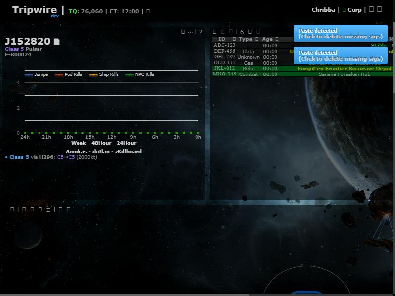
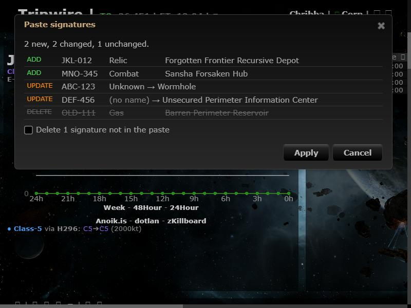
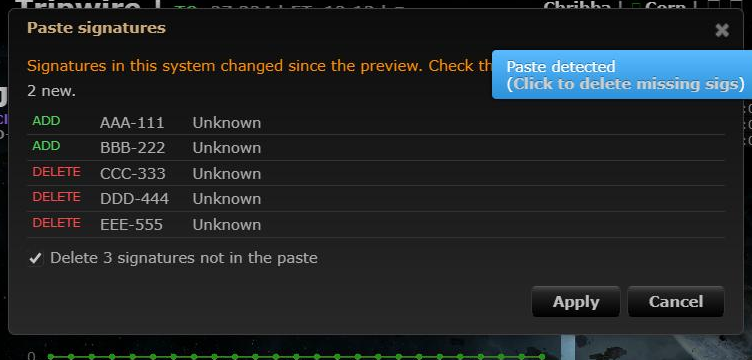

# Paste scans anywhere, with a preview

**Date:** 2026-10-10

## Description

Pasting probe-scanner results now shows a preview of what will change before anything is saved: signatures to
add, signatures to update (old → new type or name), and signatures in the system that are missing from the paste,
which are deleted only when "Delete N signatures not in the paste" is ticked (off by default, like upstream's
"Click to delete missing sigs" link). Apply (or Enter) / Cancel; if nothing would change, no dialog opens. Pastes
are picked up anywhere on the page outside text fields, including Shift+Insert and the browser's Edit menu, and
text that isn't scanner output is ignored.

## Before / After

| Before | After |
| --- | --- |
|  |  |

Before: the paste is applied straight away with a "Paste detected" notice. After: a preview to confirm.

If the system's signatures changed between the preview and Apply (e.g. another user added one), nothing is
applied: the preview is refreshed with a warning and asks again, so only what was shown gets added, updated or
deleted. While the previous paste is still saving, a new paste is ignored with a notice (as upstream does), so
quick repeated pastes don't create duplicates.

## Settings

Settings > General Preferences > Signature paste: "Paste scans anywhere on the page" and "Preview changes before
applying" (both on by default; `options.pasteAnywhere.enabled` / `.preview`, missing = on, cleared by Reset).
With the preview off, pastes apply immediately as before.

## Change

New `app/js/fork/paste-anywhere.js` (diff logic in the `pasteAnywhere` global, tested in
`app/js-test/fork/paste-anywhere.test.js` with real scanner rows run through upstream's parser) and
`app/css/fork/paste-anywhere.css`. A capture-phase `paste` listener handles pastes on the page and in upstream's
hidden `#clipboard` field (which Ctrl+V focuses), before upstream's handler. Parsing and applying stay upstream's:
rows go through upstream `rowParse`, Apply calls upstream `parsePaste` (add/update) and `removeMissing` (delete),
so undo works as before. Pasted and stored text is HTML-escaped in the preview.

Upstream file touched: `app/js/tripwire/paste.js` (small edits): expose `rowParse` as
`tripwire.pasteSignatures.rowParse` and its private `processing` flag as `tripwire.pasteSignatures.isProcessing()`, and move the body of the `#fullPaste` click handler into
`tripwire.pasteSignatures.removeMissing(paste)`, which the handler now calls.
