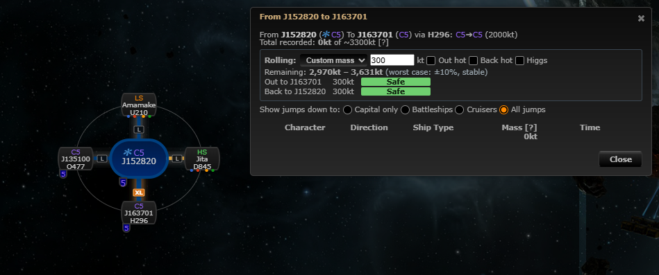
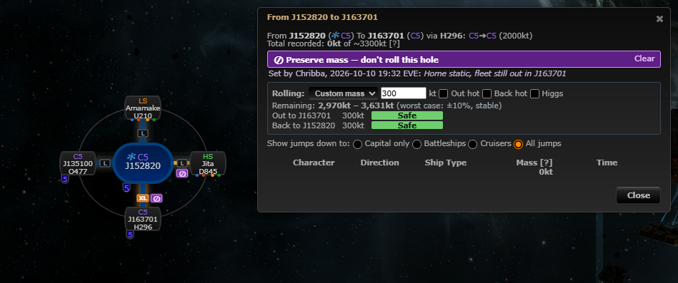

# Preserve mass on a connection

**Date:** 2026-10-10

## Description

Anyone on a mask can mark a wormhole connection as "preserve mass" (don't roll it or burn its mass, e.g. the home
static or the hole a fleet needs to come back through), with an optional reason. Everyone on the mask sees a violet
⊘ marker on the connection, next to its size tag, with who set it, when and why in its tooltip, and a "Preserve
mass — don't roll this hole" warning above the rolling verdicts in the mass dialog. The flag goes away with the
wormhole.

## Before / After

| Before | After |
| --- | --- |
|  |  |

## Settings

Toggle: Settings > Chain Map Settings > Preserve mass, "Show preserve-mass markers on connections" (on by default,
`options.preserveMass.enabled`, removed by Settings > Reset). It only hides the markers on the chain map: setting or
clearing a flag is an explicit action in the context menu or the mass dialog, and the mass dialog's warning stays,
since it is there to stop someone rolling a hole the group needs.

## Change

- **Setting it**: right-click a system on the chain map, "Preserve mass…" (the hole leading into that system, the
  same one the "Mass" entry opens), or "Preserve mass…" in the mass dialog; a small dialog asks for the optional
  reason (100 characters). "Stop preserving mass" in the menu and "Clear" in the mass dialog's warning remove it.
  Not offered for EVE-Scout connections or the chain's root.
- **Server**: new `public/preserve_mass.php` (GET = the mask's flags; POST `mode=set&wormholeID=…&reason=…` /
  `mode=clear&wormholeID=…`) and `preserve_mass.inc.php`. Same protection as `public/rally.php`: session mask only,
  changes POST-only with `X-Requested-With: XMLHttpRequest`, and a flag can only be set on a wormhole of the
  session's mask. New table `fork_preserve_mass` (one row per mask and wormhole: who, when, reason), created on first
  use. A foreign key to `wormholes` (`ON DELETE CASCADE`) removes the flag with its wormhole (deleted, collapsed,
  its signature deleted, or the `wormholeClean` event); every request also removes orphans of the mask (for
  databases where the key couldn't be created). No upstream table changed.
- **Sync**: polled every 10 s, like the rally point; your own changes show at once.
- **Map** (`app/js/fork/preserve-mass.js`, `app/css/fork/preserve-mass.css`): the marker is placed wherever the size
  tags are placed (it hooks `sizeTags.placeOnDrawnMap` / `placeOnOrgChart`, so every renderer, draw, collapse and
  badge update), with the same geometry: right of the connection's size tag, else left, below or above, whichever
  covers the least of the two nodes, their badges and text; on the line's visible midpoint when there is no size
  tag. In the old org chart it sits right of the tag in the connector cell. Chain legend row added.
- **Mass dialog**: the panel sits directly above the worst-case rolling calculator's verdicts.
- **Security**: the reason is stored as plain text (control, zero-width and direction characters removed) and
  escaped wherever it is shown (marker `title`, mass dialog, reason dialog via `.val()` / `.text()`).
- Tests: `app/js-test/fork/preserve-mass.test.js` (mocha: ids, flag map, reason cleaning, tooltip and escaping,
  marker placement next to the tag), `tests/preserve_mass_test.php` (storage against the dev database: set/update,
  masks kept apart, cascade on wormhole and signature delete, orphan clean-up). Docs: `docker/README.md`.
- No upstream files touched.
