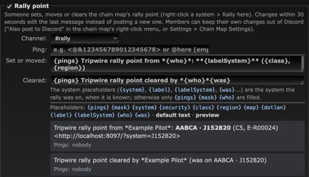

# Rally point message: chain label

**Date:** 2026-10-10

## Description

The rally point Discord message now names the system the way the chain map does, with its chain label (the name of
the hole leading into it), e.g. **AABCA · J152820**, not only the EVE system name. The cleared message says which
system the rally was on. New placeholders `{label}` and `{labelSystem}` (rally point and k-space) and `{was}` (rally).

## Before / After

Before (default texts, from the dev stack's Discord mock):

```
Tripwire rally point from *Chribba*: **J152820** (C5, E-R00024)
Tripwire rally point cleared by *Chribba*
```

After (Mask Admin > Discord preview; the same texts arrived at the Discord mock, set and then cleared within 30 s,
which edits the message):

```
Tripwire rally point from *Chribba*: **AABCA · J152820** (C5, E-R00024)
Tripwire rally point cleared by *Chribba* (was on AABCA · J152820)
```



No "before" screenshot of the settings page: it only differs in the preview text above (the old texts are shown there).

## Settings

No toggle. This changes the text of an existing message, which corp admins already control in Mask Admin > Discord:
they can leave the label out by using `{system}` instead of `{labelSystem}`. Without a label the message is the same
as before.

## Change

- **Where the label comes from.** The chain map (`app/js/chain-map.js`) shows, for a system, the name of the wormhole
  signature on the *parent* side of the hole leading into it (`node.child.name = parent.name`). It walks from the
  active chain tab's home system(s), which are each user's own option, so the server can't repeat that walk. New
  `discord_chain_label()` (`discord/rally.php`) uses the rule the Add Signature dialog already uses without a home tab
  (`holeNaming.incomingFromWormholes`): a wormhole of the mask touching the system leads in when its far-side signature
  has a name starting with a letter or digit and its near-side signature is unnamed or a return bookmark (`<...`). Reached more than once (loops), the
  shortest leading name token wins (closest to home under the hierarchical naming), then the lowest wormhole id. Home,
  k-space without a named hole and systems without a wormhole get no label. One prepared query (UNION ALL of both
  wormhole directions) when the message is rendered.
- **Placeholders** (`discord/template.php`): `{label}`, `{labelSystem}` ("AABCA · J152820" or just "J152820") for the
  rally point and k-space types; `{was}` for the rally's cleared text (" (was on AABCA · J152820)" or empty). The
  template syntax now accepts camelCase names. Labels are escaped like game data (markdown, `@`, `<`, `:` for links);
  `allowed_mentions` is unchanged (admin texts only). K-space takes the label from the hole that was mapped (the
  same rule applied to the hole that was mapped, when it is queued). The legacy path escapes `:` in the label too.
  Kill types are unchanged.
- **New defaults**: `{pings} Tripwire rally point from *{who}*: **{labelSystem}** ({class}, {region})` + `{map}` and
  `{pings} Tripwire rally point cleared by *{who}*{was}`. Stored settings whose text is exactly an earlier default
  (ignoring `\r` and outer spaces) are read as the new default (`discord_template_upgrade`, also for already queued
  messages); edited texts are kept.
- **Cleared message**: `fork_rally` loses the system with the row and `discord_rally` only keeps the message id, so
  `public/rally.php` now passes the system the rally was on (read before the delete) with the clear: into the outbox
  row (`systemID`, plus its label as it is at clear time) and to the legacy sender. A set's label is looked up when
  the message is sent. A clear queued before
  this version, or a set whose rally was cleared by someone else meanwhile, still says only who cleared it.
- **Legacy `DISCORD_WEB_HOOK` path** (`rally_discord.inc.php`): same label and "(was on ...)" text.
- UI (`app/js/fork/discord-notifications.js`): the "Cleared" help text; the placeholder list and preview come from
  the server (preview sample label AABCA). Bundles rebuilt. Docs in `docker/README.md`.
- Tests: `discord/tests/discord_test.php` (label lookup in SQLite: inbound side, none, home, several, other mask,
  k-space; rendering with/without label, escaping, cleared text, migration), `tests/rally_discord_test.php` (legacy),
  mocha for the help text. Checked end to end on the dev stack (MySQL, worker dispatch and legacy post to the Discord
  mock). No upstream files touched.
