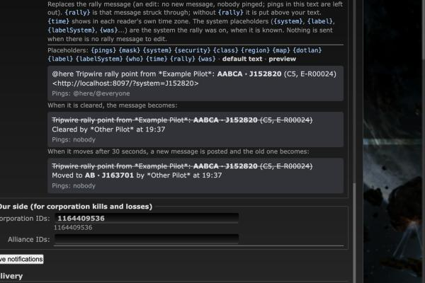

# Rally point: clearing strikes through the message

**Date:** 2026-10-10

## Description

Clearing the rally point no longer posts a new "@here ... cleared" message (which pinged everyone, didn't say which
rally, and left the rally message looking active) and no longer turns a fresh rally message into a "cleared" one. The
rally message itself is edited, at any time, into its text struck through plus who cleared it and when. A move after
30 seconds posts a new message (with the ping) and strikes through the old one with where it moved.

## Before / After

What the dev stack's Discord mock shows after each sequence (`tests/rally_discord_flow_test.php`, which drives the
real worker and the legacy sender; `(edited)` = the message was edited, `[pinged]` = its *post* notified @here; edits
never notify). Full captures: [before.txt](before.txt) (1.17.0 code, `--print`) and [after.txt](after.txt).

The production sequence (Tyrael sets and clears within 30 s, Kytus sets, Aashai clears 55 minutes later), before:

```
- @here Tripwire rally point from *Kytus Bos*: **J163701** (C5, E\-R00025)
  <http://localhost:8097/?system=J163701>  (edited)  [pinged]      <- was Tyrael's rally, now Kytus's (or a "cleared" text)
- @here Tripwire rally point cleared by *Aashai Modor* (was on J163701)  [pinged]
```

After:

```
- ~~Tripwire rally point from *Commander Tyrael*: **J163701** (C5, E\-R00025)~~
  Cleared by *Commander Tyrael* at <t:…:t>  (edited)  [pinged]
- ~~Tripwire rally point from *Kytus Bos*: **J163701** (C5, E\-R00025)~~
  Cleared by *Aashai Modor* at <t:…:t>  (edited)  [pinged]
```

Moved after 30 s, then cleared, after:

```
- ~~Tripwire rally point from *Kytus Bos*: **J163701** (C5, E\-R00025)~~
  Moved to **J152820** by *Aashai Modor* at <t:…:t>  (edited)  [pinged]
- ~~Tripwire rally point from *Aashai Modor*: **J152820** (C5, E\-R00024)~~
  Cleared by *Kytus Bos* at <t:…:t>  (edited)  [pinged]
```

Discord renders `<t:…:t>` as the time in each reader's own time zone (e.g. 19:08). Mask Admin > Discord preview
after (the struck text and the time as the browser shows them):



No `before.png`: what changed is what reaches Discord, which the text captures above show for every sequence. The
Mask Admin page only differs in its help texts and in the preview, which before showed the set message and, under it,
`@here Tripwire rally point cleared by *Example Pilot* (was on AABCA · J152820)` with "Pings: @here/@everyone".

## Settings

No toggle. This is a fix of how an existing notification behaves (the new behaviour is what the old one was meant to
do); corp admins already turn the type on/off and edit its texts in Mask Admin > Discord, and members keep "Also post
to Discord".

## Change

- **Mask Admin type** (`discord/rally.php`, `discord/dispatch.php`, `discord/template.php`): the sender keeps the
  mask's live rally message with its text as posted (new table `discord_rally_message`; `discord_rally` of 1.15-1.17
  is no longer read: its rows may be "cleared" notices, and without their text they can't be struck through). A pure
  `discord_rally_plan()` decides per queued change: set/move within 30 s of the post = edit; move later = post (pings)
  and queue a `rallyEdit` row that edits the old message to "~~text~~ / Moved to ... by ... at <time>"; clear = edit
  to the cleared text at any time, or **nothing** when there is no live message (never posted, deleted in Discord,
  another webhook, the type turned off and on: `enabledAt` now travels with the queued row). A clear of a message
  deleted in Discord (404 10008) is dropped, a set/move is posted again. The 30 s debounce and the "newer queued
  change supersedes" rule stay; a set and clear queued together send nothing (the set never reached Discord).
- **Edits never ping**: struck text drops the ping field, mentions the admin wrote and the `{map}` link line; every
  PATCH sends `allowed_mentions: {parse: []}` (Discord doesn't notify on edits either, but we don't rely on it).
- **Templates**: new placeholders `{rally}` (the message struck through) and `{time}` (`<t:unix:t>`, raw, not
  escaped). New cleared default ``{rally}\nCleared by *{who}* at {time}``. `discord_template_upgrade` also maps 1.17's
  cleared default (``{pings} Tripwire rally point cleared by *{who}*{was}``) to it; 1.15's already did. A custom
  cleared text without `{rally}` still strikes the message: the struck text is put above it (said in the UI help).
  The "Moved to" line is fixed text.
- **Legacy `DISCORD_WEB_HOOK`** (`rally_discord.inc.php`): same rules with fixed texts and no pings; the live message
  and its text are in `fork_rally_discord_message`. A failed post keeps the old message tracked (a later change still
  ends it). Differences: the moved edit is sent right after the new post in the same request (no queue/retry); a
  failed edit can't be told apart from a deleted message (`file_get_contents`), so a failed in-window edit posts a new
  message and still sends the old one its "Moved to" edit, and a failed clear edit is not retried; the time is when
  the request ran.
- Re-setting the rally to exactly what the live message shows sends nothing within 30 s; later it is posted again
  (pinged) like a move, and the old message gets the same "Moved to" edit even though the system didn't change. This
  is rare by design: `public/rally.php` only queues a set when the rally's system changes, so it needs a change that
  wasn't posted in between (e.g. someone moving it with "Also post to Discord" unticked and back).
- An ending edit keeps the cleared / moved line whole: a struck rally text that doesn't fit Discord's 2000 characters
  is cut instead.
- UI (`app/js/fork/discord-notifications.js`): help texts, preview renders `~~strike~~` and `<t:…>` and shows the
  cleared and moved edits (`public/discord.php` returns `previewMoved`). Bundles rebuilt. Docs in `docker/README.md`.
- Dev mock: logs message ids and has `GET /channel` (the channel as a reader sees it).
- Tests: `discord/tests/discord_test.php` (plan, strike, payloads, migration, and every sequence against SQLite with a
  fake Discord), `tests/rally_discord_test.php` (legacy texts), new `tests/rally_discord_flow_test.php` (both paths
  end to end on the dev stack), mocha for the preview. No upstream files touched.
