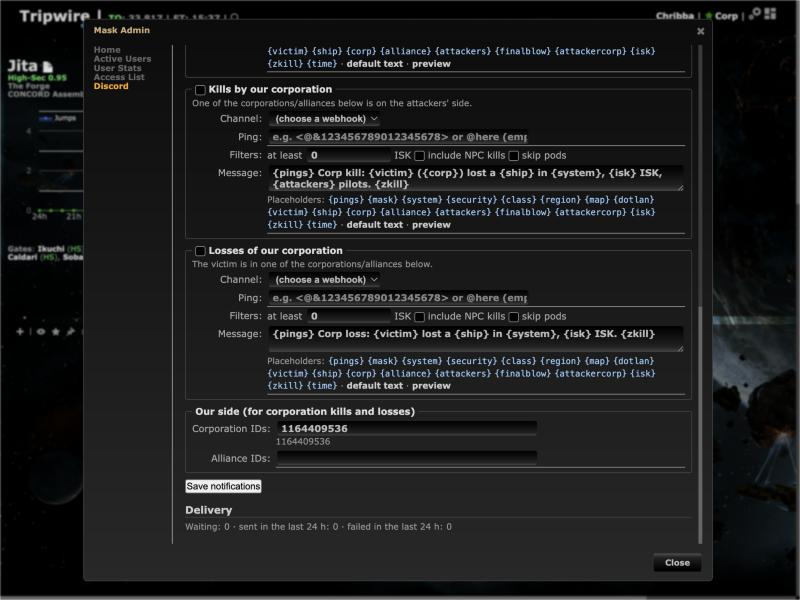
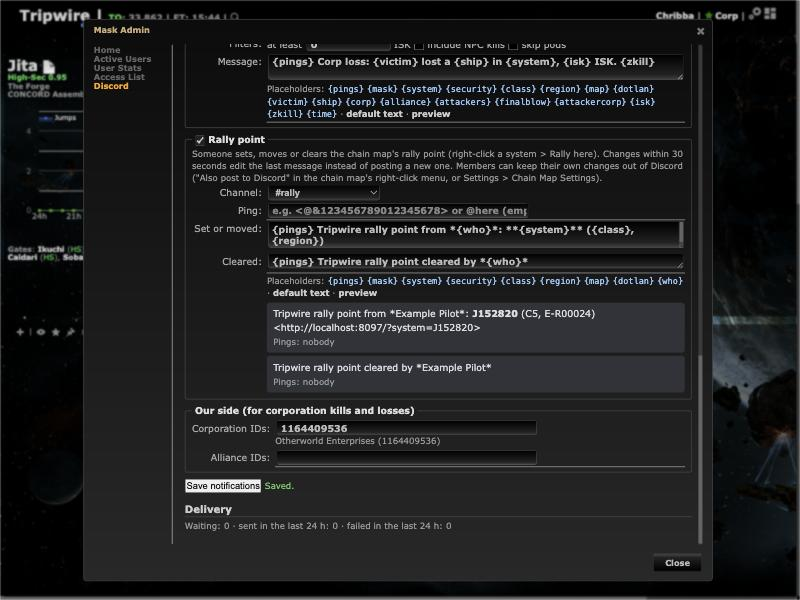
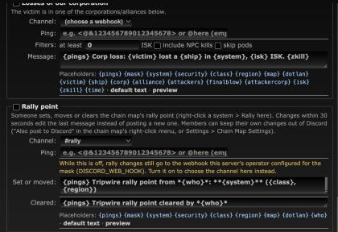
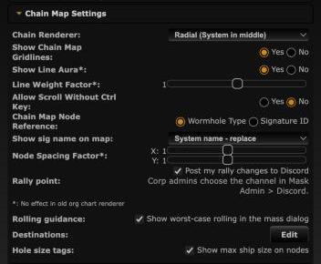

# Rally point in Mask Admin > Discord

**Date:** 2026-10-10

## Description

The rally point posts from the [first version](../2026-10-10-rally-discord/README.md) only went to upstream's
server-wide `DISCORD_WEB_HOOK`, which production doesn't set, so they went nowhere. Rally point is now a notification
type in Mask Admin > Discord: corporation admins turn it on, pick the channel (webhook), a ping and the texts, like the
other Discord notifications. Masks without it keep the old behaviour.

## Before / After

| Before | After |
| --- | --- |
|  |  |

Type off while the server has a legacy `DISCORD_WEB_HOOK` for the mask: 

Settings row: 

## Settings

Kept the per-user toggle from the first version: "Also post to Discord" in the chain map's right-click menu and
Settings > Chain Map Settings > Rally point "Post my rally changes to Discord" (`options.rallyDiscord.enabled`, on by
default, Reset turns it back on). Reason: whether a mask posts, and where, is now the corp admins' choice; whether *my*
change is announced (e.g. a scout's private regroup) is still each member's. The row now says the channel is chosen by
corp admins in Mask Admin > Discord, and the right-click entry shows when the mask has the rally type turned on (or the
legacy webhook), as before.

## Change

- New type `rally` in the Discord settings (`discord/settings.php`, `discord/template.php`): on/off, webhook, ping and
  two texts, "set or moved" (default `{pings} Tripwire rally point from *{who}*: **{system}** ({class}, {region})` plus
  `{map}` on a second line) and "cleared" (`{pings} Tripwire rally point cleared by *{who}*`). Same wording as before;
  `{class}` is the short form the other types use (`HS`, `C5`, ...). Same validation, `allowed_mentions` from the
  admin's texts and ping only, game data (the character name) escaped, `enabledAt` stamped by the server. Text only,
  no embed. The Discord page shows both texts and previews both.
- **Outbox with edits, not the direct send.** `public/rally.php` now queues the change in `discord_outbox`
  (`discord/rally.php`); the one sender (`discord_dispatch`) gained PATCH support for this type only. Trade-off: the
  direct path (#28) answered within one request but bypassed everything #27 built (per-webhook rate limits, 429
  handling, circuit breakers, broken-webhook marking, retries, delivery status on the settings page, "only the worker
  calls Discord"). Keeping it would have meant a second, unguarded sender for the same webhooks. The outbox adds about a
  second of latency (the sender runs every second) and needs the `discord-notify` worker, which every Docker install
  runs since #27. #28's behaviours carry over:
  - the message shows the rally **as stored when it is sent** (`fork_rally`), so racing changes always end on the
    final rally; a queued rally message is dropped when a newer one of the same mask is queued (the GET_LOCK isn't
    needed: one sender, leader-locked);
  - changes within 30 s edit the mask's last rally message (`PATCH .../messages/<id>`, id from `?wait=true`, kept in
    the new `discord_rally` table) when it went to the same webhook; otherwise a new message;
  - an edit of a message deleted in Discord (404, code 10008 Unknown Message) is posted again as a new message and
    does **not** mark the webhook broken (404 Unknown Webhook still does);
  - links from configuration only (`discord_map_url`: `TRIPWIRE_DOMAIN` / `TRIPWIRE_HTTPS`, like the other types),
    the webhook URL is never logged or sent to the browser.
- **Fallback:** `rally_discord_route()` (`rally_discord.inc.php`): the Mask Admin type when it is on (and the mask
  qualifies: corp mask or corp-owned custom mask with a Tripwire admin), else upstream's `DISCORD_WEB_HOOK` for the mask
  posted directly exactly as before, else nothing. The setting wins when on; while it is off, the Discord page says
  rally changes still go to the server's legacy webhook. Missing `discord_*` tables count as "not set".
- Nothing from before the type was turned on: changes are only queued while it is on (plus an `enabledAt` check).
- `docker/dev/discord-mock.php`: accepts `PATCH .../messages/<id>`; `GET /delete/<id>` simulates a deleted message.
- Docs: `docker/README.md` (types table, `DISCORD_WEB_HOOK`, tables, outbound hosts, dev mock).
- Tests: `discord/tests/discord_test.php` (+48 checks: settings, texts, escaping, mentions, edit/post decision, edit
  URL, remember/repost/superseded against SQLite, which masks have the type), `tests/rally_discord_test.php` (+9:
  routing between the setting and `DISCORD_WEB_HOOK`), mocha (rally type form, preview without embed, legacy note).
- No upstream files touched (`ping.inc.php` is no longer required by `public/rally.php`; the legacy lookup is a fork
  copy, `discord_rally_legacy_hook()`).
- New table `discord_rally`, created on first use like the other `discord_*` tables (no migration, no new settings).

Checked in the dev stack against the fake Discord: set, move within 30 s, clear (one POST, two PATCHes); a change after
the message was deleted (PATCH 404 10008, then a new POST, webhook still OK); three changes in a row (two dropped as
superseded, one PATCH showing the last); with "Also post to Discord" unticked nothing is queued; with the type off and
`DISCORD_WEB_HOOK` set for the mask the old direct post happens:

```
15:44:42 POST  .../webhooks/111111111111111111/...?wait=true   Tripwire rally point from *Chribba*: **J152820** (C5, E\-R00024)
15:44:45 PATCH .../messages/1791647082001                      ... **Jita** (HS, The Forge)
15:44:47 PATCH .../messages/1791647082001                      Tripwire rally point cleared by *Chribba*
15:45:29 PATCH .../messages/1791647120005 -> 404 (deleted)
15:45:30 POST  ...?wait=true                                   ... **Jita** (HS, The Forge)
15:45:32 PATCH .../messages/1791647130007                      ... **Dodixie** (HS, Sinq Laison)   (outbox rows 7, 8 superseded)
15:46:05 POST  .../webhooks/222222222222222222/legacytoken?wait=true   (type off, DISCORD_WEB_HOOK)
```
