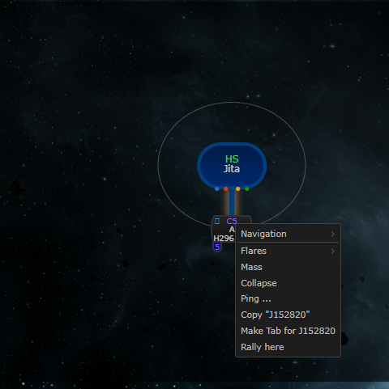
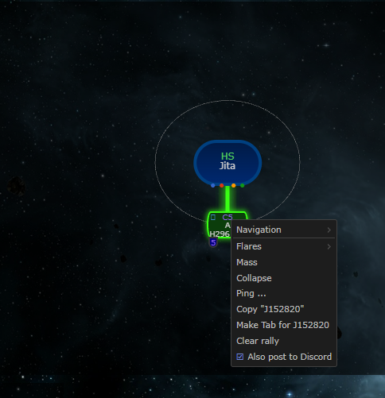
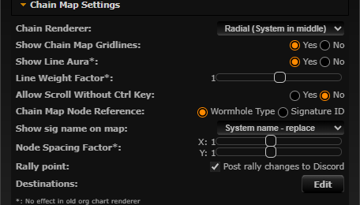

# Rally point to Discord

**Date:** 2026-10-10

## Description

Setting, moving or clearing the rally point now also posts a short message to the mask's Discord webhook,
the same one upstream's chain map pings use. The person changing the rally can untick "Also post to
Discord" in the chain map's right-click menu; nothing happens when the mask has no webhook.

## Before / After

| Before | After |
| --- | --- |
|  |  |

Settings row: 

## Settings

Toggle: the "Also post to Discord" entry in the chain map right-click menu (only shown when the mask has a
webhook) and Settings > Chain Map Settings > Rally point "Post rally changes to Discord". Both set
`options.rallyDiscord.enabled` (missing = on), so the last choice is remembered per user; Settings > Reset
turns it back on.

## Change

- `public/rally.php` (fork file): a change POSTed with `discord=1` is posted after the response is sent
  (`fastcgi_finish_request`), only when the rally actually changed (moving to the same system or clearing
  an empty rally posts nothing). GET/POST responses include `discord` (does the mask have a webhook).
- New `rally_discord.inc.php`: webhook lookup through upstream's `discord_webhook_for_current_mask()`
  (`ping.inc.php`) and sending like `public/ping.php` (`file_get_contents` + http stream context, JSON
  body, 5 s timeout). Message follows upstream's ping format: system name with class and region from
  `public/js/combine.js` (server side, not trusted from the client), who set it (session character), and
  a link back to Tripwire. Clearing posts "Tripwire rally point cleared by *name*".
- Escaping: user text (the character name) is stripped of control characters and `<`/`>`, markdown is
  backslash-escaped, `@` gets a zero-width space, and every payload carries
  `"allowed_mentions": {"parse": []}`, so `@everyone`, `@here` and `<@id>` can't ping.
- Debounce (new table `fork_rally_discord`, one row per mask, created on first use): at most one **new**
  Discord message per mask per 30 s. A change inside the window edits that message (`PATCH
  .../messages/<id>`, the id comes from posting with `?wait=true`), so the channel always shows the latest
  rally without extra messages. If the message id is unknown the change is skipped. The window is claimed
  before posting so two simultaneous changes don't both post.
- `app/js/fork/rally.js` / `app/css/fork/rally.css`: the menu entry (keeps the menu open when toggled),
  the Settings row, `discord=1|0` on changes. Mocha tests for the option and payload logic; PHP tests in
  `tests/rally_discord_test.php` (escaping, labels, payload, debounce, webhook URLs; 39 checks).
- `docker/Dockerfile` leaves `tests/` out of the image; `docker/README.md` documents the webhook use.
- No upstream files touched.
- **Third-party host:** rally posts go to the mask's configured webhook, normally `discord.com`, which
  upstream's pings already call. Nothing is sent without a configured webhook.

Captured in dev against a local stub webhook (`php -S 127.0.0.1:9999` inside the app container,
`DISCORD_WEB_HOOK={"<mask>":"http://127.0.0.1:9999/api/webhooks/123/devtoken"}`): set, move to Jita 2 s
later, clear 1 s later, then (with the option unticked) set again:

```
12:06:20 POST /api/webhooks/123/devtoken?wait=true
{"content":"Tripwire rally point from *Chribba*: **J152820 (C5, E-R00024)**\n<http:\/\/127.0.0.1\/?system=J152820>","allowed_mentions":{"parse":[]}}

12:06:22 PATCH /api/webhooks/123/devtoken/messages/1001791633980
{"content":"Tripwire rally point from *Chribba*: **Jita (High-Sec, The Forge)**\n<http:\/\/127.0.0.1\/?system=Jita>","allowed_mentions":{"parse":[]}}

12:06:23 PATCH /api/webhooks/123/devtoken/messages/1001791633980
{"content":"Tripwire rally point cleared by *Chribba*","allowed_mentions":{"parse":[]}}
```

(no request for the unticked change). After the window, a new message is posted again; the link then
carries the port from the Host header:

```
12:06:53 POST /api/webhooks/123/devtoken?wait=true
{"content":"Tripwire rally point from *Chribba*: **Jita (High-Sec, The Forge)**\n<http:\/\/127.0.0.1:8096\/?system=Jita>","allowed_mentions":{"parse":[]}}
```
