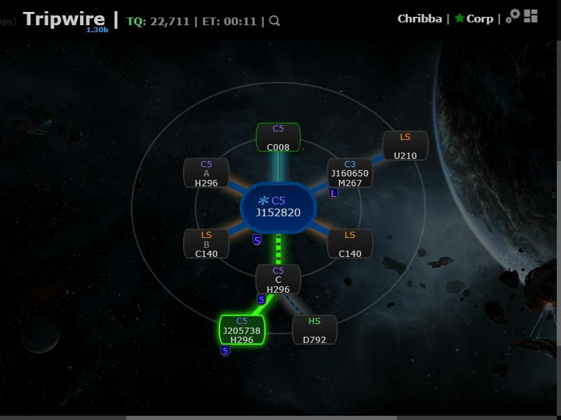

# Rally point

**Date:** 2026-10-10

## Description

A fleet commander can right-click a system on the chain map and choose "Rally here". Everyone on the
same mask sees that system pulse green, the wormhole connections from their own location to it
highlighted, and a "Rally: <system> (<n> jumps) ✕" banner in the chain map header.

## Before / After

| Before | After |
| --- | --- |
|  |  |

## Change

- New `public/rally.php`: GET returns the rally for the session mask; POST `mode=set&systemID=…` /
  `mode=clear` changes it (POST only, requires `X-Requested-With: XMLHttpRequest`, only real system IDs
  30000000–31999999). Stored in a new table `fork_rally` (one row per mask), created with
  `CREATE TABLE IF NOT EXISTS` on first use, so no migration is needed.
- New `app/js/fork/rally.js` + `app/css/fork/rally.css`: polls every 10 s, wraps `chain.nodes` to mark the
  rally node and add a `rally-route` modifier to the connections on the route (BFS over the chain's
  wormhole connections, starting at the tracked character's system, else the viewing system, else the
  chain root), adds the context-menu entry and the header banner. Works with the radial, orgchart-top/side
  (canvas) and Google orgchart renderers. The node pulse respects `prefers-reduced-motion`.
- No upstream files touched.
