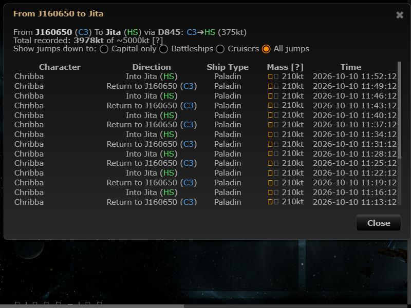
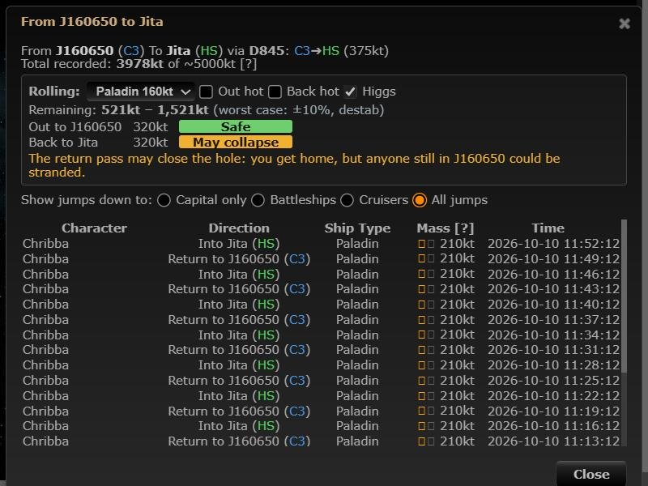

# Worst-case rolling calculator

**Date:** 2026-10-10

## Description

The mass dialog now shows worst-case rolling guidance: the range of mass that can be left in the hole
(nominal mass ±10%, minus the logged mass, narrowed by the hole's stable/destab/crit state) and a
Safe / May collapse / Will collapse verdict for an out pass and the return pass with a chosen ship, with
a warning when you could be stranded on the far side.

## Before / After

| Before | After |
| --- | --- |
|  |  |

## Settings

Toggle: Settings > Chain Map Settings > Rolling guidance (on by default, `options.rollingCalc.enabled`;
Reset turns it back on). It adds a panel to an existing dialog that some people use only to read the
jump log, so they can switch it off and get the old dialog back.

## Change

- New `app/js/fork/rolling-calculator.js` (`rollingCalc`: pure maths plus the dialog panel),
  `app/css/fork/rolling-calculator.css`, tests in `app/js-test/fork/rolling-calculator.test.js`.
- Maths: remaining = [0.9·M − used, 1.1·M − used], intersected with the mass state
  (stable ≥ 50%, destab 10–50%, crit < 10% of the real total). If the log contradicts the state, the
  state wins (logs can miss jumps); if more is logged than 1.1·M, the log is ignored and a note is shown.
  A pass of mass m is Safe if m < min, Will collapse if m ≥ max, else May collapse; over the hole's jump
  limit is "Too heavy to jump".
- Out = away from the system you're viewing. Out may/will collapse, or a return pass over the jump limit,
  shows "you could be / will be stranded". A safe out with a risky return shows a caution that anyone
  still on the far side could be stranded (the ship that collapses a hole gets through).
- Ship: your current ship (from ESI) or any ship in this hole's jump log, or a custom mass; prop on/off per
  pass and Higgs default to the chain map's hot-jump / Higgs toggles. Hull masses are the dialog's
  existing `appData.mass` data.
- No guidance for an unknown or guessed (system-class) hole type: a hint to set the type instead.
- No upstream files touched: hooks the mass dialog by wrapping the global `parseMassData` and listening
  for `dialogopen`; bundles `public/js/app.min.js` / `public/css/app.min.css` rebuilt.
