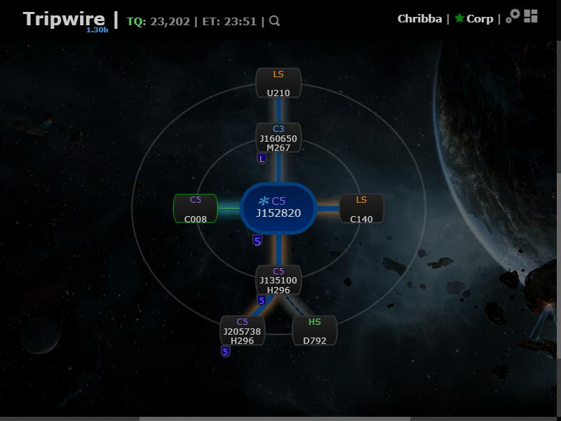
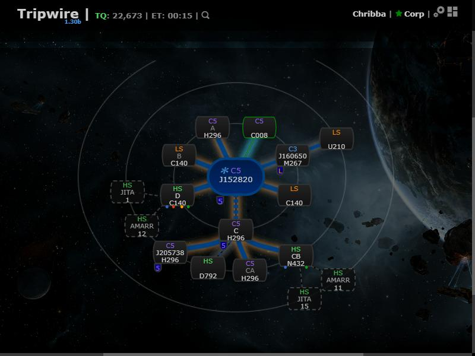
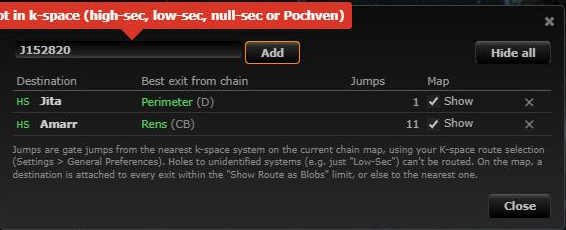

# Saved destinations

**Date:** 2026-10-10

## Description

Users can keep a list of k-space systems they often travel to (Jita, Amarr, their staging, ...). Tripwire
shows the nearest k-space exit on the current chain and its gate jumps for each, and can draw each
destination on the chain map as an extra node attached to the exit(s).

## Before / After

| Before | After |
| --- | --- |
|  Chain map without destinations |  Jita and Amarr drawn off the Perimeter (D) and Rens (CB) exits |
| |  The Destinations window |

## Change

- `app/js/fork/route-destinations.js`: `routeDestinations` (pure logic: saved list, k-space filter, chain
  exits, best exit, synthetic chain rows) plus the UI: a "Destinations" window opened from a new pin icon in
  the chain map toolbar and from Settings > Chain Map Settings > Destinations: Edit.
  - Saved per user in `options.routeDestinations = [{systemID, show}]` (missing key = empty list; Settings >
    Reset keeps the list, via the existing What's New `options.reset` wrapper for keys without defaults).
  - Jumps use `guidance.findShortestPath(tripwire.map.shortest, ...)` like the existing route display, so the
    "K-space route selection" / avoid-list preferences apply; results are cached per (from, to) by guidance.
  - Exits are the k-space systems on the drawn chain (roots and wormhole/EvE-Scout links). Holes to
    unidentified systems ("Low-Sec" etc.), J-space and the viewing/favorite route nodes are ignored.
  - Map: `chain.nodes` is wrapped to append synthetic rows/connections after the real ones, so every renderer
    draws them. A shown destination is attached to every exit within "Show Route as Blobs up to" jumps, or
    else to the nearest exit; nothing is drawn if the destination is itself on the chain. Nodes have class
    `destination-node`, ids `dest-<exit node id>-<systemID>`, `systemID: 0` and no `data-nodeid` (so
    automapper, flares, activity, current-system highlight, collapse and the system context menu ignore them);
    rows carry `destination: {systemID, exitSystemID, jumps}`; connections use modifier `destination-route`.
- `app/css/fork/route-destinations.css`: dashed/muted node and dashed thin connection; window styling.
- `app/js-test/fork/route-destinations.test.js`: unit tests.
- No upstream files touched. No third-party calls.
