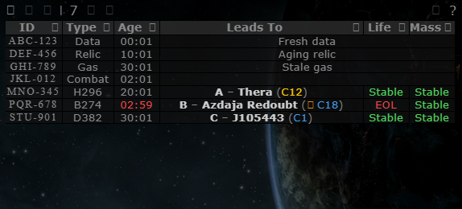
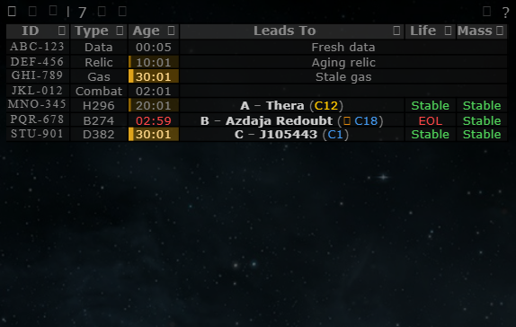

# Signature age colouring

**Date:** 2026-10-10

## Description

The Age cell of signatures nobody has updated for a while is tinted amber, in two steps, so scanners can see
at a glance which sigs need re-scanning. Hovering the Age cell adds a line such as "Stale: not updated for 30 h"
to its tooltip.

## Before / After

| Before | After |
| --- | --- |
|  |  |

## Settings

Toggle: Settings > General Preferences > "Colour signatures by age" (on by default), stored as
`options.sigAge.enabled` (missing = on); applied on Save, cleared by Reset.

## Change

- **What the age measures:** time since the sig last changed, i.e. its `modifiedTime` (falls back to
  `lifeTime`, the creation time). `modifiedTime` is set on create, on any edit, and when a paste adds new info
  (type or name). Re-pasting a sig that is already fully known sends nothing to the server, so it does **not**
  refresh the age: to "confirm" a sig a scanner has to edit it. (Making a re-paste count would need the paste
  to touch every unchanged sig on the server, which re-renders every row for every user; left out.)
- **Thresholds:** non-wormhole sigs are *aging* from 4.5 h and *stale* from 24 h. Wormhole sigs are *aging*
  from 12 h (a hole nobody has looked at for 12 h may have gone EOL unnoticed) and *stale* from 24 h. Holes
  already marked EOL keep upstream's red countdown and are not tinted; gates and never-expiring sigs
  (`lifeLength` 0) are not tinted either. The upstream Age column itself is unchanged (it still counts from
  creation).
- **Look:** one amber hue in two strengths plus an inset left bar (2 px / 4 px), so the steps differ in
  more than colour. The bar stays visible on hovered and selected rows. Tripwire has a single dark theme.
- **Updates:** re-coloured every minute and whenever the table's rows change (a `MutationObserver` on the
  table body's row list: adds, edits, deletes, system change, sort). Only classes and the tooltip attribute
  change; rows are not rebuilt.
- New files: `app/js/fork/sig-age.js` (pure logic in `sigAge`, tested in `app/js-test/fork/sig-age.test.js`),
  `app/css/fork/sig-age.css`. No upstream files touched.
