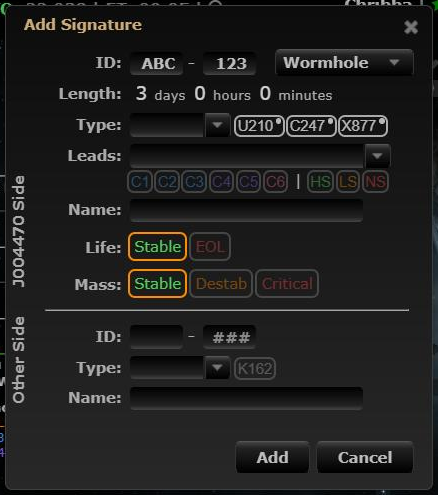

# Wormhole type quick picks show statics

**Date:** 2026-10-10

## Description

The wormhole Type quick-pick buttons in the Add/Edit Signature dialog now show the current system's statics
when Leads To is empty (K162 on the other side), list statics first (marked with a dot and a "Static" tooltip)
when Leads To is set, and show up to 6 types. They are rebuilt every time the dialog opens, fixing stale
buttons left over from the previous signature. Picking a static with Leads To empty also fills Leads To with
the static's destination class.

## Before / After

| Before | After |
| --- | --- |
|  |  |

## Change

New `app/js/fork/sig-quickpicks.js` (logic in `sigQuickPicks.compute`, tested in
`app/js-test/fork/sig-quickpicks.test.js`) and `app/css/fork/sig-quickpicks.css`. It re-renders
`#wormholeTypeQuickSelectFrom` / `#wormholeTypeQuickSelectTo` after upstream's handlers run (dialog open,
signature type change, Leads To change/input, Type change). No upstream files touched.
