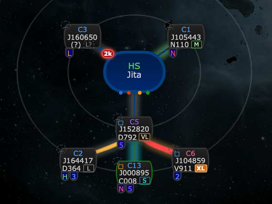
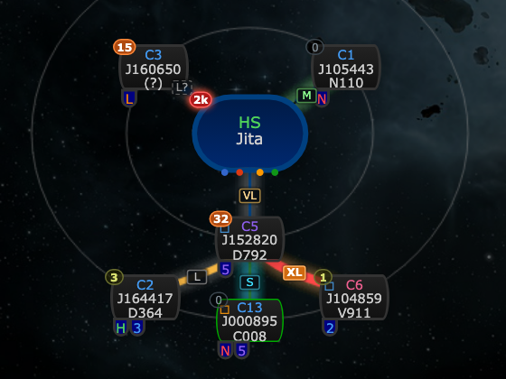
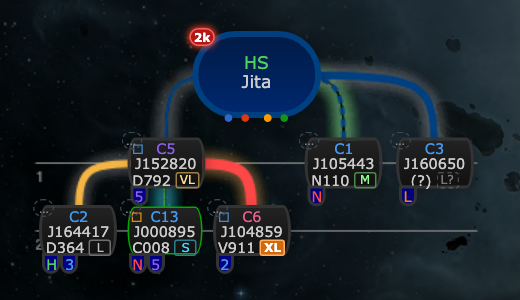
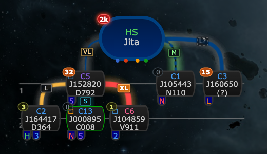
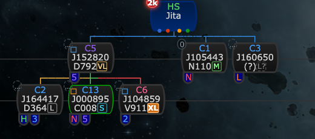
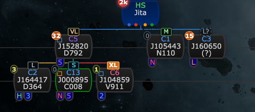
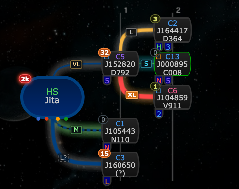

# Hole size tags on the connection

**Date:** 2026-10-10

## Description

The hole size tag (S / M / L / VL / XL: the largest ship that fits through) now sits on the connection line
between two systems instead of on the system node, since it describes the wormhole, not the system. It works in
all four chain map renderers, keeps its tooltip and the dimmed "?" style for guessed sizes, and is no longer
shown on the node.

## Before / After

Radial (the default renderer):

| Before | After |
| --- | --- |
|  |  |

New org chart (system at top):

| Before | After |
| --- | --- |
|  |  |

Old legacy org chart, and new org chart (system at left):

| Before | After |
| --- | --- |
|  |  |
| |  |

## Settings

Toggle: Settings > Chain Map Settings > Hole size tags, now labelled "Show max ship size on connections" (on by
default, unchanged: `options.sizeTags.enabled`). No "on the node / on the connection" choice: the tag means the
wormhole, so it belongs on the connection, and keeping a node mode would mean keeping a second drawing path for
the same information. Users who don't want the tags can still switch them off.

## Change

`app/js/fork/size-tags.js`: the `chain.nodes` wrapper now stores the tag on the child node's cell
(`sizeTag`) instead of adding it to the node markup, and new hooks draw it on the connector after every draw and
collapse:

- Radial, new org chart (top) and new org chart (side) (`chain-map-renderer-base.js`): the renderer's
  `drawConnection` is wrapped to note which connections were drawn; after `draw`/`collapse` each one is traced
  through the renderer's own `drawConnection` with a recording context (so curves match the drawn line), and the
  tag is centred on the middle of the part of the line not covered by the two nodes or their badges (threat,
  statics, occupied...), or slid off the badges when the nodes nearly touch. Tags are absolutely positioned in the
  map's inner container, so they move with the map and don't change its size or the layout. Positions are worked
  out once per draw (one layout read for all tags), never per frame.
- Old legacy org chart (Google OrgChart): the tag is centred on the vertical connector cell above the child node
  (the cell upstream colours for mass/EOL), after `draw` and after the chart's own collapse (via
  `chain.updateCollapsed`).
- Renderers are hooked as they become active (`chain.useRenderer`).

Pure geometry (bezier points, path tracing, visible midpoint, badge avoidance, screen to map coordinates) is
covered in `app/js-test/fork/size-tags.test.js`. Styles in `app/css/fork/size-tags.css`. The chain map has a
single (dark) theme. No upstream files touched.
