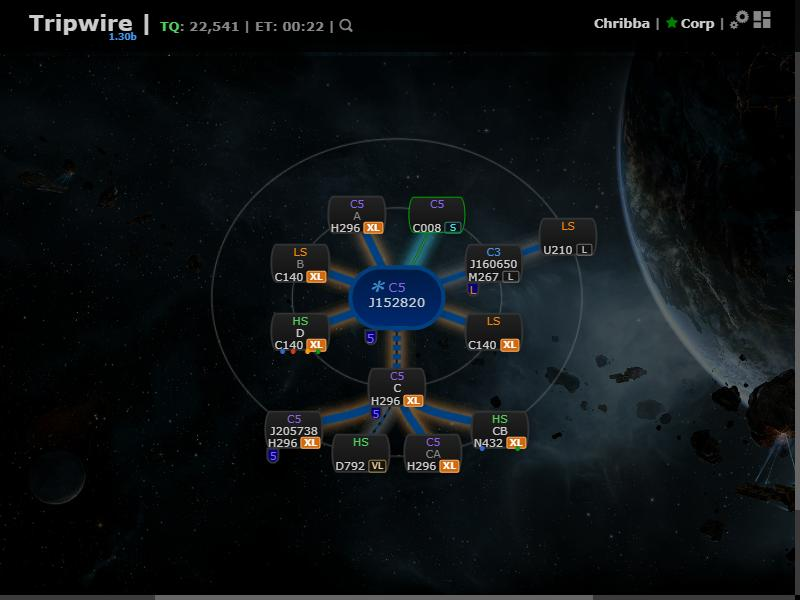

# Hole size tags on the chain map

**Date:** 2026-10-10

## Description

Every wormhole node on the chain map now shows a small tag with the largest ship that fits through the
connection leading to it: S (frigate), M (up to 62 kt), L (up to 410 kt), VL (1,000 kt, freighters) or
XL (2,000 kt, capitals, highlighted in orange). If the wormhole type isn't known (e.g. only the K162 side was
scanned) the size is guessed from the system classes and shown dimmed with a "?" (e.g. "XL?").
The tags can be turned off with the "Hole size tags" checkbox in Settings > Chain Map Settings.

## Before / After

| Before | After |
| --- | --- |
|  |  |

## Change

New `app/js/fork/size-tags.js` (logic in `sizeTags`, tested in `app/js-test/fork/size-tags.test.js`) and
`app/css/fork/size-tags.css`. It wraps `chain.nodes` (composing with other wrappers) and appends the tag to
the hole-type line of each non-root node, using the same lookup as the chain map's connection auras
(`wormholeFromTypePair || likelyWormhole`). Root nodes, calculated gate-route nodes and synthetic destination
nodes are not tagged. The setting is stored as `options.sizeTags.enabled` (missing = on) and, like the other chain
settings, takes effect on the Settings dialog's Save (the row is injected from the fork file; no upstream edit). A "Max ship size" row is added to the chain map legend (the &equiv; icon). No upstream
files touched.
