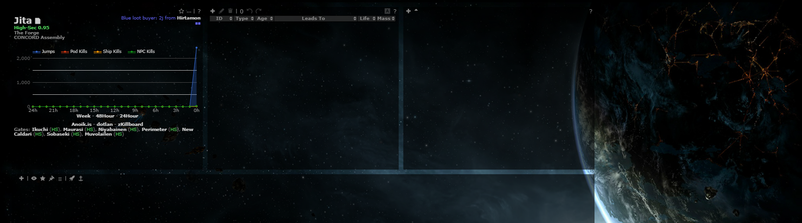
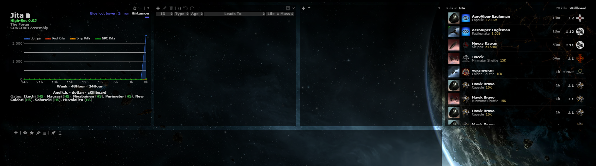
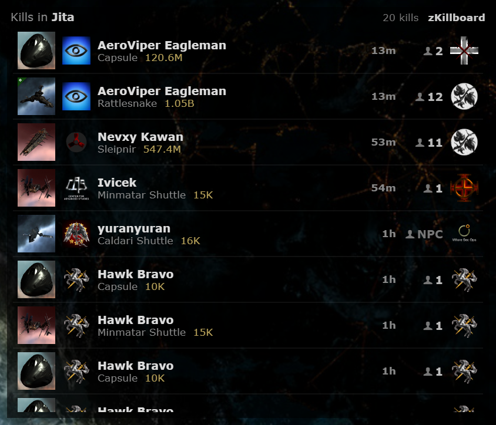
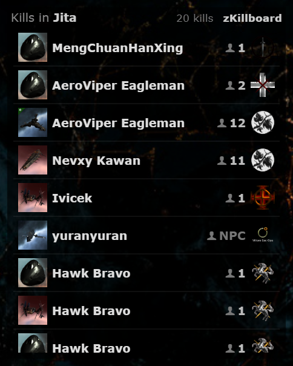
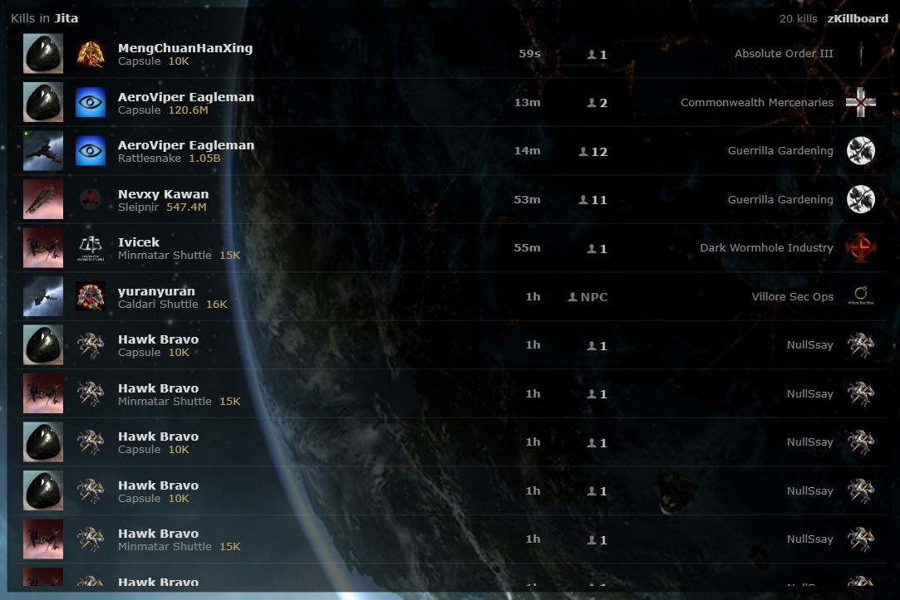

# System Kill Feed

**Date:** 2026-10-10

## Description

A new "Kills" panel in the layout shows the 20 most recent kills in the system you are viewing: victim ship, victim
corporation and pilot on the left, the final blow's corporation and the number of pilots involved on the right, with
time and value, each linking to zKillboard. To serve it (and later features) without more zKillboard traffic, all
zKillboard/ESI access now goes through one pooled server module that only the existing feed worker uses.

## Before / After

| Before | After |
| --- | --- |
|  |  |

The panel (2x; also the What's New image), at its narrowest and in a wide layout:

| Narrow | Wide |
| --- | --- |
|  |  |

## Settings

Toggle: Settings > General Preferences > "System kill feed" (on by default), stored in `options.systemKillFeed.enabled`
(missing = on). Off removes the panel from the layout and stops all its requests; applied on Save, Settings > Reset
turns it back on.

## Change

- **Panel** `app/js/fork/system-killfeed.js` + `app/css/fork/system-killfeed.css`: a gridster widget added from fork
  JS (`grid.add_widget`), so it takes part in Customize layout and is saved in `options.grid` like the built-in panels.
  A saved layout without it (older layouts) places it right of the top row when the window has room, otherwise under
  the chain map. It follows the viewed system (wraps `tripwire.systemChange`) and shows the last 24 hours: it reads
  what the server has at once and asks it to back-fill only after the system has been viewed for 1 s, so clicking
  through systems queues nothing. It refreshes every 90 s (every 4 s while the server is back-filling or resolving
  names), pauses while the tab is hidden, and drops secondary details as the panel narrows (value, ship line, corp
  logo/time) and shows the final blow's corporation name when wide. Loading, empty ("No kills in the last 24 hours."),
  feed-off, "feed behind by …", "server busy" and error states. All external text is escaped.
- **Endpoint** `public/system_kills.php` (new, logged-in users, GET only): `systemID` and/or `systems` (≤ 200, real
  solar systems only), `pastSeconds`, `limit` (≤ 50), `since` (cursor for incremental polling, like `kills.php`),
  `source=panel|chain` (back-fill priority), `queue=0|1`. Reads the database only; queues back-fills and unknown
  names for the worker; never fails because zKillboard or ESI are down (it returns what is stored, with per-system
  `complete` / `pending` / `queueFull` flags and the stream's lag).
- **Pooled zKillboard integration** `zkill/` (new, see [docker/README.md](../../docker/README.md#zkillboard-integration)):
  one HTTP client (User-Agent, per-host spacing, 429 `Retry-After`, backoff, a 10-minute block on 403 or a non-JSON
  answer, ESI error and rate limits, versionless ESI routes), new tables `zkill_killmails` (all kills from the stream,
  `ZKILL_RETENTION_HOURS`, default 48 h, with a since-cursor id), `zkill_state` (stream coverage and high-water mark),
  `zkill_backfill` (per-system queue with priority, global/per-user caps), `zkill_names` (ESI name cache); DDL in
  `docker/sql/zkill.sql`. Valid system IDs: `zkill/system_ids.php`, generated from `public/js/combine.js` by
  `zkill/tools/generate-system-ids.js`. Tests: `zkill/tests/zkill_test.php`.
- **Worker** `zkill_feed.worker.php`: now uses the module's HTTP client, also stores every killmail in
  `zkill_killmails`, records the stream's high-water mark, and only while it is caught up drains the back-fill queue
  (zKillboard API, one request per `ZKILL_API_INTERVAL` s, default 2; jobs bounded by 10 s timeouts and an 8 s ESI
  budget) and the name queue (ESI `POST /universe/names`). Kill Reporting is unchanged:
  `zkill_kills` is still filled only from the stream, for chain systems, so back-filled kills never cause sounds or
  pop-ups, and `public/kills.php` is untouched.
- **Config**: `ZKILL_RETENTION_HOURS`, `ZKILL_API_INTERVAL` in `docker/config.php`, `.env.example`, both compose files
  and the docker README; `docker/Dockerfile` leaves `zkill/tests/` and `zkill/tools/` out of the image.
- **Third parties** (AGENTS.md section 6): the browser loads ship icons and corporation logos from `images.evetech.net`
  and links to `zkillboard.com`; the server (worker only) calls `zkillboard.com` (back-fills, besides the existing
  R2Z2 feed) and `esi.evetech.net` (killmails, names). No analytics or tracking.
- **Security** (AGENTS.md section 6): `system_kills.php` is a GET with a side effect (it can queue a back-fill and
  unknown names). Like upstream's endpoints it has no CSRF token, so another site could make a logged-in user's
  browser queue work. That is bounded: only real solar systems, one deduplicated row per system, at most 800 queued
  back-fills from the panel and 1000 including chain requests, 250 / 500 per user, and the worker drains them at its fixed, rate-limited pace, so the worst case
  is a delayed queue, not more zKillboard traffic than the limits allow.
- **Deterministic bundles**: `docker/gulpfile.dev.js` (used by the dev `assets` watcher) now expands each `gulp.src`
  glob into a sorted file list, so bundles keep main's script order instead of depending on file-system order;
  the `tripwire-feature` skill now rebuilds with
  `npx gulp --gulpfile docker/gulpfile.dev.js --cwd /src js css` and says bundles must keep main's line order.
- **Upstream files touched**: none. The panel is added from fork JS; `tripwire.php`, `layout.js`, `options.js` and
  `systemChange.js` are unchanged (wrapped from outside). Rebuilt bundles: `public/js/app.min.js`, `public/css/app.min.css`.
