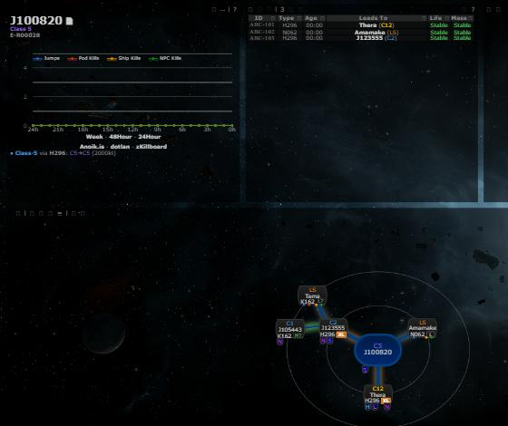
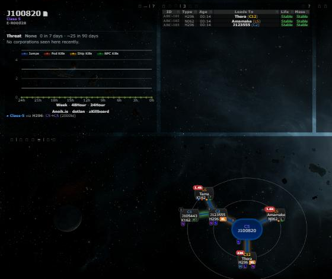
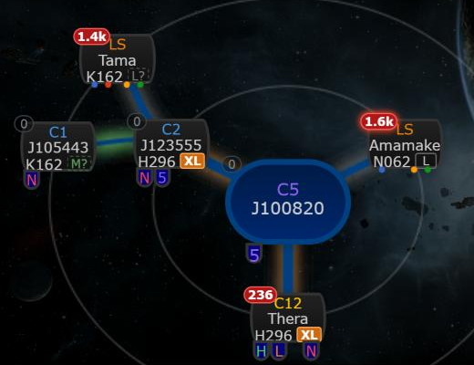
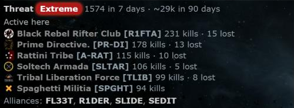

# System Threat

**Date:** 2026-10-10

## Description

Every system on the chain map gets a small heat badge with its recent kill activity (kills in the last 7 days,
coloured from quiet grey to red, glowing after a kill in the last hour), and the system info panel gets a "Threat"
line plus the corporations active in the viewed system, flagging likely residents and structure losses. It answers
"is this hole lived in / hunted?" at a glance, like WormholeSystems or Wayfinder.

## Before / After

| Before | After |
| --- | --- |
|  |  |

Badges (also the What's New image) and the info panel block for a busy system:

| Badges | Info panel |
| --- | --- |
|  |  |

## Settings

Two toggles, both on by default, missing key = on, applied on Save, back on after Settings > Reset (reset is
temporary until saved, like every other setting):

- Settings > Chain Map Settings > "Threat badges" (`options.systemThreat.enabled`): off removes the badges and stops
  the chain requests.
- Settings > General Preferences > "System threat & residents" (`options.systemResidents.enabled`): off removes the
  block from the system info panel and stops its requests.

## Change

- **Badge** (`app/js/fork/system-threat.js` + `app/css/fork/system-threat.css`): wraps `chain.nodes` (like size tags)
  and puts the badge on the node's top-left corner; real solar systems only (no unknown destinations, no route
  destination nodes). Count = zKillboard's kills in the last 7 days; level by kills per day (none / low < 0.5 /
  moderate < 2 / high < 6 / extreme), raised by a busier last 24 h from the stored kills. Without zKillboard stats yet
  it falls back to the stored kills of the retention window (`ZKILL_RETENTION_HOURS`), as far back as the stream has
  every kill. Tooltip: 1 h / 24 h / 7 d / ~30 d / ~90 d (30/90 days estimated from zKillboard's monthly totals), last
  kill, age of the stats. Refreshed every 5 minutes and when the chain changes; badges are patched into the drawn map
  without a redraw.
- **Info panel block** (above the activity graph): level, 7-day count, ~90-day estimate; up to 6 corporations
  active here (7-day top lists from zKillboard merged with final blows and losses of the stored kills) with "likely
  resident" tags, the top alliances, structures lost in the retention window (Upwell structures, customs offices,
  skyhooks, Metenox drills, basic control towers). Likely resident: lost a structure here; in C1-C6 / C13 wormholes
  also "both killed and lost ships here" or "lost 3 or more". In k-space only structure losses flag anyone (busy gate
  systems are full of corporations that both kill and die). The 7-day top lists only contain attackers, and losses
  are only known for the retention window, so it is a hint, not a census.
- **Server**: `zkill/stats.php` (new) caches zKillboard's per-system stats
  (`/api/stats/solarSystemID/<id>/kills/`, verified against zKillboard's `view/apistats.php`: `activepvp` and
  `topLists` cover the last 7 days, `months` are monthly totals) in the new table `zkill_system_stats` (also the queue;
  DDL in `zkill/schema.php` / `docker/sql/zkill.sql`, created on first use like the other `zkill_*` tables), fresh for
  12 h, caps 400 queued overall / 200 per user. `zkill/threat.php` (new) reads local counts, residents and structure
  losses. `public/system_threat.php` (new, logged-in users, GET only, same checks as `system_kills.php`) reads the
  database and queues stats, a back-fill of the viewed system and unknown names; never calls zKillboard or ESI.
- **Single pooled zKillboard integration**: the stats are fetched only by the existing feed worker,
  `zkill_feed.worker.php` (one added line: `zk_stats_run_one()` runs when `zk_backfill_run_one()` had nothing to
  do), through the same HTTP client, User-Agent and `ZKILL_API_INTERVAL` budget, only while the stream is caught up and
  no back-fill is waiting. No new worker, cron job, per-request call or browser call to zKillboard / ESI.
- **Third parties** (AGENTS.md section 6): no new host. The server calls `zkillboard.com` as before (one more API
  route, same integration); the browser loads corporation logos from `images.evetech.net` and links to
  `zkillboard.com`, like the kill feeds.
- **Security**: like `system_kills.php`, the GET can queue work without a CSRF token; bounded to real systems, one
  deduplicated row per system and the caps above. All zKillboard / ESI text is escaped.
- **Tests**: `app/js-test/fork/system-threat.test.js` (levels, month estimates, summaries, badges, node decoration,
  residents, info block, settings), `zkill/tests/stats_test.php` (stats compaction, queue decisions, caps, resident
  aggregation).
- **Docs**: `docker/README.md` (System stats section, file table, tables list).
- **Upstream files touched**: none. Fork files changed: `zkill_feed.worker.php`, `zkill/zkill.inc.php`,
  `zkill/schema.php`, `docker/sql/zkill.sql`, `docker/README.md`. Rebuilt bundles: `public/js/app.min.js`,
  `public/css/app.min.css`.
