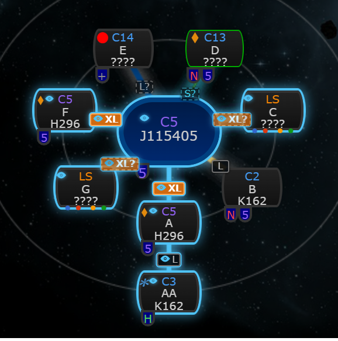
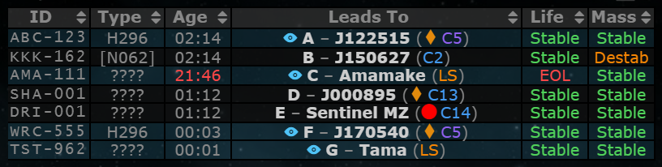
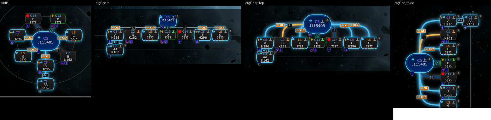
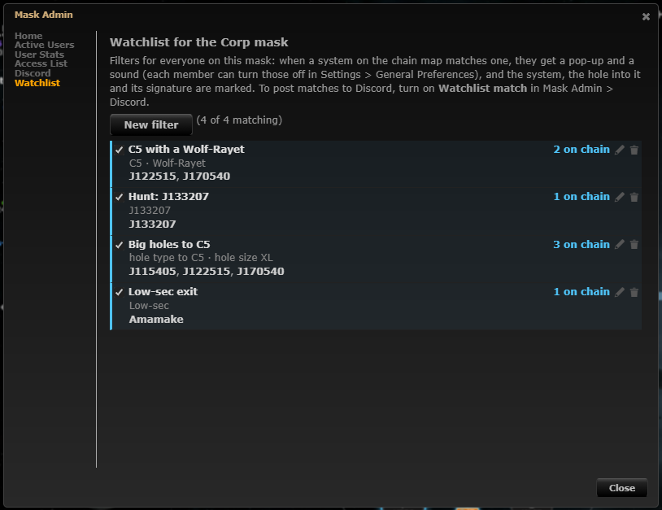
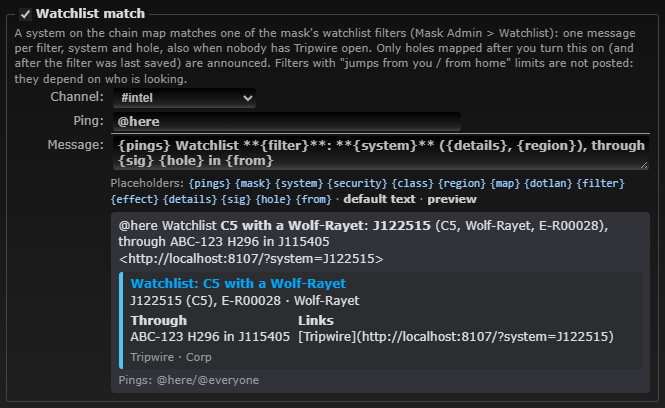

# Watchlist

**Date:** 2026-10-10

## Description

A Watchlist for the corporation: its Tripwire admins keep named filters per mask in Mask Admin > Watchlist ("C5 with a
Wolf-Rayet", "J123450", "anything on an H296 within 3 jumps of me"). Everyone on the mask is told when the chain map
has a match (pop-up and sound, once per match), the system, the hole into it and that hole's signature are marked, and
the new Discord type "Watchlist match" posts matches even when nobody has Tripwire open.

The first version of this change (same PR) kept filters per user in the user's options; at the user's request they
now belong to the mask and are set by the corporation's admins, alerts go to everyone on the mask (each member can
turn the sound, pop-ups and marks off), matches are posted to Discord, and the hole is highlighted.

## Before / After

| Before | After |
| --- | --- |
|  |  |

After: four of the mask's filters match; each new match got a pop-up (top right). Matching nodes are outlined with an
eye in their top row, the hole that makes the match (or the hole into the matching system) is drawn in light blue with
an eye next to its size tag, and its signature in the viewed system is tinted with an eye in the Leads To cell.

| The highlighted hole | The signature table |
| --- | --- |
|  |  |

The same in the four chain renderers (radial, org chart, top-down, side-ways):

Mask Admin > Watchlist (admins), the editor, and the panel (members without the admin flag see it read-only):

| Mask Admin > Watchlist | Editor |
| --- | --- |
|  |  |

Mask Admin > Discord > Watchlist match with its preview, and what the local `discord-mock` received
([discord-payload.json](discord-payload.json)) after a hole to a Wolf-Rayet C5 was mapped:

## Settings

Per user: Settings > General Preferences > Watchlist: "Show the Watchlist panel", "Pop-up for a new match", "Mark
matches on the chain map and signatures", "Sound for a new match" with the tone (Kill Reporting's tones). All on by
default; stored in `options.watchlist` (`enabled`, `popups`, `markers`, `soundEnabled`, `sound`; a missing key means
on / chime); Settings > Reset removes the key (all on again).
Per mask: the filters (admins, Mask Admin > Watchlist; a filter can be paused for everyone) and the Discord type
(off until an admin turns it on in Mask Admin > Discord, like every Discord type).

## Change

- **Filters per mask** (`watchlist/watchlist.inc.php`, new fork module; table `fork_watchlist`, one JSON row per mask,
  created on first use, reference DDL `docker/sql/watchlist.sql`): the corp mask and corporation-owned custom masks,
  the same masks and admins (`checkAdmin`) as the Discord notifications. `public/watchlist.php` (new): every member of
  the session's mask reads the filters (`GET`); admins save, delete and pause them (`POST` JSON with a per-session
  CSRF token header, `X-Requested-With`, same-origin check, like `public/discord.php`). The server normalises
  conditions with the browser's rules, checks IDs and wormhole types against `watchlist/data.json`, and stamps
  `updatedAt` / `updatedBy`. Other masks (Private, Public, alliance, personal custom masks) have no watchlist.
  Per-user filters (`options.watchlist.filters`) are gone (the feature was never released) and ignored.
- **Browser** (`app/js/fork/watchlist.js`): loads the mask's filters (and again every minute and when the tab comes
  back), matches them on every chain draw, keeps the timestamped "already announced" keys per mask and chain tab as
  before, and per the user's settings shows pop-ups, plays the sound and marks matches: the node (eye in its top row),
  the hole (`watchlist-hole` line class, read by all four renderers; an eye in the connection's size tag, or an eye
  tag alone when there is no size tag, with the filter names in its tooltip) and the hole's signature row in the
  signature table. A filter with hole conditions marks the holes that make the match; one on the system only marks the
  hole the chain map reaches the system through. The panel is read-only for members; admins get New filter / edit /
  pause / delete there and in the new Mask Admin > Watchlist page (same editor; shown only where the Discord page is).
  The chain map hook is installed again on ready when another feature wrapped `chain.nodes` after it, so the marks go
  on last (after size tags rebuild `node.sizeTag`).
- **Discord type "Watchlist match"** (`discord/watchlist.php`, new): `discord_notify.worker.php` matches each mask's
  filters against every wormhole of the mask every 15 s (no new worker). One message per filter, system and hole (the
  oldest hole of the system that makes the match), deduped through `discord_enqueue_once` / `discord_dedupe_once`
  (`wl:<filter>:<system>:<wormhole>`); only holes changed after the type was turned on and after the filter was last
  saved or turned on are announced; filters with jump limits are skipped (they depend on who is looking). Template
  placeholders `{filter}`, `{system}`, `{class}`, `{effect}`, `{details}`, `{region}`, `{sig}`, `{hole}`, `{from}`,
  `{map}` (link from `TRIPWIRE_DOMAIN`, not request headers); filter names and game data escaped,
  `allowed_mentions` only from the admin's ping/template. Fork files touched: `discord/discord.inc.php`,
  `discord/settings.php`, `discord/template.php`, `discord_notify.worker.php`, `public/discord.php` (preview sample),
  `app/js/fork/discord-notifications.js`.
- **One matcher, two languages**: `watchlist/watchlist.inc.php` ports `normaliseConditions`, `classKeys`,
  `leadsToKeys`, `matchEntry`, `entriesFromLinks` and `match`; both run the shared cases in
  `watchlist/tests/cases.json` (normalisation, classes, leadsTo incl. Drifter J-codes, sizes, entries, 33 match cases)
  from mocha and from `watchlist/tests/watchlist_test.php` (110 checks, plus validation, links from DB rows, which
  matches are new for Discord, the message, escaping and mentions, the type's settings). Static data:
  `watchlist/data.json`, generated from `public/js/combine.js` by `watchlist/tools/generate-watchlist-data.js`.
- `app/js/fork/size-tags.js`: `tagHtml` draws the watchlist eye (escaped filter names in the tooltip) when the watchlist
  set `sizeTag.watchlist`; otherwise unchanged.
- `app/css/fork/watchlist.css`, `app/js-test/fork/watchlist.test.js` (shared cases, settings, holes, size tag eye),
  `docker/README.md` (#watchlist, the Discord type, the new table), `docker/Dockerfile` (`watchlist/tests` and
  `watchlist/tools` left out of the image), rebuilt `public/js/app.min.js` and `public/css/app.min.css`.
- Upstream files touched: none (besides the rebuilt bundles). No new data sources or third-party hosts (Discord only
  through the existing worker and outbox).

## Limitations

- The server matches the mask's whole chain (every wormhole of the mask); the browser matches the chain map as drawn
  (from the chain tab's home). Sizes on the server come from known hole types only (the browser also guesses from the
  system classes, like the size tags).
- Shattered C1-C6 systems aren't marked in Tripwire's data, so "Shattered" means C13 and the Drifter systems.
- Members see filter changes within a minute (or when they come back to the tab).
