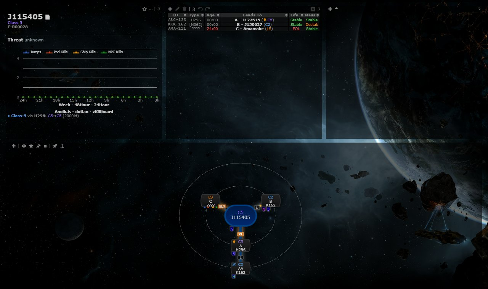
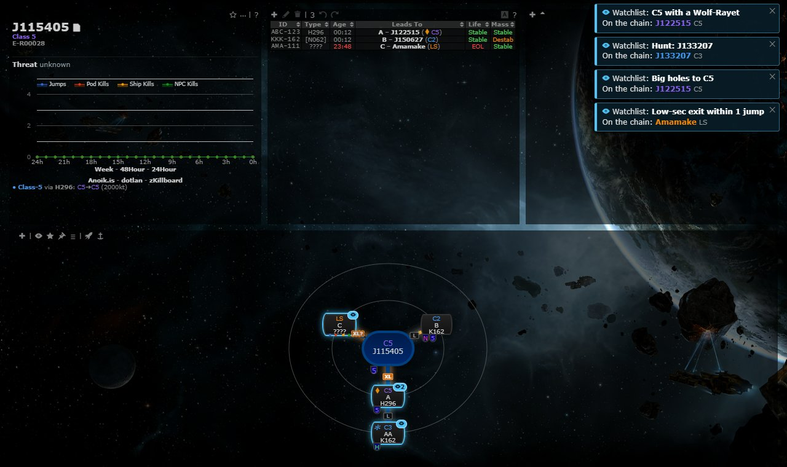
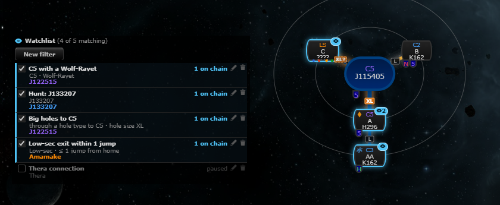
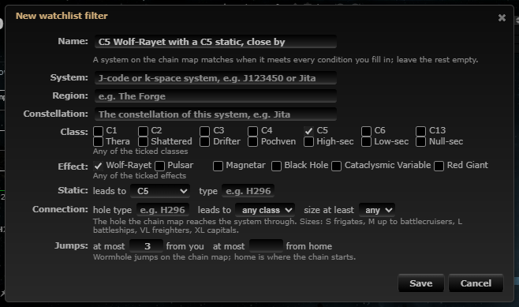

# Watchlist

**Date:** 2026-10-10

## Description

A new Watchlist panel where each user keeps named filters ("C5 with a Wolf-Rayet", "J123450", "anything through an
H296 within 3 jumps of me"). Tripwire matches them against every system and connection on the chain map whenever the
chain changes; a new match shows a pop-up and plays a sound once, and the matching nodes get a marker naming the
filter.

## Before / After

| Before | After |
| --- | --- |
|  |  |

After: four filters match; each new match got a pop-up (top right), the matching nodes are outlined with an eye
marker (the number is how many filters match it; the tooltip names them).

| Panel | Editor |
| --- | --- |
|  |  |

## Settings

Toggle: Settings > General Preferences > "Watchlist: Show the Watchlist panel and alert when the chain has a match"
(on by default), plus "Alert sound" (a Kill Reporting tone or no sound; default chime). Off removes the panel, the
markers and the pop-ups and stops matching. Stored in `options.watchlist.enabled` / `.sound`; a missing key means on /
chime. Settings > Reset restores both and keeps the filters (they are the user's data, not a preference).

## Change

- `app/js/fork/watchlist.js` (new): pure logic in the `watchlist` global (settings and filter normalisation, class
  keys, matching, chain model, new-vs-seen diff, node marker, editor form parsing, descriptions), plus the panel,
  the editor dialog, pop-ups, sound and the settings row.
- Filters live in `options.watchlist.filters` (per user, max 50): `{id, name, enabled, conditions}`. Conditions, all
  of which must match (an empty filter never matches):
  - `systemID` (J-code or any system, typed by name with autocomplete), `regionID`, `constellationID` (picked as
    "the constellation of system X": Tripwire has no constellation names);
  - `classes` (any of C1-C6, C13, Thera, Shattered = C13 + Drifter systems, Drifter, Pochven, HS/LS/NS as the app
    classifies security) and `effects` (any of the six);
  - `staticLeadsTo` (a static leading to a class) and/or `staticType` (e.g. H296);
  - connection (the hole the chain map reaches the system through): `whType`, `whLeadsTo` (the type's destination
    class), `minSize` (the size tags' S/M/L/VL/XL; guessed from the system classes when the type is unknown, like the
    size tags);
  - `maxJumpsMe` (wormhole jumps on the chain from the tracked character; no match while the location is unknown or
    off the chain) and `maxJumpsHome` (from the chain's root).
- Matching wraps `chain.nodes`: every chain build (sync, redraw) matches real systems on the map (not calculated
  gate-route nodes, destination nodes or unknown "Class-5"-style systems), marks matching nodes (outline + eye badge
  with a tooltip, top-right corner; threat badges are top-left) and announces matches whose `filterID|systemID` key
  wasn't there at the previous build of the same mask and chain tab. A match that disappears and comes back is
  announced again; the "seen" keys are kept per mask + tab in memory and `sessionStorage` (a reload in the same tab
  doesn't repeat them; a new tab announces current matches once). An empty chain (still loading) doesn't reset them.
  When a filter uses "jumps from you", the chain is re-matched when the tracked character moves.
- Pop-ups (one per filter, top right, 15 s, dismissable) list the new systems; the sound is played through
  `killReporting.play` (its tones).
- Filter names and all user text are escaped in the panel, pop-ups, node tooltips and editor errors.
- `app/css/fork/watchlist.css` (new), `app/js-test/fork/watchlist.test.js` (new, 69 tests), rebuilt
  `public/js/app.min.js` and `public/css/app.min.css`.
- Upstream files touched: none (besides the rebuilt bundles). No new data sources or third-party hosts.

## Limitations

- Shattered C1-C6 systems aren't marked in Tripwire's data, so "Shattered" means C13 and the Drifter systems.
- Filters are per user; sharing them with the mask and Discord alerts are follow-ups.
