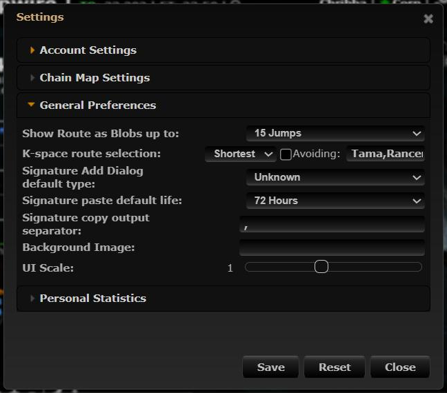
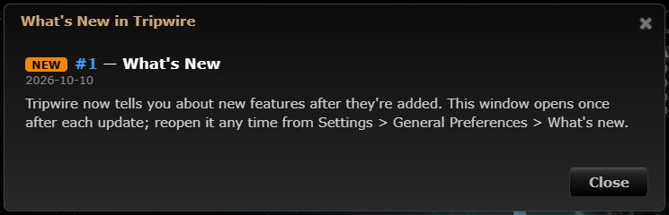
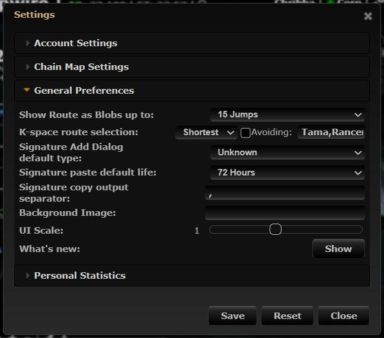

# What's New

**Date:** 2026-10-10

## Description

Users now learn about features added to this fork: a "What's New in Tripwire" window opens once after
an update that adds a feature, and can be reopened from Settings > General Preferences > What's new.

## Before / After

| Before | After |
| --- | --- |
|  Settings window, no What's New |  The window that opens after an update |
| |  New Settings row to reopen it |

## Change

- `public/whats-new/features.json`: the list of announced features (one entry per PR, keyed by PR
  number); screenshots go in `public/whats-new/img/`.
- `app/js/whats-new.js`: loads the list on page load, opens the window when there is a feature newer than
  the user's `options.whatsNew.lastSeenPR`, saves that value (per user, via `options.php`) when the
  window is closed, and adds the "What's new: Show" row to Settings > General Preferences.
  The window's DOM and the Settings row are injected from JS.
- Fixes Settings > Reset, which always failed upstream (it threw on `options.userID`, which has no
  default): `options.reset()` is wrapped to keep keys without defaults, including the What's New seen state.
- `app/css/whats-new.css`: window styling. `app/js-test/whatsNew.test.js`: unit tests.
- `public/js/app.min.js`, `public/css/app.min.css` (+ maps): rebuilt bundles.
- `AGENTS.md`: new rule 2, "Announce user-facing features in What's New".
- Deployment (fork-owned files): nginx sends `Cache-Control: no-cache` for JS/CSS/JSON. Upstream loads
  `app.min.js?v=<upstream version>`, which doesn't change when this fork ships code, so browsers kept
  running stale bundles. PHP sessions now live in a `php-sessions` volume (dev and prod compose) so
  updating the image no longer logs everyone out.
- Dev tooling: `docker/dev-seed.sh` creates a local login without EVE SSO; dev PHP errors go to the log
  instead of the page.
- No other upstream files touched. No third-party calls (links to the fork's GitHub PRs open only on click).
