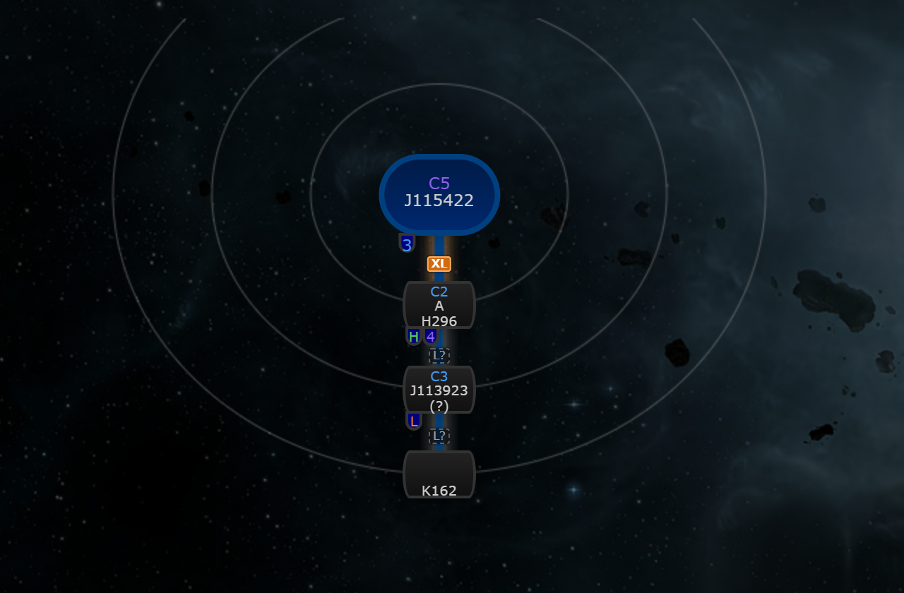
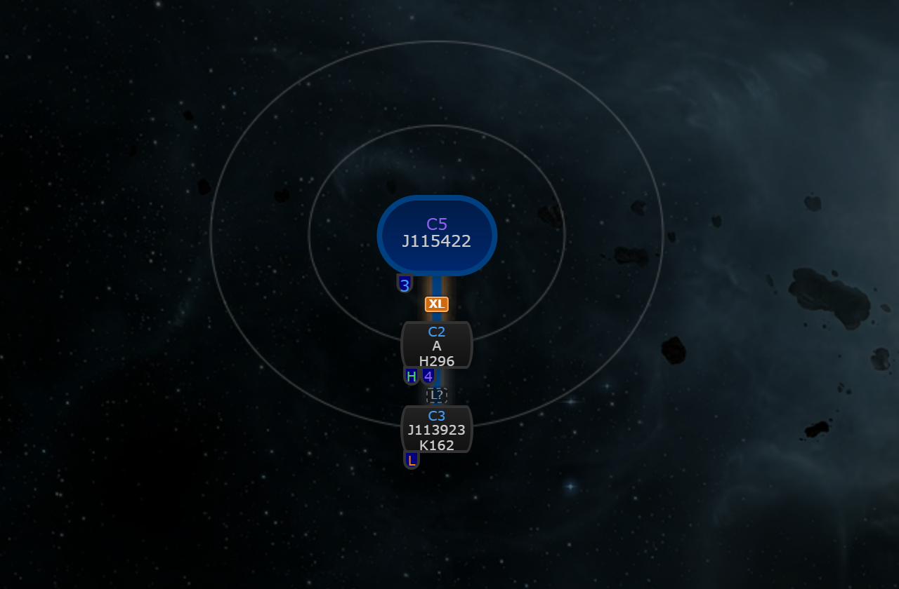
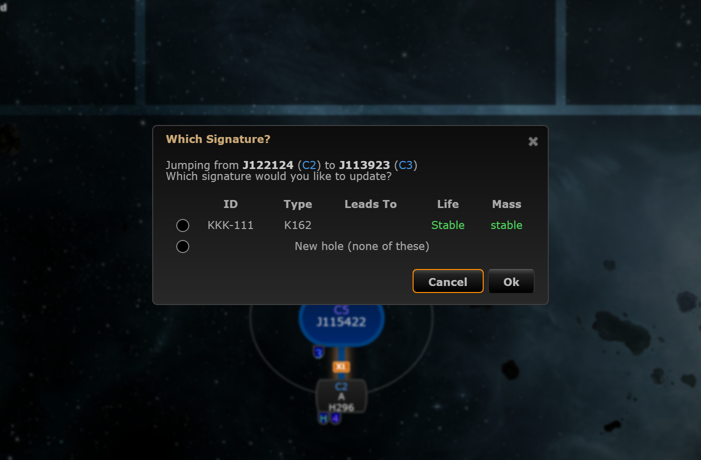

# Automapper and sync fixes

**Date:** 2026-10-11

## Description

Six bug fixes around the automapper, undo and sync, one commit each: a re-jump no longer creates a second "???"
hole, automapper undo lands on the right system, same-second edits reach other clients, two pilots jumping together
make one connection, undo works after a dialog add, and data/relic/ore/gas/combat signatures count down to expiry.

## Before / After

Re-jump: the pilot jumps J122124 to J113923, where a K162 was already scanned with its Leads To unset (jump simulated,
no ESI in dev). Before: a second blank hole "???" is created and the scanned K162 stays dangling. After: because a
K162 with no Leads To is not certain to be the hole just used, the existing "Which Signature?" picker offers it plus
"New hole"; choosing it links the K162 to J122124 with no extra hole (a single candidate is linked without asking only
when its Leads To is exactly the origin system, or its known hole type leads to exactly the origin's class).

| Before | After |
| --- | --- |
|  |  |

The picker (after):

## Settings

No toggle: bug fixes, no setting anyone would want to turn off.

## Change

1. **Re-jump duplicate hole.** `wormholesForJump` only matched holes that start in the system jumped from. Now, when
   nothing matches, `automapperRejump.holesIntoDestination` (new `app/js/fork/automapper-rejump.js`, pure, mocha tests)
   finds holes with a signature in the destination whose other side is unset or a compatible generic Leads To
   (class / type / known hole type; K162 fits anything). One match is linked (the unset side gets the origin
   system). Safety rule: a single candidate is linked without asking only when its Leads To is exactly the origin
   system or its hole type is known (on the destination side) and leads to exactly the origin's class; any other
   single candidate, and several candidates, open the existing "Which Signature?" picker with those candidates plus
   "New hole". No candidate creates a new hole as before. The jump's from/to now travel in the automap payload and
   `signatures.php` uses them for the mass log (a re-jump can link a hole whose initial signature is in the
   destination, which used to record the jump reversed).
2. **Undo on the wrong system.** The automapper pushed undo entries onto `viewingSystemID`; they now go on the
   viewed system when it is one of the jump's systems, else the system jumped into (`app/js/fork/automapper-undo.js`).
3. **Same-second edits.** `refresh.php` resends signatures only when the client's newest modifiedTime is older than
   the database's (1 s resolution). After an action whose response omitted the list, the next request declares
   itself stale so the list comes back whole (`sync.js`). Adapted from mogglemoss/tripwire cf69a9b (MIT); the server
   side is unchanged. The full-sync flag is cleared only when the full list arrives, not when the request is built.
4. **Duplicate automapped connections.** A per-pair, per-mask MySQL `GET_LOCK` plus a "connection already exists"
   check in the automap add path of `signatures.php`, released in `finally` (connections can be persistent); the
   second request returns success without results. Adapted
   from mogglemoss/tripwire 30738532 (MIT). `tests/automap_dedupe_test.php`.
5. **Undo after a dialog add.** `addSignature` read `lastInsertId()` after the statistics upsert (which resets it), so
   dialog adds came back with id 0 and undo failed; it is read first now. Also a whole "ABC-123", "ABC 123" or
   "abc123" typed or pasted into the first signature ID field splits across the two fields (3-character cap kept). Adapted from mogglemoss/tripwire 09bcb40 (MIT), only
   these two parts (no Tab absorbing, no "paste anywhere", no undo.js change). The dialog change has no before/after
   screenshot.
6. **Countdown on non-wormhole signatures.** Ported exactly as astriania/tripwire 655edf6 (MIT): `addSignature.js` uses
   `var wormhole;` (undefined for non-wormhole signatures) and `wormhole && wormhole.life != "stable"`. Note: our tree
   already started from `{}`, so non-wormhole signatures counted up before and still do; this is a behaviour-neutral
   alignment with upstream (no screenshot). `editSignature.js` is untouched.

Upstream files touched (small edits): `app/js/tripwire/automapper.js`, `app/js/tripwire/sync.js`,
`app/js/tripwire/addSignature.js`, `app/js/dialogs/signature-dialog.js`,
`tripwire.php` (ID field maxlength 3 to 7), `signatures.php`. New fork files: `app/js/fork/automapper-rejump.js`,
`app/js/fork/automapper-undo.js`, `app/js-test/fork/automapper-rejump.test.js`, `app/js-test/fork/automapper-undo.test.js`,
`tests/automap_dedupe_test.php`.

Tests: `npx mocha --recursive app/js-test` (2140 passing), `php tests/automap_dedupe_test.php` (21 checks).
