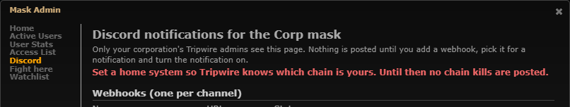
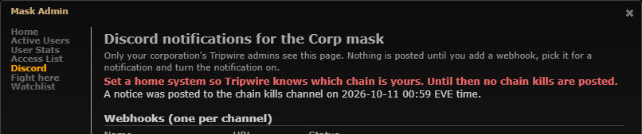
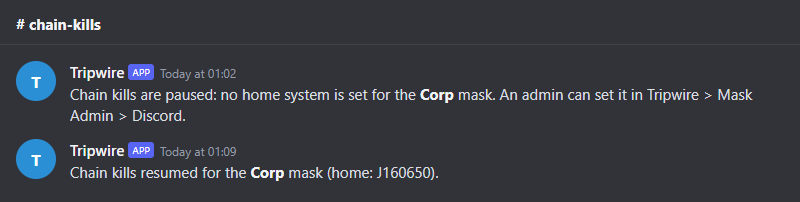

# Discord: notice when chain kills are paused (no home system)

**Date:** 2026-10-11

## Description

Since [chain kills only cover the home chain](../2026-10-10-chain-kills-connected/README.md), a mask with chain kills on
and no home system posts no chain kills at all. Mask Admin warned, but the Discord channel just went quiet. Now the
worker posts one notice to the chain kill channel when that happens, and one "resumed" line once a home is set.

## Before / After

| Before | After |
| --- | --- |
|  |  |

Before: nothing in Discord, only the warning in Mask Admin > Discord. After: the warning also says when the notice was
posted. What the channel shows (rendered from the payloads the dev stack's `discord-mock` received):

## Settings

No toggle. It is an admin-facing state message, not a feature: one message per "no home" episode, and it only fires
while the configuration is incomplete (chain kills on but posting nothing). The admin silences it for good by fixing
the cause (set a home) or turning chain kills off. An option to hide the one message that explains why the channel is
silent would mostly hide a misconfiguration.

## Change

- New fork file `discord/chain_notice.php`: `discord_chain_notice_poll()` runs in `discord_notify.worker.php` every
  15 s (k-space leader, masks with chain kills on and a working webhook). No home → one `chainPaused` message through
  the outbox: "Chain kills are paused: no home system is set for the **Corp** mask. An admin can set it in Tripwire >
  Mask Admin > Discord." The episode is a `discord_sent` row (kind `nohome`, ref `wh:<webhookID>`), claimed with the
  enqueue in one transaction (`discord_enqueue_once`), so repeated passes or a second worker post nothing.
- The episode ends when a home is set, chain kills are turned off or moved to another channel, or the mask/webhook can
  no longer send, or the webhook's URL is replaced in Mask Admin (`discord_chain_notice_forget_webhook`; the next pass
  posts a new notice to the new channel). With a home now on the same channel and the notice sent or still queued: one
  `chainResumed` message "Chain kills resumed for the **Corp** mask (home: J160650)." (the row delete is its claim).
  Otherwise (e.g. the notice failed) it ends silently. Removing the home again posts a new
  notice.
- Consistent with `discord_chain_systems()`: only "no home" (0) pauses chain kills. A home with no live holes on the map
  is a chain of one system (kills there still post); an unknown home ID is dropped when settings load, so it is "no home".
- Fixed texts, `allowed_mentions: {parse: []}` (the type's ping field is not used), mask/system names escaped
  (`discord_escape`). `discord_payload()` hands both kinds to `discord_chain_notice_payload()`.
- `discord_outbox_prune()` keeps `nohome` rows past the 7-day dedupe prune (else a long episode would re-post weekly).
- Mask Admin > Discord: `discord.php` returns `homeNotice` (`discord_chain_notice_status`); the "Set a home system"
  warning adds "A notice was posted to the chain kills channel on 2026-10-11 00:59 EVE time." (or "waiting to be sent"
  / "could not be sent"; "Chain kills paused since ..." once its outbox row is pruned). Failed notices are named in
  the Delivery list.
- Tests: `discord/tests/discord_test.php` (+5: texts, no pings, escaping), new `discord/tests/chain_notice_flow_test.php`
  (21 checks against the dev stack's MySQL, worker and `discord-mock`: no home → one notice; repeated ticks → no
  repeat; home set → resumed + reset; home removed again → new notice; chain kills off → nothing; channel moved;
  webhook URL replaced; failed notice → no resumed; prune keeps the episode; mask that can no longer send), `app/js-test/fork/discord-notifications.test.js` (+3).
- Docs: `docker/README.md#discord-notifications`.
- Existing installs: every mask that has chain kills on without a home gets the notice once after the update.

Files: `discord/chain_notice.php` (new), `discord/discord.inc.php`, `discord/template.php`, `discord/outbox.php`,
`discord/schema.php` (comment), `discord_notify.worker.php`, `public/discord.php`, `app/js/fork/discord-notifications.js`,
`app/css/fork/discord-notifications.css`, tests and docs. Upstream files touched: none.
