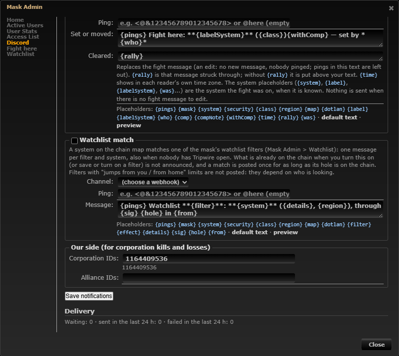
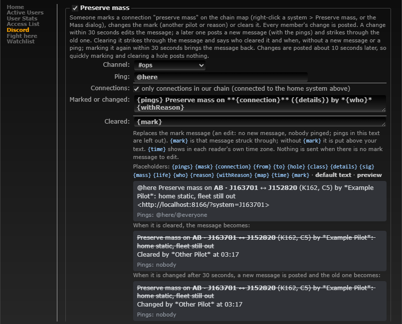

# Discord: preserve mass marks

**Date:** 2026-10-11

## Description

"Preserve mass" (#36) is now a notification type in Mask Admin > Discord, so the corporation hears when a chain
connection is marked, its mark changes (another pilot or reason) or it is cleared. Like Fight here, the message is
edited within 30 seconds, a clear strikes it through, and quick toggling posts nothing.

## Before / After

| Before | After |
| --- | --- |
|  |  |

## Settings

No per-user toggle: a preserve mass mark is a safety signal for the whole corporation ("don't jump this hole
carelessly"), so every member's change is posted, unlike Fight here's "Also post to Discord". The corporation's
admins turn the type on or off (off by default, like every Discord type) and choose its channel, ping and texts.
"Only connections in our chain" is on by default (consistent with chain kills): a new message is only posted for a
connection connected to the home system; untick it to post every marked connection of the mask.

## Change

- New `discord/preserve_mass.php` (type 7, key `preserveMass`): settings (`enabled`, `webhookID`, `template`,
  `templateClear`, `ping`, `chainOnly`), placeholders (`{connection}` "AB · J163701 ↔ J152820" with chain labels from
  `discord/chain_label.php`, `{from}`, `{to}`, `{hole}`, `{class}`, `{details}`, `{sig}`, `{mass}`, `{life}`, `{who}`,
  `{reason}`, `{withReason}`, `{map}`, `{time}`, `{mark}`), default texts "{pings} Preserve mass on **{connection}**
  ({details}) by *{who}*{withReason}" + link, and "{mark}" + "Cleared by *{who}* at {time}".
- `public/preserve_mass.php` decides on the server whether the flag changed (before / after the request; the same
  pilot and reason again is no change) and, after the response, queues it through the existing outbox. Rows wait
  10 s and a newer row of the same hole replaces an older one (debounce); the sender renders the flag as stored then.
- The sender (`discord/dispatch.php`) handles the rows like Fight here's: one live message per (mask, wormhole) in
  the new `discord_preserve_message` table; edit within 30 s, post + strike ("Changed by ...") later, clear = strike,
  re-mark within 30 s of a clear = the message comes back; edits never ping; `allowed_mentions` only from the admin's
  text and ping field; names, reasons and labels escaped. The worker prunes old message rows.
- Mask Admin > Discord: the type with channel, ping, chain option, both texts, placeholders and a preview (the mark,
  cleared and changed messages). The home-system warning also shows for this type while it is limited to the chain.
- Tests: `discord/tests/preserve_mass_test.php` (97 checks), end to end `tests/preserve_mass_discord_flow_test.php`
  against the dev worker and discord-mock (20 checks), mocha `discord-notifications.test.js` (+6).
- No upstream files touched. Fork files changed: `discord/template.php`, `discord/settings.php`, `discord/schema.php`
  (+ `docker/sql/discord.sql`), `discord/dispatch.php`, `discord/discord.inc.php`, `discord_notify.worker.php`,
  `public/discord.php`, `public/preserve_mass.php`, `preserve_mass.inc.php` (`preserve_mass_get`),
  `app/js/fork/discord-notifications.js`, `docker/README.md`. No new outbound hosts (Discord only, through the worker).
