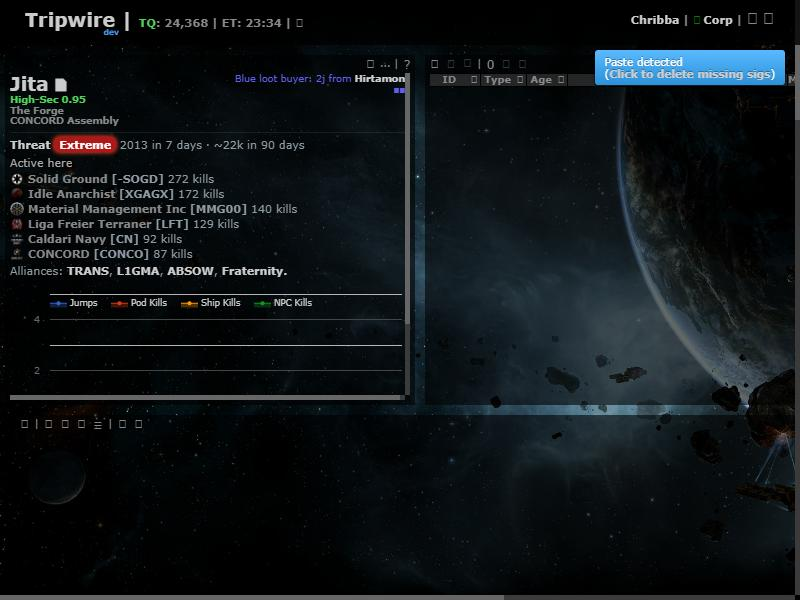
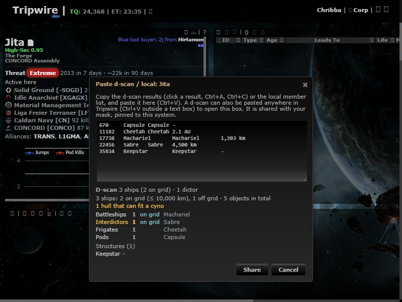

# Paste a d-scan anywhere

**Date:** 2026-10-11

## Description

Pressing Ctrl+V anywhere in Tripwire (outside a text box) with a d-scan on the clipboard now opens the
"Paste d-scan / local" dialog for the viewed system with the scan filled in and its preview shown. Nothing is
shared until the pilot clicks Share. Before, the paste went to the signature parser and showed the "Paste detected
(Click to delete missing sigs)" notice, where one click would have deleted every sig in the system.

## Before / After

| Before | After |
| --- | --- |
|  Ctrl+V of a d-scan: only the "Paste detected / delete missing sigs" notice |  The d-scan dialog opens with the scan and its preview; no sig notice |

## Settings

Toggle: Settings > General Preferences > D-scan & local intel > "Open the d-scan dialog when you paste a d-scan
anywhere (Ctrl+V)" (`options.intelScans.pasteDetect`, on by default; Reset turns it back on). Also off when the Intel
feature itself is turned off.

## Change

- `app/js/fork/intel-scans.js`: `looksLikeDscan(text)` (the first 50 non-blank lines are all modern d-scan rows:
  numeric type ID + name + type + distance; sig pastes, local lists, legacy 3-column rows and mixed pastes don't count;
  a d-scan too big to share still counts and the dialog shows the size error) and a capture-phase `paste` listener
  (`onPaste`) that only acts on upstream's hidden `#clipboard` box, so upstream's sig-paste handler never sees a d-scan. Pastes into real text boxes and every other paste behave as before. Local member lists are not
  auto-detected (they look like any text).
- Tests in `app/js-test/fork/intel-scans.test.js`.
- No upstream files touched.
