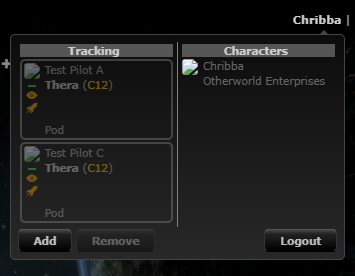
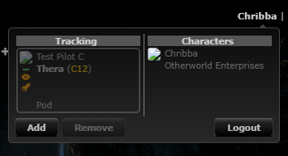

# Removing several tracking characters at once

**Date:** 2026-10-11

## Description

Fix: removing more than one ESI tracking character before the next refresh only deleted the last one server-side,
so the others came back on reload. The Remove handler checked `tripwire.data.esi.delete` (never set) but wrote
`tripwire.data.esiDelete`, so every removal replaced the pending list instead of adding to it.

## Before / After

Three fake tracking characters (A, B, C) seeded in the dev DB, A and B removed one after the other, then the page
reloaded. All ESI and EVE image requests were answered locally in the browser (no real ESI calls, fake tokens).

| Before | After |
| --- | --- |
|  |  |
| Sent `esiDelete: ["95000002"]`; Test Pilot A is still in the `esi` table and comes back | Sent `esiDelete: ["95000001","95000002"]`; only Test Pilot C is left |

Mocha (`app/js-test/fork/esi-remove.test.js`, real `tracking.js` + `tripwire.sync` + `sync-pending.js`): before the
fix 2 of 5 fail ("sends every character removed before the next refresh", "keeps the list after a failed refresh and
adds later removals to it"); after, 5 of 5 pass.

## Settings

No toggle, because this is a bug fix with no behaviour anyone would want to keep.

## Change

- `app/js/tracking.js` (upstream, one line, `// fork` marker): the `#removeESI` handler checks
  `$.isArray(tripwire.data.esiDelete)`, so removals append to the pending list.
- How the list travels (unchanged, checked): `tripwire.sync` merges `tripwire.data` into the `refresh.php` request;
  `refresh.php` deletes each `esiDelete` id for the user (scoped by `userID`) and returns the remaining characters.
  On success `tripwire.data` is reset, which clears the list; on a failed request it is kept and resent with the next
  refresh, and later removals now add to it instead of overwriting it. A removal made while a refresh is in flight is
  put back by `sync-pending.js` and sent next time (re-sending an id already deleted is a harmless no-op `DELETE`).
- New test `app/js-test/fork/esi-remove.test.js`.
