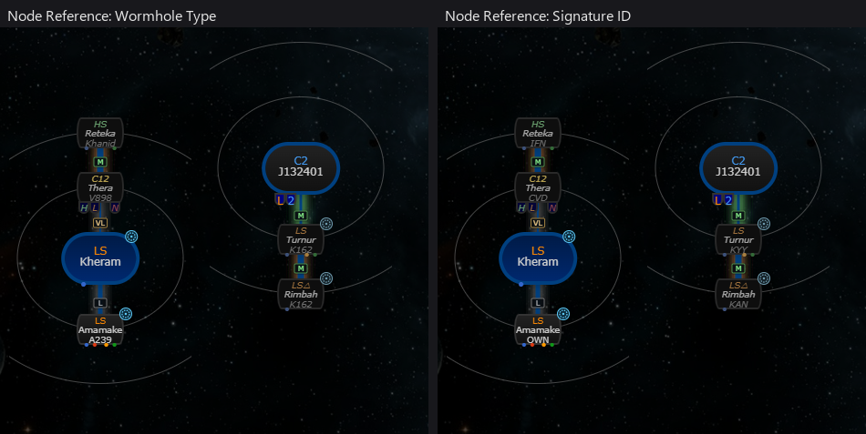

# EVE-Scout connections: signature and hole type from the same end

**Date:** 2026-10-11

## Description

Fix: on the chain map, an EVE-Scout (Thera/Turnur) node paired the signature ID of one end with the hole type of
the other end, so with "Node Reference: Wormhole Type" it showed the far side's type (V898 where your side is the
K162, and K162 where your side is the J377/N944). Each node now shows the signature in the system you jump from
and that signature's own type, the same way your own mapped holes do.

## Before / After

Stubbed EVE-Scout response (no live data): Kheram <-> Thera (V898 on the Thera side, CVD-320 in Kheram),
Thera <-> Reteka (T458 in Reteka, IFN-322 in Thera), J132401 <-> Turnur (J377 in J132401, KYY-030) and
Turnur <-> Rimbah (N944 in Turnur, KAN-600). Amamake is an own mapped hole (A239 / OWN-111 in Kheram) for comparison.
Left half: Wormhole Type; right half: Signature ID.

| Before | After |
| --- | --- |
|  |  |

Before: Thera shows V898 next to CVD (CVD-320 in Kheram is the K162), Turnur shows K162 next to KYY (the J377),
Rimbah K162 next to KAN (the N944). After: K162 / J377 / N944, matching the signature IDs.

## Settings

No toggle, because this is a bug fix: the overlay keeps its existing per-tab EVE-Scout switch.

## Change

EVE-Scout's API (`api.eve-scout.com/v2/public/signatures`, OpenAPI `signature_representation.yaml`): `out_signature`
is in the hub (`out_system_id`, Thera/Turnur), `in_signature` in `in_system_id`; `wh_exits_outward: true` puts
`wh_type` on the hub side and the K162 on the other side. Tripwire's chain map stores the signature in the parent
system on `node.child` (the child node's label) and the far one on `node.parent` (`chain-map.js` for own holes).
The signature IDs already followed that, but the two `type` values in each branch of `findLinks` were the other
way round; they are swapped back.

Upstream files touched: `app/js/map-data-suppliers/eve-scout.js` (4 lines, `// fork` markers) and its upstream test
`app/js-test/map-data-suppliers/eve-scout.test.js` (8 expected types, which encoded the mix-up). New fork test
`app/js-test/map-data-suppliers/eve-scout-sides.test.js` (Thera and Turnur, our system on either end, every end
pairs each ID with its own type).
