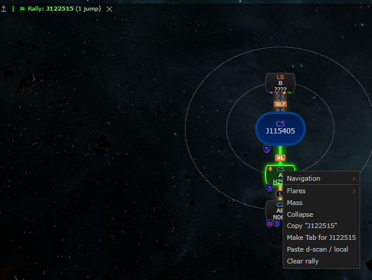
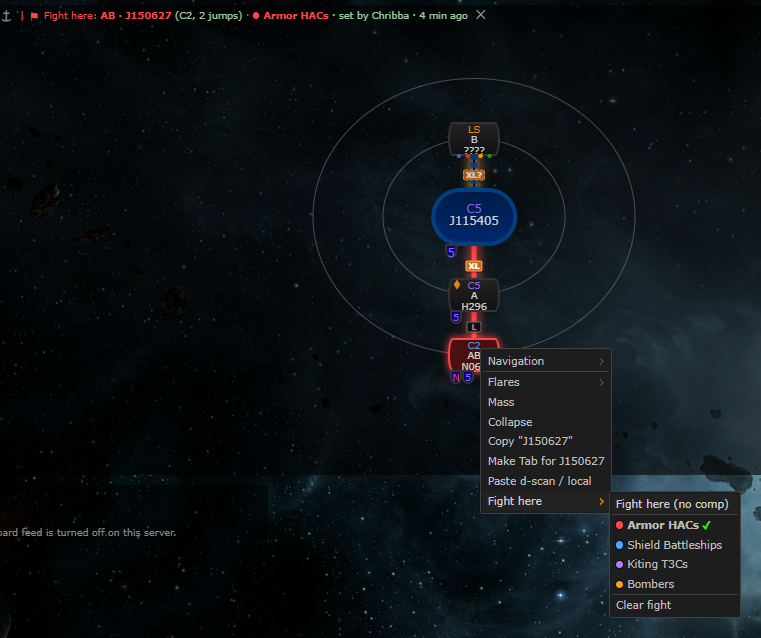
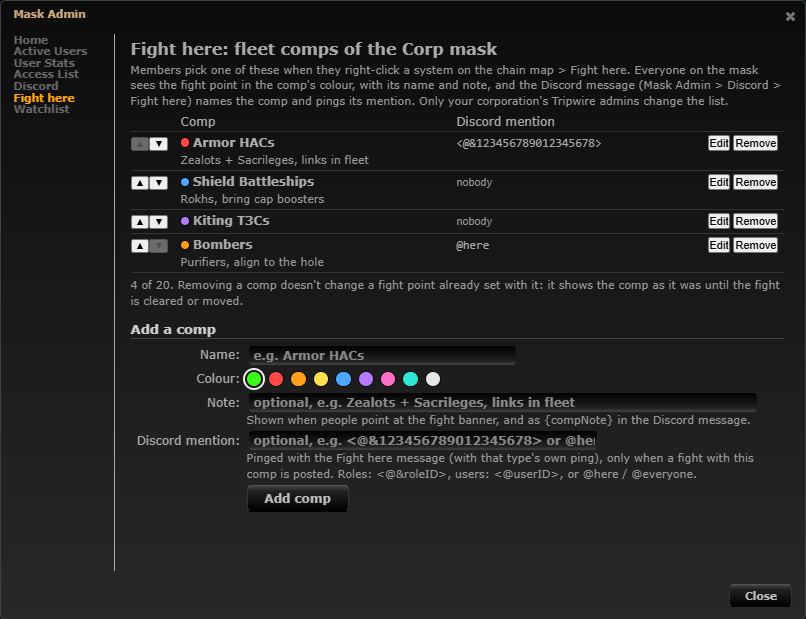
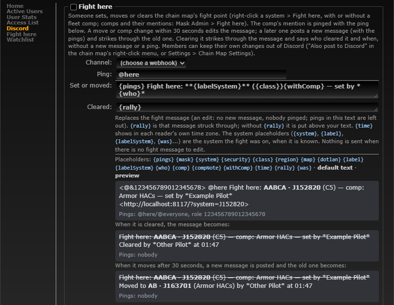
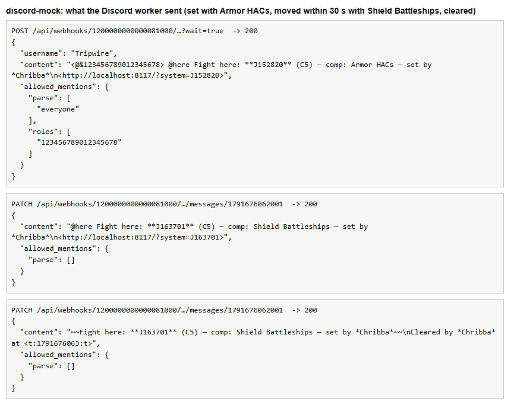
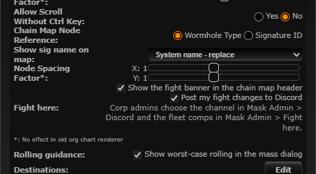
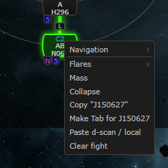
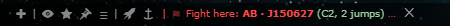

# Fight here: the rally point with fleet comps

**Date:** 2026-10-11

## Description

User request: "Extend the rally here feature … rename it to `Fight Here` … allow the button to have children and make
the values configurable — we have fleet comps and want to notify everyone which comp through the UI." The chain map's
rally point is now **Fight here**, with a submenu of the mask's fleet comps; corporation admins configure the comps in
the new Mask Admin › Fight here, and the banner, the node colour and the Discord message show the chosen comp.

## Before / After

Right-click a system (before: "Rally here" / "Clear rally"; after: "Fight here ▸" with the comps, and the banner):

| Before | After |
| --- | --- |
|  |  |

Mask Admin › Fight here: 

Mask Admin › Discord › Fight here preview (the mask's first comp, with its role mention): 

What reached the dev stack's Discord mock (`tests/fight_endpoint_test.php`): set with Armor HACs, moved within 30 s to
another system with Shield Battleships (an edit), cleared (struck through): 

```
POST  .../webhooks/1200000000000081000/…?wait=true
{"username":"Tripwire","content":"<@&123456789012345678> @here Fight here: **J152820** (C5) — comp: Armor HACs — set by *Chribba*\n<http://localhost:8117/?system=J152820>","allowed_mentions":{"parse":["everyone"],"roles":["123456789012345678"]}}
PATCH .../messages/1791676062001
{"content":"@here Fight here: **J163701** (C5) — comp: Shield Battleships — set by *Chribba*\n<http://localhost:8117/?system=J163701>","allowed_mentions":{"parse":[]}}
PATCH .../messages/1791676062001
{"content":"~~Fight here: **J163701** (C5) — comp: Shield Battleships — set by *Chribba*~~\nCleared by *Chribba* at <t:1791676063:t>","allowed_mentions":{"parse":[]}}
```

"Fight here (no comp)", then Armor HACs seconds later (its role must be pinged, edits never notify):

```
POST  …?wait=true                {"content":"@here Fight here: **J152820** (C5) — set by *Chribba*\n<…>","allowed_mentions":{"parse":["everyone"]}}
POST  …?wait=true                {"content":"<@&123456789012345678> @here Fight here: **J152820** (C5) — comp: Armor HACs — set by *Chribba*\n<…>","allowed_mentions":{"parse":["everyone"],"roles":["123456789012345678"]}}
PATCH …/messages/<first>         {"content":"~~Fight here: **J152820** (C5) — set by *Chribba*~~\nChanged to **J152820** (Armor HACs) by *Chribba* at <t:…:t>","allowed_mentions":{"parse":[]}}
```

(With a chain label the system reads e.g. **AB · J163701**, as in the preview; this mask's test systems have no hole.)

## Settings

- New per-user toggle: Settings > Chain Map Settings > Fight here > "Show the fight banner in the chain map header"
  (`options.fightBanner.enabled`, missing = on, applied on Save, cleared by Reset). The banner now carries more (comp,
  who, age), so members who don't want it can hide it; the system stays marked on the map. 
- Carried over and relabelled: "Post my fight changes to Discord" (`options.rallyDiscord.enabled`) and the "Also post
  to Discord" menu entry.
- Comps are admin configuration per mask, not a per-user setting.

## Change

- **Naming.** Everything users read says "Fight here" (menu, banner, notifications, Settings, Mask Admin › Discord type
  name and help, Discord default text, legacy webhook texts). Internal names stay `rally` (`public/rally.php`,
  `fork_rally`, Discord type key `rally`, `options.rallyDiscord`, CSS/JS identifiers): no data migration, saved
  settings keep working, and fewer moving parts.
- **Menu** (`app/js/fork/rally.js`): "Fight here ▸" with "Fight here (no comp)" (the old rally), a separator, one entry
  per comp (colour dot + name, note as tooltip, ✓ on the current one), a separator and "Clear fight" (only while a
  fight is set; names the system when it is elsewhere). Only when the mask has at least one comp; without comps the
  old one-click entry stays ("Fight here", or "Clear fight" on the fight's system): 
  "Also post to Discord" as before.
- **Banner**: "Fight here: AB · J150627 (C2, 2 jumps) · ● Armor HACs · set by Chribba · 4 min ago ✕", one line in the
  comp's colour, the text cut with an ellipsis rather than wrapping while ✕ stays visible (chain map 450 px wide:
  ); tooltip with the whole line and the comp's note. The chain
  label comes from the server (`discord_chain_label`, same as the Discord message); the age from the database clock.
- **Node and route** in the comp's colour in all four renderers (CSS custom properties per palette colour; the canvas
  renderers read them through `propertyFromCssClass`, the Google org chart through `td.rally-route.fight-c-*`). No comp:
  the old green.
- **Comps** (new `fight/fight.inc.php`, `public/fight.php`, `app/js/fork/fight-comps.js`): Mask Admin › Fight here for
  the same admins and masks as Mask Admin › Discord (corp mask + corporation-owned custom masks, `checkAdmin`); add,
  edit, reorder (▲▼), remove; at most 20; name required ≤ 40 (unique per mask), colour from a fixed palette of 9, note
  ≤ 140, Discord mention validated like the type's ping field (`discord_ping_normalise`). Stored in the new
  `fork_fight_comps` (JSON per mask, created on first use). Same CSRF token / `X-Requested-With` / JSON / `Origin`
  checks as `public/discord.php`; members read the list without the mentions.
- **Fight point + comp** (`public/rally.php`): `mode=set` takes an optional `compID`, looked up on the server (never a
  name or colour from the browser); a copy of the comp is stored in new `fork_rally` columns (`compID`, `compName`,
  `compColour`, `compNote`, `compMention`), added to existing tables the first time a fight point is set (unknown
  column → `ALTER TABLE`); reads use `SELECT *`, so older tables read as "no comp". A removed or renamed comp keeps
  showing on the fight until it is cleared or moved. Another comp on the same system is a change (Discord edit or new
  message). GET also returns the chain label and the comps.
- **Discord** (`discord/rally.php`, `discord/template.php`, `public/discord.php`): new placeholders `{comp}`,
  `{compNote}` and `{withComp}` (" — comp: Armor HACs" or empty; needed because templates have no conditionals). New
  default ``{pings} Fight here: **{labelSystem}** ({class}){withComp} — set by *{who}*`` + `{map}`; texts saved with the
  1.17 default ("Tripwire rally point from …") read as the new default (`discord_retired_templates`), edited ones are
  kept. `{pings}` = the comp's mention + the type's ping (each once); `allowed_mentions` only from those and the admin's
  text. Comp name and note are escaped like game data. The "Moved to" edit names the new comp; when only the comp changed on the same system it says "Changed to … (comp)"
  (`discord_rally_message` and the legacy `fork_rally_discord_message` get a `systemID` column, added on their first
  write). Within the 30 s window a change is an edit, except when it pings someone the live message didn't (a comp
  with a role picked after "no comp"): edits never notify, so it is posted as a new message with the pings and the old
  one struck through. The preview uses the
  mask's first comp (or an example). Legacy `DISCORD_WEB_HOOK` texts (`rally_discord.inc.php`) name the comp, no pings.
- **Tests**: mocha `app/js-test/fork/fight-comps.test.js` (31 tests: comp normalisation, menu entries and escaping,
  the one-click entry without comps, banner text/age/classes, admin form validation, node/route colours, banner toggle);
  `fight/tests/fight_test.php` (85 checks: validation, storage, removed comps, payload with comp + mention, new
  mentions within the window with and without `{pings}`, "Changed to", escaping, old-default upgrade, legacy texts);
  `tests/fight_endpoint_test.php` (42 checks on the dev stack: admin / non-admin 403 / CSRF / Origin / JSON, comps and
  fight point over HTTP, removed comp, and the Discord flows to the mock above; it puts the dev mask's rows back
  afterwards). Existing Discord/rally tests updated for the new texts. All PHP and mocha tests pass.
- Docs: `docker/README.md` (new "Fight here" section, Discord type row, `DISCORD_WEB_HOOK`, tables);
  `docker/Dockerfile` leaves `fight/tests/` out of the image.
- **Deploy note:** the `discord-notify` worker must run the new code to render `{withComp}` (it does after an image
  update; in the dev stack restart the `app` container after pulling).
- No upstream files touched. No new third-party hosts.
