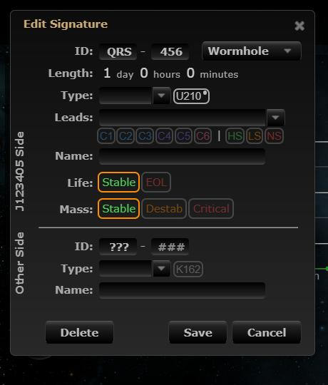
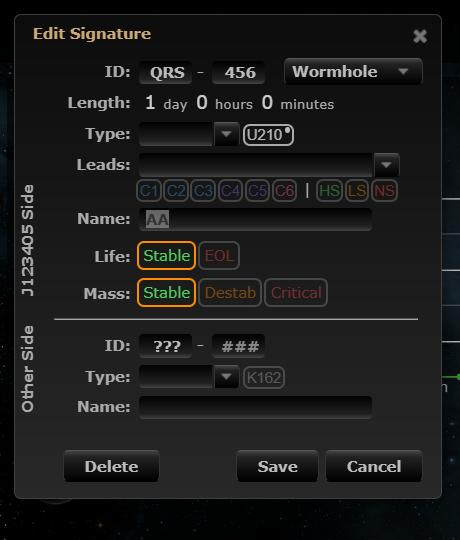
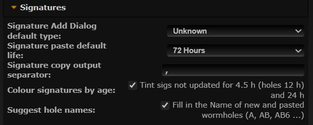

# Hole names when editing pasted holes

**Date:** 2026-10-11

## Description

The suggested hole name (A, AB, AB6 ...) was only filled in when adding a signature by hand. Holes added by a scan
paste have no name, so opening one to fill it in now pre-fills the Name the same way (sized from the type, so a
K162 counts as large until you set the other side's type or change the name yourself).

## Before / After

| Before | After |
| --- | --- |
|  Editing a pasted hole in J123405 (reached through A): Name empty |  Name pre-filled with AA, selected so typing replaces it |
| |  New toggle |

## Settings

Toggle: Settings > Signatures > Suggest hole names (on by default; `options.holeNaming.enabled`). Turns the suggestion
off in both the Add and Edit dialogs; the bookmark copy on Add/Save is unchanged.

## Change

- `app/js/fork/hole-naming.js`: Edit Signature suggests a name when the sig has no name yet and its other side isn't
  a named hole (then it's the way back into the chain, e.g. the K162 of hole A, and stays empty). Already-named sigs
  are never changed; typing in Name stops further suggestions. The suggestion is selected when Name has focus.
- New pure helpers `holeNaming.enabled` and `holeNaming.suggestOnEdit`, with tests. No upstream files touched.
