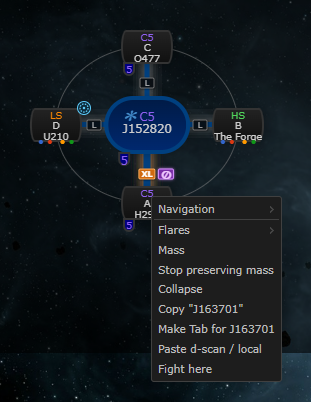
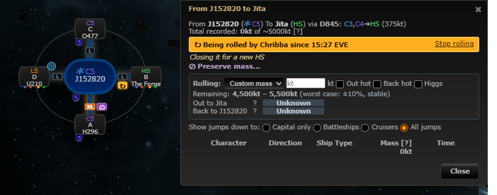
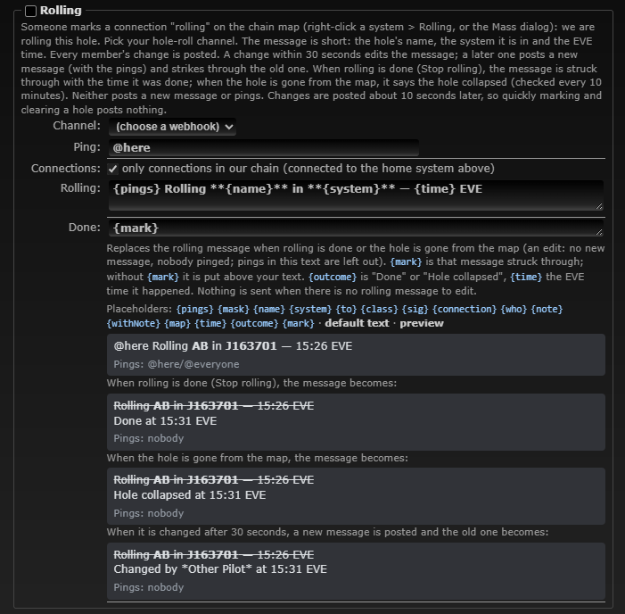

# Rolling: mark a hole we are rolling

**Date:** 2026-10-11

## Description

Anyone on a mask can mark a chain connection "Rolling" (we are rolling this hole), with an optional note. Everyone on
the mask sees an amber ↻ marker on the connection and a "Being rolled by X since 19:08 EVE" line in the mass dialog,
and, when a corp admin turns on the new Mask Admin > Discord type "Rolling", the hole-roll channel gets a short
message: the hole's name, its system and the EVE time. A sibling of Preserve mass (#36, #60).

## Before / After

| Before | After |
| --- | --- |
|  |  |

Mask Admin > Discord type and preview: 

## Settings

Toggle: Settings > Map Markers > Rolling, "Show rolling markers on connections" (on by default,
`options.rolling.enabled`, registered with `forkSettings.register`, order 35 right after Preserve mass, removed by
Settings > Reset). Like preserve mass it only hides the markers on the chain map: marking and clearing are explicit
actions, and the mass dialog line stays so nobody burns mass on a hole someone else is already rolling.
The Discord type is mask-wide, so it lives in Mask Admin > Discord (off by default, like every type).

## Change

- **Marking**: right-click a system on the chain map, "Rolling…" (the hole leading into that system, as "Mass" and
  "Preserve mass…"), or "Rolling…" in the mass dialog; a small dialog takes an optional note (100 characters).
  "Stop rolling" in the menu and the mass dialog clear it. Not offered for EVE-Scout connections or the chain's root.
  Marking Rolling on a hole marked Preserve mass asks first ("This hole is marked preserve mass by X (reason): roll it
  anyway?"), and marking Preserve mass on a hole being rolled asks too.
- **Server**: new `public/rolling.php` (GET = the mask's flags; POST `mode=set&wormholeID=…&note=…` /
  `mode=clear&wormholeID=…`) and `rolling.inc.php` (reuses preserve mass's id / mask / text-cleaning helpers). Same
  protection as `public/preserve_mass.php`: session mask only, POST with `X-Requested-With`, the wormhole must be in
  the mask. New table `fork_rolling` (mask, wormhole, character ID and name, when, note), created on first use, no
  foreign key to upstream's `wormholes`: read joined to the mask's wormholes so a flag disappears with its hole;
  orphans deleted on POST. Polled every 10 s; your own changes show at once.
- **Map** (`app/js/fork/rolling.js`, `app/css/fork/rolling.css`): the marker is placed by the same hooks and geometry
  as the preserve-mass marker (next to the connection's size tag, avoiding nodes, badges, every size tag and the
  preserve-mass markers already placed; in the old org chart right of the tag and the preserve-mass marker). Tooltip
  "Rolling — started by X at 19:08 EVE" + note (escaped). Chain legend row.
- **Discord** (type 8, key `rolling`, `discord/rolling.php`): settings `enabled`, `webhookID`, `ping`, `chainOnly`
  (on), `template`, `templateClear`. Defaults `{pings} Rolling **{name}** in **{system}** — {time} EVE` and
  `{mark}` + `{outcome} at {time} EVE`. Template design for the end of rolling: one "done" text with an `{outcome}`
  placeholder ("Done" when someone clears it, "Hole collapsed" when the worker finds the hole gone from the map), so a
  custom text covers both; `{who}` is "Tripwire (the hole is gone from the map)" for the latter. `{time}` is EVE time
  "HH:MM" (when rolling started in the mark; when it ended in the done text). The done text is an edit and never pings.
  Same sender as preserve mass (debounce 10 s, one live message per hole in `discord_rolling_message`, edit within
  30 s, strike on clear, edits never ping, `allowed_mentions` only from the admin's text and ping field, user text
  escaped); `discord_preserve_plan` takes the payload builder as a parameter so both types share it. Holes gone from
  the map are struck by the worker's 10-minute prune pass (`discord_rolling_clear_gone`, claim `rollGone`). Mask Admin
  > Discord: the type, its channel, ping, chain option, both texts, placeholders and a preview (mark, done, hole
  collapsed, changed). Settings mention it in the no-home warning.
- Tests: mocha `app/js-test/fork/rolling.test.js` (31), `tests/rolling_test.php` (34, storage), 
  `discord/tests/rolling_test.php` (68), end to end `tests/rolling_discord_flow_test.php` (21, worker + discord-mock).
  Docs: `docker/README.md`.
- No upstream files touched. Fork files changed: `discord/preserve_mass.php` (plan takes a payload builder),
  `discord/template.php`, `discord/settings.php`, `discord/schema.php` (+ `docker/sql/discord.sql`),
  `discord/dispatch.php`, `discord/discord.inc.php`, `discord_notify.worker.php`, `public/discord.php`,
  `app/js/fork/discord-notifications.js` (+ its test), `docker/README.md`. No new outbound hosts (Discord only, through
  the worker).
