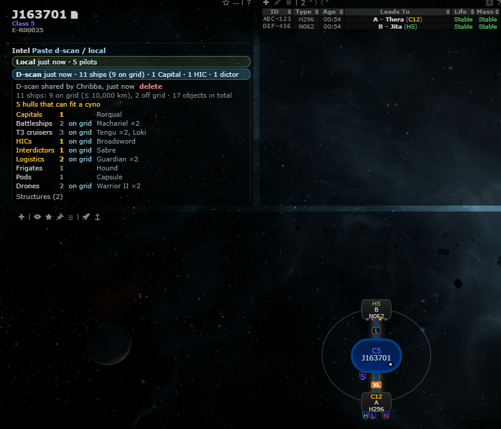
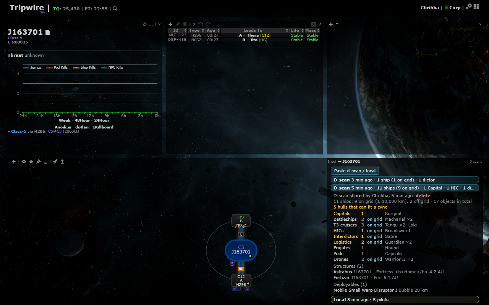
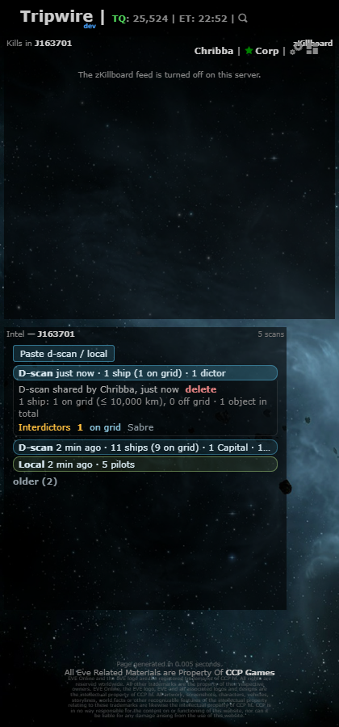

# Intel panel for d-scan & local scans

**Date:** 2026-10-11

## Description

The d-scan / local scans of the viewed system move out of the system info panel into their own movable, resizable
**Intel** panel, at the user's request to keep the system info panel clean (a long summary used to push the activity
graph out of the info panel). Same data, polling and paste dialog as before
([D-scan & local scans](../2026-10-10-dscan-local/README.md)).

## Before / After

| Before | After |
| --- | --- |
|  |  |

At phone width the panel stacks with the others and wraps its summary (no horizontal scrolling):

## Settings

Same toggle: Settings > General Preferences > "D-scan & local intel" (`options.intelScans`, on by default). Off
removes the panel, the chain map dots and the right-click entry and stops the requests; Settings > Reset turns it back
on and leaves a visible panel where it is.

## Change

- New layout widget `#intelScansWidget` ("Intel — <system>", scan count on the right), registered with gridster like
  the Kills panel (shares `systemKillFeed.gridster / savedPosition / defaultPosition`): first free place when there is
  no saved layout, moved and resized with Customize layout (minimum 4 × 3), position saved with the layout.
- Turning it off remembers its position in `options.intelScans.position` (like the Favourites panel), so turning it
  back on puts it in the same place even after another Settings save in the same session (upstream's
  `options.apply()` restores `options.grid` from the copy loaded with the page). The position is dropped again once
  the panel is back, so the layout owns it from then on.
- Contents: "Paste d-scan / local" button, fresh scans newest first, "older (n)" fold, a click on a chip expands the
  full summary (delete for your own scans), empty state "No scans for this system. Paste one…". The panel scrolls
  inside; long type lists and names wrap instead of widening it.
- The intel block in the system info panel is gone (no duplicate). The chain map dot and the right-click "Paste
  d-scan / local" entry are unchanged and checked in all four renderers.
- Pure renderer `intelScans.panelHtml(state)` with mocha tests (order, fold, expand/delete, empty state, escaping,
  remembered position).
- Upstream files touched: none.
