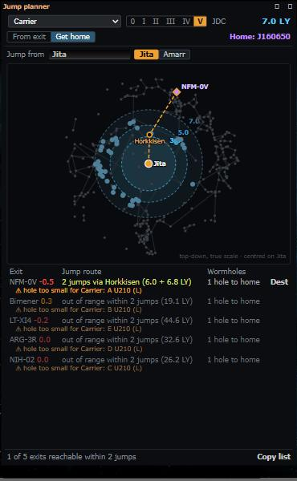
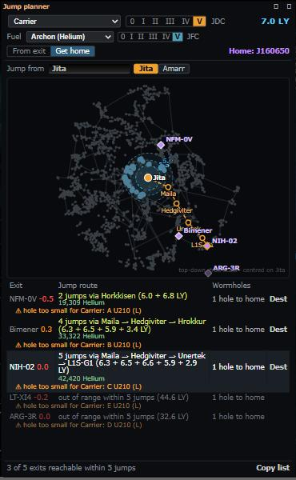
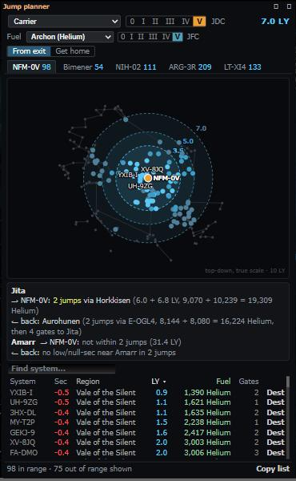

# Jump planner: Get home up to 5 jumps, and jump fuel

**Date:** 2026-10-11

## Description

Get home now finds routes of up to 5 jumps (was 2) to the chain's low/null-sec exits, and the Jump planner shows how many
isotopes each jump and each route takes, from the hull's own SDE data and skill levels you enter by hand.

## Before / After

Before: from Jita a Carrier reaches one exit, the others read "out of range within 2 jumps", no fuel anywhere.
After: 4- and 5-jump routes through named midpoints (all drawn on the map), fuel per route, and a fuel bar under the ship controls.

| Before | After |
| --- | --- |
|  |  |

From exit, with the Fuel column and the fuel bar (hull select, Jump Fuel Conservation levels):

## Settings

Toggle: Settings > Jump Planner > "Show jump fuel" (on by default; off hides the fuel bar and every fuel amount) and
"Jump Fuel Conservation" (your skill level, V by default). Ship-specific skill levels (Jump Freighters) and the hull
(Carrier: Archon / Chimera / Nidhoggur / Thanatos, each burns its own isotope) are set in the panel's fuel bar. Stored in
`options.jumpRange` (`fuel`, `hull`, `fuelSkills`); Settings > Reset deletes them with the rest. Get home's longer reach
has no toggle: it is a pure improvement.

## Change

- **Get home, up to 5 jumps.** New generic engine function `jumpRange.routesFrom(start, destinations, range, index, systems,
  opts, maxJumps)`: one hop-limited layered search per start (not per exit), exact for "fewest jumps, then least total LY",
  midpoints and destinations must be valid cyno targets (never high-sec or Pochven, jammed rules and the low/null-sec
  switches apply), the start can be any k-space system. Origin-agnostic and DOM-free, so Jita/Amarr -> chain exits for JF /
  Black Ops logistics can reuse it. Measured: about 40 ms from Jita to all 3,981 valid systems with a Carrier (7 LY), about
  100 ms with a Jump Freighter (10 LY). The panel keeps the last search (`homeCache`) while start, range and rules stay the same.
  `reach` / `routesTo` / `nearHub` are unchanged: the trade-hub strip stays at 2 jumps.
- Get home text: "3 jumps via A → B (5.8 + 5.6 + 4.0 LY)", "out of range within 5 jumps", footer "reachable within 5 jumps";
  Dest / Set destination is the first cyno (first midpoint, or the exit for 1 jump); the mini-map draws the whole route with
  every midpoint marked and named; copy text and tooltips work for 1-5 jumps. A 2-jump route can now differ from the old one
  (least total LY instead of the shortest longer leg).
- **Jump fuel.** `generate-coords.js` now also reads, from the SDE, each hull's isotope (dogma 866), amount per LY (868) and
  its skill bonuses (the dogma effect that modifies 868 plus the hull's trait line), and the skill every hull can train.
  Regenerated `public/jumprange/ships.json` from SDE build 3586130 (same build, so `systems.json` and `DATA_VERSION` are
  unchanged; `jumpPlanner.SHIPS_REV` busts the browser's cached copy). Facts found: Jump Fuel Conservation is typeID **21610**
  (21611 is Jump Drive Calibration), -10% per level, every hull; only the four Jump Freighters have a hull skill bonus
  (Jump Freighters, 10% per level, dogma effect `eliteBonusJumpFreighterJumpDriveConsumptionAmount2`, attribute 1312 = -10; the
  trait text says the same, the attribute was used); no hull has a role bonus; amounts per LY: 3,000 for capitals, 700 Black Ops,
  4,000 Rorqual, 8,200-10,000 Jump Freighters; isotope by hull race.
  `jumpRange.fuelPerJump` / `routeFuel`: `ceil(fuelPerLy x LY x (1 - 0.1 x JFC) x (1 - 0.1 x JF) x (1 - role))` per jump, summed
  ([EVE University: Jump drives](https://wiki.eveuniversity.org/Jump_drives)). The source gives no rounding rule: each jump is
  rounded up (assumed). Jump Drive Economizer rigs are not counted. Skill levels are typed in, not read from ESI.
- Shown: a Fuel column in From exit, fuel on the hub reach lines, per-route fuel in Get home (per-jump amounts in the
  tooltip), the Copy texts, and the mini-map tooltip.
- Files: `app/js/fork/jump-range.js`, `app/js/fork/jump-planner.js`, `app/css/fork/jump-planner.css`,
  `jumprange/tools/generate-coords.js`, `public/jumprange/ships.json`, tests (`app/js-test/fork/jump-range.test.js`,
  `jump-planner.test.js`), `docker/README.md`. No upstream files touched.
