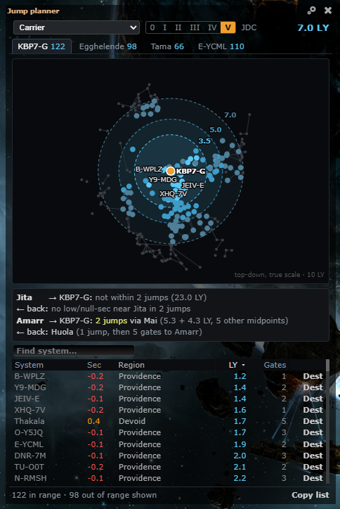
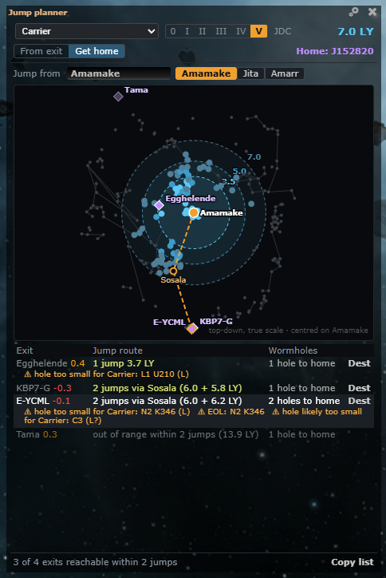

# Jump planner: Get home

**Date:** 2026-10-11

## Description

The Jump planner only planned jumps *from* an exit. A new **Get home** mode does the reverse: pick the system the jump
ship is in, and it lists the chain's low/null-sec exits it can reach in 1-2 jumps, with the wormholes from each exit
back to home and warnings for holes too small for the ship, EOL or low on mass.

## Before / After

| Before (From exit only) | After (Get home from Amamake, Carrier) |
| --- | --- |
|  |  |

## Settings

No new toggle: Get home is a mode inside the existing panel, which already has its on/off in Settings > Jump Planner
and Settings > General Preferences. The mode is remembered per user in `options.jumpRange.mode` (missing = `"exit"`) and
the last valid start in `options.jumpRange.origin`; Settings > Reset removes both (it already deletes
`options.jumpRange`).

## Change

- **Mode switch** under the panel header: **From exit** (as before, default) | **Get home**. The exit's ring icon on the
  chain map always opens From exit.
- **Jump from:** a box that matches system names like the search box (same `searchSystems` / suggestions), plus quick
  picks: last used start, Jita, Amarr. High-sec and Pochven are valid starts; W-space, Thera and Zarzakh are refused
  with the reason ("J152820 is in wormhole space: jump drives can't be used there").
- **Home:** the root of the chain map (the system `pathHome` counts from: the chain tab's system, or the viewed system
  without a tab), shown as "Home: J152820"; several roots each count as their exits' home. No chain: an empty state.
- **List** (replaces the exit tabs, trade-hub strip and system search in this mode): every LS/NS exit on the chain
  (same exit set as the tabs), ranked 1 jump before 2 jumps, then by total LY: "1 jump 3.7 LY" / "2 jumps via Sosala
  (6.0 + 6.2 LY)", "N holes to home", warnings, **Dest** (sets the destination to the first cyno system, midpoint or
  exit, through the same "Set route in game" picker). Unreachable exits after, greyed, with the reason (out of range
  within 2 jumps, cyno-jammed for a normal cyno, low/null-sec targets off). Covert-cyno ships (Black Ops) still reach
  jammed exits. Hover or click a row: tooltip with the route, route drawn on the mini-map.
- **Warnings** (text only, never block): "hole too small for Carrier: N2 K346 (L)" (from the size-tags lookup:
  `sizeTags.tagFor` with the hole's type, or "likely" when the size is guessed from the system classes), "size unknown:
  ..." when there is no size, EOL, mass critical, destab, preserve-mass flag. Supercarrier / Titan: "can't go through
  wormholes".
- **Mini-map** centred on the start, range rings as before, widened to fit the farthest reachable exit; exits as
  labelled diamonds (dim when unreachable), the selected route as a dashed line start → midpoint → exit.
- **Engine** (`jump-range.js`, pure, tested): `startProblem`, `routesTo` (ranked 1-2 jump routes to many targets, for
  the later logistics feature too), `shipNeeds`, `holeFits`.
- **Planner** (`jump-planner.js`, pure, tested): `homePaths` (root and holes per chain system from `chain.nodes()`
  rows and lines), `holeLabel`, `holeWarnings`, `homeModel`, `routeText`, HTML builders; `mapModel` takes `fitLy`,
  `mapSvg` an overlay.
- Files: `app/js/fork/jump-range.js`, `app/js/fork/jump-planner.js`, `app/css/fork/jump-planner.css`,
  `app/js-test/fork/jump-range.test.js`, `app/js-test/fork/jump-planner.test.js`. Upstream files touched: none.
  No third-party calls.

### Ship and hole sizes used (checked 2026-10-11)

Hull masses from the repo's own `appData.mass` (SDE), against the size classes of the size tags (L up to 375-410 kt,
VL "freighter" up to 1,000 kt, XL "capital" 2,000 kt):

| Ship | Hull mass | Needs |
| --- | --- | --- |
| Black Ops | 106-113 kt | L |
| Jump Freighter | 820-960 kt | VL (too heavy for L) |
| Rorqual | 800 kt | VL |
| Carrier, Dreadnought, FAX, Lancer, Command Carrier | 1,100-1,310 kt | XL |
| Supercarrier, Titan | — | can't use wormholes |

Sources: [EVE University: Wormhole attributes](https://wiki.eveuniversity.org/Wormhole_attributes) (the largest holes
"that freighters and capitals can transit"; everything below capitals fits the 300 kt-class holes),
[EVE University: Wormhole space](https://wiki.eveuniversity.org/Wormhole_space) ("Supercapitals don't fit through
wormholes"). Hull mass only: plates and propulsion modules add mass, which is why it is a warning. The spec's first
guess put Jump Freighters and the Rorqual at "at least Large"; their hull masses (800-960 kt) don't fit a Large hole,
so they need a freighter (VL) hole.
