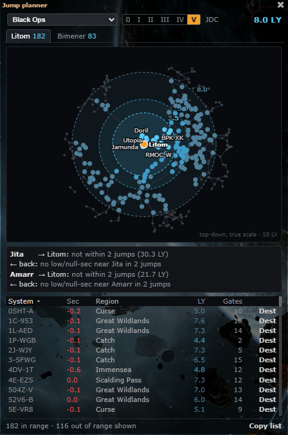
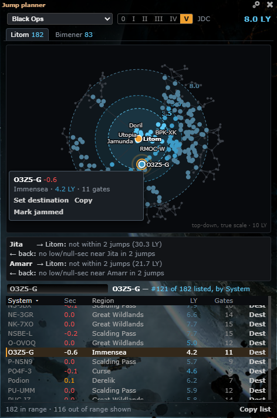
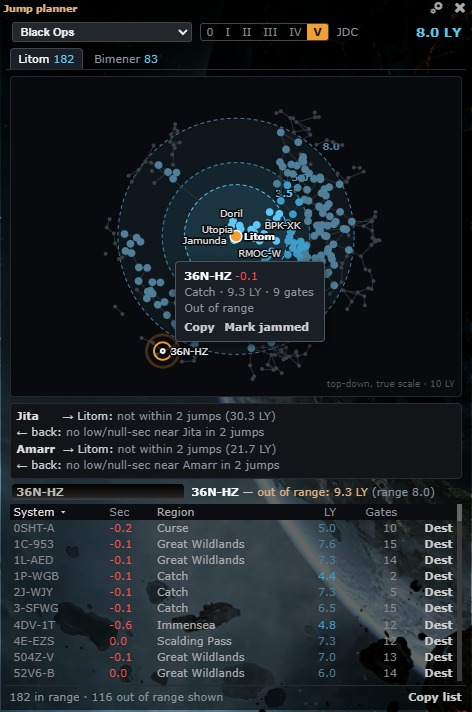
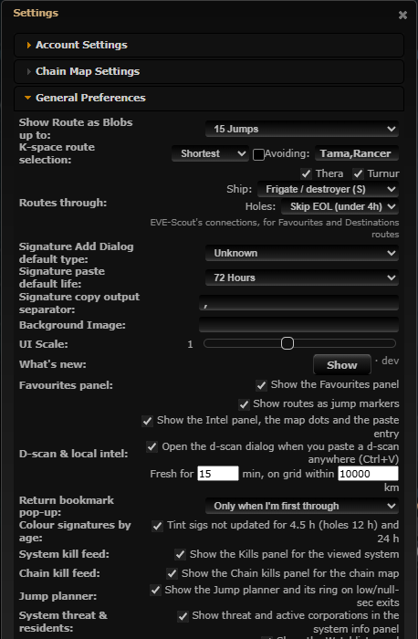
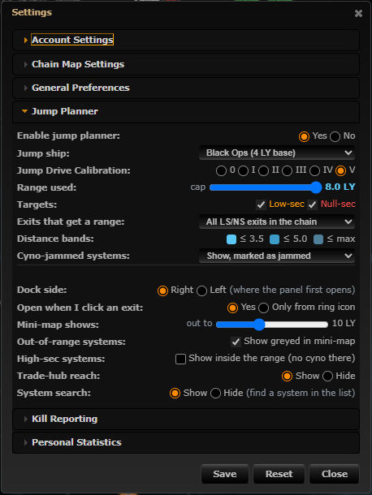

# Jump planner: system search, settings shortcuts

**Date:** 2026-10-11

## Description

A "Find system…" box in the Jump planner finds any system by name and shows where it is in the list (rank in the
current sort, row highlighted and scrolled to, ring and label on the mini-map, its tooltip) or, if it isn't listed, why
not (high-sec, W-space, Pochven / Zarzakh, out of range, cyno-jammed and hidden, low/null-sec targets off). Users also
couldn't find the planner's on/off switch, so it is now in General Preferences too, and a gear in the panel opens its
settings.

## Before / After

| Before | After |
| --- | --- |
|  |  |

Not in the list, with the reason (still highlighted on the mini-map, where it is drawn greyed):

Settings > General Preferences > Jump planner, and the new System search row in Settings > Jump Planner (the gear in
the panel opens this section):

| General Preferences | Jump Planner |
| --- | --- |
|  |  |

## Settings

Toggle: yes. Settings > Jump Planner > **System search: Show / Hide** (`options.jumpRange.search`, missing = on, on by
default; Hide leaves the box out of the panel); applied on Save, removed by Settings > Reset (the existing wrapper
deletes `options.jumpRange`).

The planner's own on/off now also has a row in Settings > General Preferences (**Jump planner**, under Chain kill feed,
next to the other panels' rows). It is the same key as Settings > Jump Planner > Enable jump planner
(`options.jumpRange.enabled`): the two stay in sync while the dialog is open and are saved and reset together.

## Change

- **Search row** between the trade-hub strip and the list: input (130 px) and a one-line result. Suggestions (up to 8)
  from every system in `appData.systems`, not only those in range: exact name, then prefix, then substring, case-
  insensitive, ignoring `-` and spaces (`0sht a` finds 0SHT-A). Keys: ↑/↓, Enter picks (the first match if none is
  highlighted), Esc closes the list, then clears. "No system with that name" when nothing matches.
- **Picked and listed:** "O3Z5-G — #121 of 182 listed, by System" (rank in the current sort, out of the rows
  listed, so cyno-jammed rows marked in the list count too; "(reversed)" for a descending one), the row stays highlighted (orange edge) and is scrolled into the middle of the list's own scroll box (never the
  page; layout px, so it works with Settings > UI Scale), the mini-map gets a ring with a pulse (no pulse with reduced motion) and the label is forced on, and the
  hover tooltip shows. Jammed rows add "cyno-jammed, no normal cyno" / "marked cyno-jammed".
- **Picked, not listed:** the reason from the range engine's rules (`jumpRange.kind`, `isValidCynoTarget`,
  `distanceLy`): high-sec, wormhole space, Pochven, Zarzakh, out of range ("9.3 LY (range 8.0)"; two decimals just past it: "8.03 LY (range 8.0)"), low-sec / null-sec
  targets off in Settings, cyno-jammed and hidden by the setting, no position known; with the LY from the exit when
  both positions are known. Order: system type, then range, then your settings. Highlighted on the map when it is drawn.
- Switching exit tab, ship, JDC or sort re-runs it against the new list; clearing the box removes every highlight.
  Kept while the panel is open, forgotten when it is closed (no stored state).
- A redraw while you type (e.g. the jammed-marks refresh) keeps the box focused and the suggestion list as it was
  (highlighted entry, or closed after Esc).
- **Gear icon** in the panel title bar, next to ×: opens Settings (the toolbar's own click path) with the Jump
  Planner section expanded.
- Pure, tested parts in `jumpPlanner`: `searchKey`, `searchSystems`, `searchStatus`, `searchResultHtml`,
  `searchMenuHtml`, `beyondText`, `centerScrollTop`, `generalRowHtml`; `mapSvg` takes the picked system. All names go through `escape`; the typed text is
  only ever set with `.val()` and never rendered.
- Files: `app/js/fork/jump-planner.js`, `app/css/fork/jump-planner.css`, `app/js-test/fork/jump-planner.test.js`.
  Upstream files touched: none.
